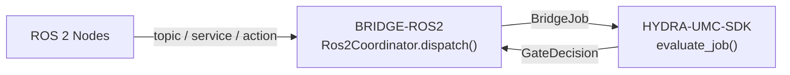

<!-- =============================================================================
HYDRA-UMC-BRIDGE-ROS2 - ROS 2 coordination bridge
Copyright (C) JuanenRac (Electro Hobby 3D) <electrohobby3d@gmail.com>
GPL-3.0-or-later - see LICENSE
============================================================================= -->

<p align="center">
  
</p>

# 🐢 HYDRA-UMC-BRIDGE-ROS2

<p align="center">🇺🇸 <b>English</b> | <a href="README_spa.md">🇪🇸 Español</a> | <a href="README_fra.md">🇫🇷 Français</a> | <a href="README_ita.md">🇮🇹 Italiano</a> | <a href="README_deu.md">🇩🇪 Deutsch</a> | <a href="README_zho.md">🇨🇳 简体中文</a> | <a href="README_jpn.md">🇯🇵 日本語</a> | <a href="README_por.md">🇵🇹 Português</a></p>

### 🔗 Dependency-Free Coordination Boundary Between HYDRA-UMC and ROS 2

<p align="center">
  
  
  
  
  
  
</p>

---

> **Honesty check - what actually runs today:** the dependency-free coordination core (`coordinator.py`'s `Ros2Coordinator`, funneling every dispatch through `HYDRA-UMC-SDK`'s own `evaluate_job()`), the real (lazily-imported) `rclpy` transport for `std_srvs/Trigger` and `std_msgs/String` (`rclpy_transport.py`'s `Ros2SafeStopClient`/`Ros2StateSubscriber`), and the MQTT command/status transport (`mqtt_transport.py`) are real and covered by 81 passing unit tests (`python tools/build_test.py` - `test_coordinator.py`, `test_rclpy_transport.py`, `test_mqtt_transport.py`, `test_intake.py`, `test_mqtt_environment.py`, `test_hardening.py`). None of it has been exercised against a real ROS 2 installation, a real DDS network, or a real MQTT broker - `test_rclpy_transport.py` runs against a fake node/publisher and `test_mqtt_transport.py` against a fake broker client, so `rclpy`/`std_srvs`/`std_msgs` aren't even required to be installed for these tests to pass. The custom `.srv`/`.action` contracts `inspect_service`/`job_action` still have no real standard ROS 2 message type and no client at all yet. See "Roadmap & Known limits" below, which already states this plainly, and `CHANGELOG.md` for exactly what has shipped so far.

> **Safety and security status:** this ecosystem is not a certified safety system. There is no hardware E-STOP path, no firmware-enforced limits or interlocks and no verified motion command yet; firmware images are checked with CRC-32 and an Ed25519 signature, and a release build refuses the published development keys (the tool heads and expansion boards behind the relay still run URTC bootloaders, which take a shared-key HMAC-SHA256 instead of a signature); TLS and mutual TLS are optional and off by default; no custom board has been populated or tested yet. Read the [security baseline](https://github.com/JuanenRac/HYDRA-UMC-DOCS/blob/main/docs/SECURITY_BASELINE.md) and the [threat model](https://github.com/JuanenRac/HYDRA-UMC-DOCS/blob/main/docs/THREAT_MODEL.md) before relying on any statement here for the safety of a person.

---

## 📋 At a glance

| | |
|---|---|
| Version | `0.1.3` |
| Maturity | Functional |
| Tests | 81 (`python tools/build_test.py`) |
| Stack | Python / ROS 2 / rclpy / HYDRA-UMC-SDK |
| Target | The Raspberry Pi CM5 of a HYDRA-UMC cell |
| On real hardware | Simulated only: tested against emulators, fakes or simulators; no run on real hardware is recorded for this version |

**Jump to:** [Overview](#-overview) · [Architecture](#-architecture) · [Features](#-features) · [Security & Safety](#-security--safety) · [Interfaces](#-interfaces) · [Configuration](#-configuration) · [Quick start](#-quick-start) · [Testing](#-testing) · [Troubleshooting](#-troubleshooting) · [Repository Structure](#-repository-structure) · [Related Projects](#-related-projects)

## 🚦 Project status

Each line is one part of this repository and the light says how far it is today. It is written from what the repository can show (tests, builds, runs), not from what is planned.

🟢 Done and verified · 🟡 Works, with known limits · 🟠 Partly done or not verified yet · 🔴 Not done or not working

| Area | State | What it means here |
|---|---|---|
| Software | 🟡 | Works for its main purpose; the honesty check above lists what is still missing |
| Tests | 🟢 | 81 automated tests, run on every change |
| Real hardware | 🟠 | Simulated only: tested against emulators, fakes or simulators; no run on real hardware is recorded for this version |
| Documentation | 🟢 | README in eight languages, checked against the manifest on every change |

## 🎯 Overview

**HYDRA-UMC-BRIDGE-ROS2** is the bidirectional, high-level coordination boundary between HYDRA-UMC and ROS 2. It maps continuous observation to a topic, immediate inspection to a service, and long-running cell work to a cancellable action. It is not a motor-control node, and it cannot bypass HYDRA-UMC-SERVER, MCU limits, watchdogs or E-STOP. Only the state topic and the safe-stop service are connected today; the inspection service and the job action are reserved names with no message type behind them yet. The node has to be spun for the state topic to be delivered: `run_forever()` does it on a thread of its own.

It belongs to the **External Automation Bridges** family: a set of sibling repositories (CNC, LASER, OPENPNP, PRINTER3D, ROS2) that all speak the same shared safety contract from `HYDRA-UMC-SDK`, so no bridge can invent its own definition of "safe to work".

## 🧩 Role in HYDRA-UMC

**HYDRA-UMC-BRIDGE-ROS2** sits between a ROS 2 graph and the robot cell. It reports what that side says, asks the shared gate before any auxiliary work and never takes over the authority of the machine it coordinates with.

Every bridge speaks the shared safety contract of `HYDRA-UMC-SDK`: a job is accepted only after the shared `evaluate_job()` gate says so, and the gate fails closed. The parent project is `HYDRA-UMC-SERVER`; this bridge does not call it, it answers over MQTT through `HYDRA-UMC-MQTT-BROKER` to whoever commands the cell.

## 🏛️ Architecture

<p align="center">
  
</p>

<details>
<summary>Text version of the diagram (Mermaid)</summary>



</details>

**Why it is built this way**

* **Why `coordinator.py` has zero `rclpy` dependency.** Its own module docstring states this deliberately: it "can be tested on any host and becomes a ROS 2 node only through a separately deployed adapter." This keeps the safety-relevant coordination logic testable in CI without a ROS 2 installation, and lets the adapter be chosen and validated independently, later.
* **Why three distinct interface kinds instead of one generic channel.** `state_topic`, `inspect_service` and `job_action` map to ROS 2's own semantics on purpose: continuous state publication doesn't need request/reply (topic), a quick inspection needs a synchronous answer (service), and cell work needs to be cancellable mid-flight (action) — collapsing these into one channel would lose that distinction.
* **Why `Ros2Coordinator.dispatch()` still funnels every job through the shared `evaluate_job()` gate.** ROS 2 is just another client of the same `bridge_contract` that CNC, LASER, OPENPNP and PRINTER3D use — it gets no special bypass of the IDLE/READY logic that every other bridge and HYDRA-UMC-SERVER enforce.
* **Why `ABORT` stays requestable during a fault.** The gate's productive-phase requirement (`IDLE` + `READY`) is intentionally not applied the same way to an abort request — an operator or a ROS 2 node must always be able to ask for a controlled stop, even mid-fault.
* **Why the `rclpy` adapter and ROS `.msg`/`.srv`/`.action` contracts are not in this repo yet.** Committing to specific message/service/action definitions before a real ROS 2 environment is selected and tested would risk baking in assumptions this local, dependency-free core cannot verify.
* **How this fits the rest of the ecosystem.** BRIDGE-ROS2 sits between ROS 2 nodes and `HYDRA-UMC-SDK` → `HYDRA-UMC-SERVER` → MCU safety — it is a coordination boundary, never a motor-control node, and it cannot bypass HYDRA-UMC-SERVER, MCU limits, watchdogs or E-STOP.

## ✨ Features

* ✅ **Real, dependency-free coordination core:** `coordinator.py`'s `Ros2Coordinator` has zero `rclpy` import — it is deliberately plain Python, testable on any host without a ROS 2 installation. *(implemented, tested in `tests/test_coordinator.py`)*
* ✅ **Real four-way interface mapping:** four fixed class attributes reserve the exact ROS 2 interface kind for each purpose — `/hydra_umc/machine_state` (topic, continuous state), `/hydra_umc/inspect_cell` (service, short inspection), `/hydra_umc/execute_cell_job` (action, cancellable job), `/hydra_umc/request_safe_stop` (service, controlled stop). *(implemented)*
* ✅ **Real shared safety gate:** every job dispatched through `Ros2Coordinator.dispatch()` is evaluated by `evaluate_job()` from `HYDRA-UMC-SDK`'s `bridge_contract`, the same gate every sibling bridge and HYDRA-UMC-SERVER use; a productive phase requires an `IDLE` external machine and a `READY` HYDRA-UMC cell, while `ABORT` remains requestable during a fault. *(implemented)*
* ✅ **Fail-closed phase routing and static evidence:** productive phases map only to the planned job action, `ABORT` maps to `/hydra_umc/request_safe_stop`, and an unknown future SDK phase is denied. `inspect_interface_plan.py` emits the static schema `1.1` plan — including the real `transient_local` durability QoS the state topic needs (ROS 2's own replacement for ROS 1's latched publisher, researched against design.ros2.org/articles/qos.html) — without importing `rclpy` or contacting DDS. *(implemented, tested)*
* ✅ **Real, partial `rclpy` transport:** `rclpy_transport.py` connects the 2 interfaces with a real, standard ROS 2 message type today — `Ros2SafeStopClient` (a real `std_srvs/Trigger` client) and `Ros2StateSubscriber` (a real `std_msgs/String` subscriber, using the real `transient_local` durability QoS). *(implemented, tested in `tests/test_rclpy_transport.py`)*
* ✅ **Non-mutating build/test:** `build-test.bat`/`.sh` compile the source and run deterministic unit tests without changing version or CHANGELOG. *(implemented, see Build & Release below)*
* 🔜 **Custom `.srv`/`.action` contracts for `inspect_service`/`job_action`** — these have no real standard ROS 2 message type, so a client for them needs this repository to define its own interface package first. *(planned)*
* ✅ **Observed machine state, retained messages and repeated keys:** once the bridge follows the ROS 2 state topic, the shared gate uses the state the machine reported instead of the `machine_state` written in the job (a message anybody on the broker may publish), and a machine never heard from counts as OFFLINE; `handle_message()` ignores retained messages (the broker replays them at every reconnect) and, given an `IdempotencyStore`, answers a repeated `idempotency_key` with the first answer. *(implemented, tested in `tests/test_intake.py`)*
* ✅ **A message loop that survives its input, a node that is really spun, a state that can go stale:** `handle_message()` never raises (an oversized or deeply nested JSON and any unexpected failure come back as a refusal); `cmd/job` answers with `allowed` like every other bridge (and `accepted` as before); an `ABORT` job says plainly that it is plan-only and that the stop itself is `cmd/safe_stop`. `run_forever()` spins the node on a thread of its own (`spin_node_in_background()`, so the state topic is really delivered), reuses one service client, runs `cmd/safe_stop` on a lane that never waits behind another command, leaves a Last Will on `availability`, republishes the state with its normalized `machine_state` and an `observed_at` time, and refuses to start when the ROS 2 state topic cannot be subscribed; `observed_max_age_seconds` makes a state that stops being republished count as OFFLINE (off by default). *(implemented, tested against fakes; never run against a real ROS 2 graph, so the executor and QoS behaviour is unverified)*

## 🔒 Security & Safety

| Threat | Defence | Where |
|---|---|---|
| A job for a cell or machine that is not in a safe state | Every job goes through the shared `evaluate_job()` gate of the SDK, which fails closed; the bridge has no accept/reject logic of its own | SDK `bridge_contract` |
| Oversized or unbounded job data | At most 32 parameters, keys up to 64 characters, values up to 1024, identifiers up to 128 (`MAX_PARAMETERS`, `MAX_PARAMETER_KEY_CHARS`, `MAX_PARAMETER_VALUE_CHARS`, `MAX_IDENTIFIER_CHARS`) | SDK `bridge_contract` |
| A repeated or replayed order | An `IdempotencyStore` remembers each key for 24 hours and at most 10 000 entries; a repeat gets the first answer instead of being evaluated again | SDK `job_intake` |
| A huge or hostile MQTT payload | A payload over 16 KiB, unreadable or deeply nested JSON and any unexpected failure are answered with a refusal on the result topic and never end the loop | `mqtt_transport.py` |
| A ROS 2 interface outside the allowed space | Interface names must start with `/hydra_umc/`, and the bridge knows kinds of interface, never raw motion | `coordinator.py` |
| A stop that waits behind other work | `cmd/safe_stop` runs on a lane of its own (`STOP_VERBS`); the two standard rclpy interfaces use the `transient_local` durability, so a late subscriber still gets the last state | `mqtt_transport.py`, `rclpy_transport.py` |
| A machine state taken on trust | Before `start_observing()` nothing has been read and the gate refuses the job; once observing, a state that was never heard or is not a known `MachineState` counts as `OFFLINE` | `mqtt_transport.py` |

**What it never does:** it maps no job to raw motion and talks to ROS 2 only through two standard-typed interfaces.

## 🔌 Interfaces

Topics under `hydra/bridges/ros2/`; every command is answered on `<verb>/result`.

| Topic or route | What it carries |
|---|---|
| `cmd/job` | a `BridgeJob`; the answer is the dispatch decision for the ROS 2 interface |
| `cmd/safe_stop` | calls the safe-stop service through `Ros2SafeStopClient` |
| `state`, `availability` | the machine state read from the ROS 2 state topic (`std_msgs/msg/String`) and `online`/`offline` |

To check the interface plan without ROS 2: `python tools/inspect_interface_plan.py --verify-fixture`.

## ⚙️ Configuration

| Variable | Default | What it sets |
|---|---|---|
| `HYDRA_MQTT_USERNAME` | none | The MQTT user name; the broker binds it to a client-ID prefix |
| `HYDRA_MQTT_PASSWORD` | none | The password; only valid together with the user name |
| `HYDRA_MQTT_PASSWORD_FILE` | none | The password read from a file (a Docker or systemd secret); ignored when `HYDRA_MQTT_PASSWORD` is set |
| `HYDRA_MQTT_TLS_CA` | none | The CA file that signed the broker's certificate: the connection is TLS and the certificate is verified |
| `HYDRA_MQTT_TLS` | off | `1` turns TLS on, verified against the system's trusted CAs |
| `HYDRA_MQTT_TLS_CERT` / `HYDRA_MQTT_TLS_KEY` | none | The client certificate and its key for a broker that demands mutual TLS; both are needed |

The ROS 2 node name is the argument of `create_ros2_node()`; the MQTT host, port and client ID (`hydra-umc-bridge-ros2`) are arguments of `run_forever()`.

## 🚀 Quick start

Requires Python 3.11 or newer. The tests and the build scripts expect `HYDRA-UMC-SDK` checked out next to this repository (`../HYDRA-UMC-SDK`) or pointed at with `HYDRA_UMC_SDK_ROOT`.

Try it without hardware (this checks the whole bridge against its emulators and fakes):

```bash
py -3 tools/build_test.py          # Windows
python3 tools/build_test.py         # Linux, macOS
```

Start the service (there is no console script: the service is the `run_forever()` of the MQTT transport, which you call from your own start-up code):

```python
from hydra_umc_bridge_ros2.rclpy_transport import create_ros2_node, spin_node_in_background
from hydra_umc_bridge_ros2.mqtt_transport import Ros2MqttBridge, run_forever
node = create_ros2_node("hydra_umc_bridge")          # needs rclpy from a ROS 2 installation
spin_node_in_background(node)
bridge = Ros2MqttBridge(node, cell_state=lambda: cell_state, node_is_spinning=True)
run_forever(bridge, host="192.168.0.180")
```

The user name, the password and the TLS files come from the `HYDRA_MQTT_*` variables (see Configuration); the code above needs no credentials of its own.

## 🧪 Testing

81 automated `unittest` cases run with `python tools/build_test.py` (it also compiles every module). The tests need no hardware, no network and no optional package: the ones that would need `paho-mqtt`, `pyserial` or a vendor library use a stand-in or are skipped when the package is missing.

| Test file | Tests | What it covers |
|---|---|---|
| `test_coordinator.py`, `test_intake.py` | - | job to interface mapping and the intake of jobs |
| `test_rclpy_transport.py` | - | the two rclpy interfaces against a stand-in for rclpy |
| `test_mqtt_transport.py`, `test_mqtt_environment.py`, `test_hardening.py`, `test_edge_cases.py` | - | topic dispatch, the credentials of the environment, hostile clients, edge cases |

The CI runs `HYDRA_UMC_CI=1 python tools/ci_validate.py`, which checks the manifest, the documents, the eight READMEs and the pictures, and runs the tests with an SDK checkout.

## 🏗️ Build & Release

Requires Python 3.11+. `tools/build_test.py` expects `HYDRA-UMC-SDK` checked out as a sibling directory (`../HYDRA-UMC-SDK`) or pointed at via the `HYDRA_UMC_SDK_ROOT` environment variable.

```bash
# Windows
build-test.bat      # validate only — no version/CHANGELOG change
build.bat            # Validate and build (building never changes the version)

# Linux/macOS
bash build-test.sh
bash build.sh
```

`build-test` compiles every module under `src/` with `py_compile` and runs the full `unittest` suite (every `test_*.py` file under `tests/`) — deterministically, with no ROS 2 install, no network and no version/CHANGELOG change. `build` runs that same validation first and, only on success, calls `tools/bump_version.py` to synchronize the version across `pyproject.toml`, `hydra-umc.project.json` and `CHANGELOG.md`. There is no live hardware `run` command yet — that requires a validated ROS 2 deployment.

## 🩺 Troubleshooting

| You see | Because | Do |
|---|---|---|
| `ModuleNotFoundError: hydra_umc_sdk` | The SDK is not installed or not next to this repository | Check out `HYDRA-UMC-SDK` next to this repository or set `HYDRA_UMC_SDK_ROOT` |
| `paho-mqtt is not installed` | The MQTT client is an optional extra | `pip install ".[mqtt]"` (it needs `paho-mqtt` 2.1 or newer, below 3) |
| `password was given without a username` | MQTT credentials need both parts | Set `HYDRA_MQTT_USERNAME` as well as the password |
| `could not reach the MQTT broker after N attempts` | The broker is down, the address is wrong or the port is closed | Start `HYDRA-UMC-MQTT-BROKER`, check the host and port given to the transport (it tries 5 times, 2 seconds apart); a TLS handshake failure is not retried |
| `the MQTT broker refused the connection` | The broker refused the credential (or did not answer within the time limit) | Check `HYDRA_MQTT_USERNAME` and the password; the client ID must start with the prefix the broker bound to the credential |
| `"allowed": false` + `reason` | The shared gate or a guard refused the order | Read `reason` and fix the cause; do not retry blindly |
| `rclpy` cannot be imported | rclpy comes with a ROS 2 installation, not from PyPI | Source the ROS 2 environment before starting the service; the tests do not need it |

## 📂 Repository Structure

<p align="center">
  
</p>

<details>
<summary>Text version of the tree</summary>

```text
HYDRA-UMC-BRIDGE-ROS2/
├── src/hydra_umc_bridge_ros2/
│   ├── coordinator.py             job to a named ROS 2 interface, never raw motion
│   ├── rclpy_transport.py         the two standard-typed rclpy interfaces
│   └── mqtt_transport.py          MQTT command, state and safe-stop transport
├── tests/                         81 tests, rclpy replaced by a stand-in
├── docs/                          bridge guide
├── tools/                         build and test runner, version bump, CI validator, README and picture generators and checks
├── images/                        banner and the pictures of the README
├── .github/                       CI workflow and issue templates
├── pyproject.toml                 package metadata and dependencies
├── hydra-umc.project.json         manifest: version, maturity, family
├── CHANGELOG.md                   what changed in each version
├── build.sh build.bat             build scripts (they never change the version)
├── build-test.sh build-test.bat   build scripts (they never change the version)
├── test.sh test.bat               run the tests
└── SECURITY.md SUPPORT.md CONTRIBUTING.md CODE_OF_CONDUCT.md LICENSE LICENSE.md
```

</details>

## 🗺️ Roadmap & Known limits

**Known limits today**

**Real today:** version `0.1.3`, functional as a dependency-free coordination core (`Ros2Coordinator`) with a deterministic sixty-four-test `unittest` suite covering the coordination core, the MQTT transport and the rclpy transport, fail-closed phase routing, a static `plan-only` interface schema declaring the real `transient_local` durability QoS the state topic needs, a real (lazily-imported) rclpy transport for the 2 interfaces with a real standard ROS 2 message type, and non-mutating build-test scripts wired into CI with an SDK checkout.

**Integration boundary:** this bridge is a coordination boundary only — it is not a motor-control node, and it cannot bypass HYDRA-UMC-SERVER, MCU limits, watchdogs or E-STOP; every dispatched job still passes through the same shared gate every sibling bridge uses.

**Still ahead:** no ROS network, robot or physical actuator has been validated yet — the `rclpy` adapter and concrete ROS `.msg`/`.srv`/`.action` contracts will be introduced only after a real ROS 2 environment is selected and tested.

## 🌍 Languages

This README and the documents of the repository exist in eight languages: English, Spanish, German, French, Italian, Japanese, Chinese and Portuguese (Portugal). They are written together and checked in the CI so that the eight files have the same sections and the same links. This repository has no screen or message catalogue of its own, so there are no interface strings to translate.

## 🔗 Related Projects

This project is part of the HYDRA-UMC robotics ecosystem by the same author (JuanenRac / Electro Hobby 3D). Worth knowing about, since a request might actually be about one of these rather than this repository.

**Parent Project**
- **[HYDRA-UMC-SERVER](https://github.com/JuanenRac/HYDRA-UMC-SERVER)** — the real headless backend (REST/WebSocket) every control client actually talks to; the authenticated ecosystem boundary this bridge reports to once each command has cleared this bridge's own local safety gate.

**Sibling Projects** — also talk to HYDRA-UMC-SERVER's own API, each their own client
- **[HYDRA-UMC-STUDIO](https://github.com/JuanenRac/HYDRA-UMC-STUDIO)** — web control dashboard with real-time multi-robot 3D visualization.
- **[HYDRA-UMC-SUITE](https://github.com/JuanenRac/HYDRA-UMC-SUITE)** — desktop (PySide6) swarm command center for multiple servers at once, packaged as a standalone executable.
- **[HYDRA-UMC-ANDROID-CONTROL](https://github.com/JuanenRac/HYDRA-UMC-ANDROID-CONTROL)** — native Android control app with biometric login and a paired Wear OS companion.
- **[HYDRA-UMC-IOS-CONTROL](https://github.com/JuanenRac/HYDRA-UMC-IOS-CONTROL)** — iOS/iPadOS control app (Flutter) with real-time WebSocket sync.
- **[HYDRA-UMC-DSI](https://github.com/JuanenRac/HYDRA-UMC-DSI)** — native touch UI for the onboard 7" DSI touchscreen, embedded on the CM5 itself.
- **[HYDRA-UMC-BRIDGE-AMR](https://github.com/JuanenRac/HYDRA-UMC-BRIDGE-AMR)** — coordination boundary for AGV/AMR fleets via a VDA 5050 MQTT publisher (tested against an emulated fleet only).
- **[HYDRA-UMC-BRIDGE-CNC](https://github.com/JuanenRac/HYDRA-UMC-BRIDGE-CNC)** — high-level CNC-cell coordinator with GRBL status/control-byte access (tested against an emulator only).
- **[HYDRA-UMC-BRIDGE-DROIDS](https://github.com/JuanenRac/HYDRA-UMC-BRIDGE-DROIDS)** — coordination boundary for legged/humanoid droids, with a Boston Dynamics Spot command sender (tested against an emulator only).
- **[HYDRA-UMC-BRIDGE-LASER](https://github.com/JuanenRac/HYDRA-UMC-BRIDGE-LASER)** — laser-cell coordinator reading 3 key/enclosure/interlock GPIO signals (tested against a fake chip only; it cannot arm or fire a laser).
- **[HYDRA-UMC-BRIDGE-OPENPNP](https://github.com/JuanenRac/HYDRA-UMC-BRIDGE-OPENPNP)** — safe high-level board-flow coordinator for OpenPnP pick-and-place.
- **[HYDRA-UMC-BRIDGE-PRINTER3D](https://github.com/JuanenRac/HYDRA-UMC-BRIDGE-PRINTER3D)** — safe coordination boundary for Moonraker/Klipper 3D printers, with real gated job commands.
- **[HYDRA-UMC-BRIDGE-UAV](https://github.com/JuanenRac/HYDRA-UMC-BRIDGE-UAV)** — coordination boundary for camera-equipped UAVs, with a MAVLink command sender (tested against an emulator only).

**Directly Related**
- **[HYDRA-UMC-SDK](https://github.com/JuanenRac/HYDRA-UMC-SDK)** — the shared JSON-Schema contract and software job-gate boundary every bridge validates its commands against (not a certified safety function).
- **[HYDRA-UMC-CONNECTOR-HUB](https://github.com/JuanenRac/HYDRA-UMC-CONNECTOR-HUB)** — declarative adapter-manifest registry and validator for external-machine connectors; extends the SDK's own contract idea to external machines without replacing the industrial-gateway projects.
- **[HYDRA-UMC-MQTT-BROKER](https://github.com/JuanenRac/HYDRA-UMC-MQTT-BROKER)** — `mqtt_transport.py`'s real transport for this bridge's own `hydra/bridges/ros2/...` topics — the plan-only job gate, a `std_srvs/Trigger` safe-stop call (not yet run against a ROS 2 installation), and the ROS 2 state topic republished as the separately-deployed `rclpy_transport.py` adapter always anticipated; see that repo's own `docs/BRIDGE_TOPICS.md`.
- **[HYDRA-UMC-HIL-BRIDGE](https://github.com/JuanenRac/HYDRA-UMC-HIL-BRIDGE)** — hardware-in-the-loop router with a software collision interlock between simulation and real hardware (tested without real hardware).

**Also Part of the Ecosystem**

*Core Hardware & Platform*
- **[HYDRA-UMC](https://github.com/JuanenRac/HYDRA-UMC)** — the robot-arm motherboard design: CM5 host + dual-core STM32H745, meant to orchestrate up to 8 tool arms over CAN-OTA/SPI-OTA (firmware at an early stage; no populated board yet).
- **[HYDRA-UMC-OS](https://github.com/JuanenRac/HYDRA-UMC-OS)** — reproducible Raspberry Pi OS product layer for the CM5: read-only agent, validated config/profiles, WiFi first-contact provisioning.

*Core Backend & Clients*
- **[HYDRA-UMC-EDITOR-URDF](https://github.com/JuanenRac/HYDRA-UMC-EDITOR-URDF)** — desktop graphical URDF creator/editor that pushes finished models into STUDIO's own catalog.
- **[HYDRA-UMC-EDITOR-STL](https://github.com/JuanenRac/HYDRA-UMC-EDITOR-STL)** — desktop STL model editor, transforming/replacing/removing/adding real parts in the same model catalog HYDRA-UMC-EDITOR-URDF also edits.

*URTC Tool Platform*
- **[URTC](https://github.com/JuanenRac/URTC)** — firmware for the physical Universal Robot Tool Controller PCB, 25+ tool profiles over CAN bus.
- **[URTC-FLASHER](https://github.com/JuanenRac/URTC-FLASHER)** — desktop GUI flashing tool for URTC boards, CAN-OTA plus full-chip SWD/JTAG.
- **[URTC-TESTER](https://github.com/JuanenRac/URTC-TESTER)** — desktop live CAN-bus diagnostic tool for URTC boards, one panel per tool profile.
- **[URTC-WEB-STUDIO](https://github.com/JuanenRac/URTC-WEB-STUDIO)** — browser-based alternative to URTC-TESTER via the Web Serial API, no local install needed.
- **[URTC-GATEWAY](https://github.com/JuanenRac/URTC-GATEWAY)** — gateway in front of the URTC CAN bus: an allowed list of identifiers, a rate limit and a session key; software tested on a computer, not yet on a real bus.

*Vision AI Node (Hailo-8)*
- **[HYDRA-UMC-VISION-NODE](https://github.com/JuanenRac/HYDRA-UMC-VISION-NODE)** — integration hub for the Hailo-8 vision pipeline, with a real per-stage hardware-readiness check.
- **[HYDRA-UMC-DETECTION-HEF](https://github.com/JuanenRac/HYDRA-UMC-DETECTION-HEF)** — real compiled-model registry with Hailo-architecture/checksum safe-load verification.
- **[HYDRA-UMC-VISION-STREAMER](https://github.com/JuanenRac/HYDRA-UMC-VISION-STREAMER)** — real GStreamer pipeline + MediaMTX config generator with a real HailoRT integration boundary.
- **[HYDRA-UMC-VISUAL-SERVOING-API](https://github.com/JuanenRac/HYDRA-UMC-VISUAL-SERVOING-API)** — Position-Based Visual Servoing correction law with authorisation gated on the zone state; no camera pose estimation yet.
- **[HYDRA-UMC-SAFETY-ZONES](https://github.com/JuanenRac/HYDRA-UMC-SAFETY-ZONES)** — v0 zone-breach, calibration-freshness and E-STOP-request logic that takes object positions from a file; no detector feeds it and no physical E-STOP is wired to it yet.

*Cognitive AI Node (Hailo-10)*
- **[HYDRA-UMC-COGNITIVE-NODE](https://github.com/JuanenRac/HYDRA-UMC-COGNITIVE-NODE)** — integration hub for the Hailo-10 cognitive pipeline (LLM/VLA/voice orchestration).
- **[HYDRA-UMC-VLA-ENGINE](https://github.com/JuanenRac/HYDRA-UMC-VLA-ENGINE)** — real action-token encoding/decoding and trajectory generation for a Vision-Language-Action model.
- **[HYDRA-UMC-VOICE-UI](https://github.com/JuanenRac/HYDRA-UMC-VOICE-UI)** — real voice front-end (VAD + intent parser) with a bounded, confirmation-gated Watch relay.
- **[HYDRA-UMC-SEMANTIC-PLANNER](https://github.com/JuanenRac/HYDRA-UMC-SEMANTIC-PLANNER)** — real rule-based task decomposition and semantic error recovery over MCU error codes.
- **[HYDRA-UMC-DOCS-QA](https://github.com/JuanenRac/HYDRA-UMC-DOCS-QA)** — real stdlib-only TF-IDF document search over this ecosystem's own Markdown docs.
- **[HYDRA-UMC-LOCAL-TECHNICIAN](https://github.com/JuanenRac/HYDRA-UMC-LOCAL-TECHNICIAN)** — local, policy-gated AI maintenance technician for the ecosystem itself - observes, diagnoses and proposes fixes; the two highest risk levels are deliberately not implemented yet.

*Orchestration & Swarm*
- **[HYDRA-UMC-ORCHESTRATOR](https://github.com/JuanenRac/HYDRA-UMC-ORCHESTRATOR)** — integration hub with a real gRPC/Protobuf health-report contract and mission state machine.
- **[HYDRA-UMC-JOB-DISPATCHER](https://github.com/JuanenRac/HYDRA-UMC-JOB-DISPATCHER)** — real priority-based job queue with deduplication, over a real HTTP API.
- **[HYDRA-UMC-NODE-HEALING](https://github.com/JuanenRac/HYDRA-UMC-NODE-HEALING)** — real gRPC-based fleet health watchdog with retry/backoff and identity-mismatch detection.
- **[HYDRA-UMC-PATH-PLANNER-3D](https://github.com/JuanenRac/HYDRA-UMC-PATH-PLANNER-3D)** — real RRT-based 3D path planner with real obstacle/workspace collision validation.
- **[HYDRA-UMC-SWARM-SYNC](https://github.com/JuanenRac/HYDRA-UMC-SWARM-SYNC)** — real CRDT LWW-Element-Map state sync, property-tested for multi-cell convergence.

*Digital Twin & Simulation*
- **[HYDRA-UMC-TWIN](https://github.com/JuanenRac/HYDRA-UMC-TWIN)** — integration hub for the digital-twin engine, with a real version-compatibility sync contract.
- **[HYDRA-UMC-PHYSICS-REPLICA](https://github.com/JuanenRac/HYDRA-UMC-PHYSICS-REPLICA)** — real forward kinematics and joint-limit validation over a real URDF subset.
- **[HYDRA-UMC-SYNTHETIC-DATA-GEN](https://github.com/JuanenRac/HYDRA-UMC-SYNTHETIC-DATA-GEN)** — real procedural 2D scene generator with YOLO/COCO annotation export.

*Data & Analytics*
- **[HYDRA-UMC-DATALAKE](https://github.com/JuanenRac/HYDRA-UMC-DATALAKE)** — real sqlite3-backed time-series store with a real ingest/query HTTP API.
- **[HYDRA-UMC-ANOMALY-DETECTOR](https://github.com/JuanenRac/HYDRA-UMC-ANOMALY-DETECTOR)** — real FFT + statistical baseline anomaly detector with drift monitoring.
- **[HYDRA-UMC-PRODUCTION-REPORTS](https://github.com/JuanenRac/HYDRA-UMC-PRODUCTION-REPORTS)** — real OEE/availability calculation over DATALAKE history, with reproducible CSV export.
- **[HYDRA-UMC-TELEMETRY-COLLECTOR](https://github.com/JuanenRac/HYDRA-UMC-TELEMETRY-COLLECTOR)** — real CAN/WebSocket ingestion pipeline into DATALAKE, with sequence deduplication.

*Industrial Gateway*
- **[HYDRA-UMC-GATEWAY-INDUSTRIAL](https://github.com/JuanenRac/HYDRA-UMC-GATEWAY-INDUSTRIAL)** — integration hub relaying to industrial protocols, with a real command allowlist/backpressure layer.
- **[HYDRA-UMC-OPCUA-SERVER](https://github.com/JuanenRac/HYDRA-UMC-OPCUA-SERVER)** — real OPC-UA address space, verified with a real binary-protocol client session.
- **[HYDRA-UMC-MTCONNECT-ADAPTER](https://github.com/JuanenRac/HYDRA-UMC-MTCONNECT-ADAPTER)** — real MTConnect `/probe` and `/current` XML endpoints with degraded-mode output.

*Complementary Tools & Ecosystem Operations*
- **[HYDRA-UMC-DASHBOARD-AI](https://github.com/JuanenRac/HYDRA-UMC-DASHBOARD-AI)** — Smart Summaries and Anomaly Highlighting panels over DATALAKE/ANOMALY-DETECTOR, with an honest statistical fallback.
- **[HYDRA-UMC-TOOL-CLI](https://github.com/JuanenRac/HYDRA-UMC-TOOL-CLI)** — fleet CLI with a real, stable exit-code contract, a genuine live client of HYDRA-UMC-SERVER's own API.
- **[HYDRA-UMC-WATCH](https://github.com/JuanenRac/HYDRA-UMC-WATCH)** — WearOS companion app with haptic alert patterns and a paired-phone voice relay (not yet run on a physical watch).
- **[URTC-SMART-RACK](https://github.com/JuanenRac/URTC-SMART-RACK)** — firmware for a board-mounting rack with real tool-ID decoding and Smart Idle pre-heating logic.
- **[URTC-VISION-TOOL](https://github.com/JuanenRac/URTC-VISION-TOOL)** — firmware plus a real Python vision companion for a thermal/RGB inspection tool head.
- **[HYDRA-UMC-UPDATER](https://github.com/JuanenRac/HYDRA-UMC-UPDATER)** — administrative desktop tool that discovers, clones and updates every repo in this ecosystem.
- **[HYDRA-UMC-OS-REBUILDER](https://github.com/JuanenRac/HYDRA-UMC-OS-REBUILDER)** — Windows/Linux desktop tool that builds a ready-to-flash CM5 image pre-loaded with the ecosystem's most current versions, with Raspberry-Pi-Imager-style first-boot Wi-Fi/user/SSH configuration.
- **[HYDRA-UMC-OPS-AGENT](https://github.com/JuanenRac/HYDRA-UMC-OPS-AGENT)** — maintenance-incident coordinator: a low-privilege edge role collects a sanitized inventory/health snapshot, a control-plane role renders it read-only and asks an AI provider to suggest a diagnosis - never applies a patch or deploys anything.
- **[HYDRA-UMC-DEV-SERVER](https://github.com/JuanenRac/HYDRA-UMC-DEV-SERVER)** — reproducible development host (Raspberry Pi 5 / CM5) that stores the ecosystem's source and runs bounded build/test tasks under a durable queue; a dedicated dev role, explicitly not an operational CM5.

## 📚 Documentation

Where to read more:

* [docs/BRIDGE_GUIDE.md](docs/BRIDGE_GUIDE.md) - scope, the interface plan, rclpy, scripts
* [Security baseline of the ecosystem](https://github.com/JuanenRac/HYDRA-UMC-DOCS/blob/main/docs/SECURITY_BASELINE.md)
* [Threat model of the ecosystem](https://github.com/JuanenRac/HYDRA-UMC-DOCS/blob/main/docs/THREAT_MODEL.md)
* [Changelog of this repository](CHANGELOG.md)
* [License of this repository](LICENSE.md)

## 🤝 Contributing & Community

* Before a pull request run `HYDRA_UMC_CI=1 py -3 tools/ci_validate.py` (or `HYDRA_UMC_CI=1 python3 tools/ci_validate.py`): it must print `CI_VALIDATION=PASS`. Do not run `build.sh` or `build.bat` for this check; building is not a check.
* The eight READMEs are written from one source in HYDRA-UMC-DOCS; do not edit them by hand. Change the source and write them again with `tools/make_readmes.py`.
* Do not state in a README what has not run: say "simulated" or "not tried on hardware" where that is the truth.
* See [CONTRIBUTING.md](CONTRIBUTING.md), the [code of conduct](CODE_OF_CONDUCT.md), [SECURITY.md](SECURITY.md) and [SUPPORT.md](SUPPORT.md).

## 👤 AUTHOR

**JuanenRac (Electro Hobby 3D)** · electrohobby3d@gmail.com

## 📜 LICENSE

GPL-3.0-or-later - [LICENSE](LICENSE).
