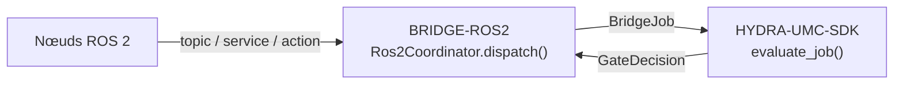

<!-- =============================================================================
HYDRA-UMC-BRIDGE-ROS2 - ROS 2 coordination bridge
Copyright (C) JuanenRac (Electro Hobby 3D) <electrohobby3d@gmail.com>
GPL-3.0-or-later - see LICENSE
============================================================================= -->

<p align="center">
  
</p>

# 🐢 HYDRA-UMC-BRIDGE-ROS2

<p align="center"><a href="README.md">🇺🇸 English</a> | <a href="README_spa.md">🇪🇸 Español</a> | 🇫🇷 <b>Français</b> | <a href="README_ita.md">🇮🇹 Italiano</a> | <a href="README_deu.md">🇩🇪 Deutsch</a> | <a href="README_zho.md">🇨🇳 简体中文</a> | <a href="README_jpn.md">🇯🇵 日本語</a> | <a href="README_por.md">🇵🇹 Português</a></p>

### 🔗 Frontière de coordination sans dépendance entre HYDRA-UMC et ROS 2

<p align="center">
  
  
  
  
  
  
</p>

---

> **Vérification d'honnêteté - ce qui fonctionne réellement aujourd'hui :** le cœur de coordination sans dépendance (`coordinator.py` avec `Ros2Coordinator`, faisant passer chaque envoi par le propre `evaluate_job()` de `HYDRA-UMC-SDK`), le vrai transport `rclpy` (importé de façon paresseuse) pour `std_srvs/Trigger` et `std_msgs/String` (`rclpy_transport.py` avec `Ros2SafeStopClient`/`Ros2StateSubscriber`), et le transport de commandes/état MQTT (`mqtt_transport.py`) sont réels et couverts par 88 tests unitaires qui passent (`python tools/build_test.py` - `test_coordinator.py`, `test_rclpy_transport.py`, `test_mqtt_transport.py`, `test_intake.py`, `test_mqtt_environment.py`, `test_hardening.py`). Rien de tout cela n'a été testé contre une vraie installation ROS 2, un vrai réseau DDS, ou un vrai broker MQTT - `test_rclpy_transport.py` tourne contre un nœud/éditeur factice et `test_mqtt_transport.py` contre un client de broker factice, si bien que `rclpy`/`std_srvs`/`std_msgs` n'ont même pas besoin d'être installés pour que ces tests passent. Les contrats personnalisés `.srv`/`.action` `inspect_service`/`job_action` n'ont encore aucun vrai type de message ROS 2 standard ni aucun client. Voir « Feuille de route et limites connues » ci-dessous, qui le dit déjà clairement, et `CHANGELOG.md` pour ce qui a été exactement livré jusqu'à présent. Le transport MQTT a aussi été exécuté contre un vrai HYDRA-UMC-MQTT-BROKER sur une machine de développement (`tests/test_broker_integration.py`, ignoré si aucun broker n'est installé) : publication et abonnement en QoS 0, 1 et 2, la disponibilité retenue et son dernier testament, et le retour après l'arrêt puis le redémarrage du broker.

> **État de la sûreté et de la cybersécurité :** cet écosystème n'est pas un système de sécurité certifié. Il n'existe pas encore de chaîne d'E-STOP matérielle, ni de limites ou de verrouillages imposés par le firmware, ni de commande de mouvement vérifiée ; les images de firmware sont contrôlées par CRC-32 et une signature Ed25519, et une compilation de version refuse les clés de développement publiées (les têtes d'outil et les cartes d'extension derrière le relais utilisent encore les chargeurs d'URTC, qui prennent un HMAC-SHA256 à clé partagée au lieu d'une signature) ; TLS et TLS mutuel sont optionnels et désactivés par défaut ; aucune carte propre n'a encore été assemblée ni testée. Lisez la [base de sécurité](https://github.com/JuanenRac/HYDRA-UMC-DOCS/blob/main/docs/SECURITY_BASELINE.md) et le [modèle de menaces](https://github.com/JuanenRac/HYDRA-UMC-DOCS/blob/main/docs/THREAT_MODEL.md) avant de vous fier à une affirmation d'ici pour la sécurité d'une personne.

---

## 📋 En un coup d'œil

| | |
|---|---|
| Version | `0.1.4` |
| Maturité | Fonctionnel |
| Tests | 88 (`python tools/build_test.py`) |
| Technologie | Python / ROS 2 / rclpy / HYDRA-UMC-SDK |
| Cible | Le Raspberry Pi CM5 d'une cellule HYDRA-UMC |
| Sur matériel réel | Simulé seulement : testé avec des émulateurs, des doubles de test ou des simulateurs ; aucune exécution sur du matériel réel n'est consignée pour cette version |

**Aller à :** [Présentation](#-présentation) · [Architecture](#-architecture) · [Fonctionnalités](#-fonctionnalités) · [Sécurité et protection](#-sécurité-et-protection) · [Interfaces](#-interfaces) · [Configuration](#-configuration) · [Démarrage rapide](#-démarrage-rapide) · [Tests](#-tests) · [Dépannage](#-dépannage) · [Structure du dépôt](#-structure-du-dépôt) · [Projets liés](#-projets-liés)

## 🚦 État du projet

Chaque ligne est une partie de ce dépôt et le feu dit où elle en est aujourd'hui. Elle est écrite d'après ce que le dépôt peut montrer (tests, compilations, exécutions), pas d'après ce qui est prévu.

🟢 Fait et vérifié · 🟡 Fonctionne, avec des limites connues · 🟠 À moitié fait ou pas encore vérifié · 🔴 Pas fait ou ne fonctionne pas

| Domaine | État | Ce que cela veut dire ici |
|---|---|---|
| Logiciel | 🟡 | Fonctionne pour son usage principal ; la vérification d'honnêteté ci-dessus liste ce qui manque encore |
| Tests | 🟢 | 88 tests automatiques, exécutés à chaque modification |
| Matériel réel | 🟠 | Simulé seulement : testé avec des émulateurs, des doubles de test ou des simulateurs ; aucune exécution sur du matériel réel n'est consignée pour cette version |
| Documentation | 🟢 | README en huit langues, vérifié par rapport au manifeste à chaque modification |

## 🎯 Présentation

**HYDRA-UMC-BRIDGE-ROS2** est la frontière de coordination bidirectionnelle et haut niveau entre HYDRA-UMC et ROS 2. Elle associe l'observation continue à un topic, l'inspection immédiate à un service, et le travail de cellule de longue durée à une action annulable. Ce n'est pas un nœud de contrôle moteur, et elle ne peut pas contourner HYDRA-UMC-SERVER, les limites du MCU, les watchdogs ou l'E-STOP. Aujourd'hui, seuls le topic d'état et le service d'arrêt sûr sont connectés ; le service d'inspection et l'action de travail sont des noms réservés sans type de message derrière. Le nœud doit tourner pour que le topic d'état soit livré : `run_forever()` le fait sur un fil dédié.

Il appartient à la famille **External Automation Bridges** : un ensemble de dépôts frères (CNC, LASER, OPENPNP, PRINTER3D, ROS2) qui partagent le même contrat de sécurité de `HYDRA-UMC-SDK`, afin qu'aucun pont ne puisse inventer sa propre définition du « sûr pour travailler ».

## 🧩 Rôle dans HYDRA-UMC

**HYDRA-UMC-BRIDGE-ROS2** se place entre un graphe ROS 2 et la cellule de robots. Il rapporte ce que dit ce côté, interroge la porte partagée avant tout travail auxiliaire et ne prend jamais l'autorité de la machine avec laquelle il coordonne.

Chaque bridge parle le contrat de sécurité partagé de `HYDRA-UMC-SDK` : un travail n'est accepté que si la porte partagée `evaluate_job()` le permet, et cette porte échoue en position fermée. Le projet parent est `HYDRA-UMC-SERVER` ; ce bridge ne l'appelle pas, il répond en MQTT, via `HYDRA-UMC-MQTT-BROKER`, à celui qui commande la cellule.

## 🏛️ Architecture

<p align="center">
  
</p>

<details>
<summary>Version texte du diagramme (Mermaid)</summary>



</details>

**Pourquoi il est construit ainsi**

* **Pourquoi `coordinator.py` n'a aucune dépendance à `rclpy`.** Son propre docstring de module l'affirme délibérément : il « peut être testé sur n'importe quel hôte et ne devient un nœud ROS 2 que via un adaptateur déployé séparément ». Cela garde la logique de coordination liée à la sécurité testable en CI sans installation ROS 2, et permet de choisir et valider l'adaptateur indépendamment, plus tard.
* **Pourquoi trois types d'interface distincts plutôt qu'un canal générique.** `state_topic`, `inspect_service` et `job_action` correspondent délibérément à la propre sémantique de ROS 2 : la publication continue d'état n'a pas besoin de requête/réponse (topic), une inspection rapide a besoin d'une réponse synchrone (service), et le travail de cellule doit pouvoir être annulé en cours d'exécution (action) — regrouper cela en un seul canal ferait perdre cette distinction.
* **Pourquoi `Ros2Coordinator.dispatch()` fait quand même passer chaque tâche par le portail partagé `evaluate_job()`.** ROS 2 n'est qu'un client de plus du même `bridge_contract` utilisé par CNC, LASER, OPENPNP et PRINTER3D — il ne bénéficie d'aucun contournement spécial de la logique IDLE/READY appliquée par tous les autres ponts et par HYDRA-UMC-SERVER.
* **Pourquoi `ABORT` reste demandable pendant un défaut.** L'exigence de phase productive du portail (`IDLE` + `READY`) n'est délibérément pas appliquée de la même manière à une demande d'abandon — un opérateur ou un nœud ROS 2 doit toujours pouvoir demander un arrêt contrôlé, même en plein défaut.
* **Pourquoi l'adaptateur `rclpy` et les contrats ROS `.msg`/`.srv`/`.action` ne sont pas encore dans ce dépôt.** S'engager sur des définitions de messages/services/actions spécifiques avant qu'un environnement ROS 2 réel ne soit sélectionné et testé risquerait d'intégrer des hypothèses que ce noyau local sans dépendance ne peut pas vérifier.
* **Comment cela s'intègre dans le reste de l'écosystème.** BRIDGE-ROS2 se situe entre les nœuds ROS 2 et `HYDRA-UMC-SDK` → `HYDRA-UMC-SERVER` → sécurité MCU : c'est une frontière de coordination, jamais un nœud de contrôle moteur, et elle ne peut pas contourner HYDRA-UMC-SERVER, les limites du MCU, les watchdogs ou l'E-STOP.

## ✨ Fonctionnalités

* ✅ **Noyau de coordination sans dépendance, réel :** `coordinator.py` — `Ros2Coordinator` n'importe `rclpy` en aucun cas ; c'est du Python pur délibérément, testable sur n'importe quel hôte sans installation de ROS 2. *(implémenté, testé dans `tests/test_coordinator.py`)*
* ✅ **Mappage à quatre interfaces, réel :** quatre attributs de classe fixes réservent le type d'interface ROS 2 exact pour chaque objectif — `/hydra_umc/machine_state` (topic, état continu), `/hydra_umc/inspect_cell` (service, inspection courte), `/hydra_umc/execute_cell_job` (action, tâche annulable), `/hydra_umc/request_safe_stop` (service, arrêt contrôlé). *(implémenté)*
* ✅ **Portail de sécurité partagé, réel :** chaque tâche envoyée via `Ros2Coordinator.dispatch()` est évaluée par `evaluate_job()` du `bridge_contract` de `HYDRA-UMC-SDK`, le même portail utilisé par tous les ponts frères et HYDRA-UMC-SERVER ; une phase productive nécessite une machine externe `IDLE` et une cellule HYDRA-UMC `READY`, tandis qu'`ABORT` reste demandable pendant un défaut. *(implémenté)*
* ✅ **Routage de phases fermé et évidence statique :** les phases productives ne se mappent que vers l'action de travail planifiée, `ABORT` se mappe vers `/hydra_umc/request_safe_stop` et une future phase SDK inconnue est refusée. `inspect_interface_plan.py` émet le plan statique de schéma `1.1` — incluant la véritable qualité de service (QoS) de durabilité `transient_local` dont le topic d'état a besoin (le propre remplacement de ROS 2 pour l'éditeur « latched » de ROS 1, documenté sur design.ros2.org/articles/qos.html) — sans importer `rclpy` ni contacter DDS. *(implémenté, testé)*
* ✅ **Transport `rclpy` réel et partiel :** `rclpy_transport.py` connecte les 2 interfaces avec un vrai type de message ROS 2 standard dès aujourd'hui — `Ros2SafeStopClient` (un vrai client `std_srvs/Trigger`) et `Ros2StateSubscriber` (un vrai abonné `std_msgs/String`, utilisant la véritable QoS de durabilité `transient_local`). *(implémenté, testé dans `tests/test_rclpy_transport.py`)*
* ✅ **Build/test non mutant :** `build-test.bat`/`.sh` compilent le code source et exécutent des tests unitaires déterministes sans changer la version ni le CHANGELOG. *(implémenté, voir Compilation et publication ci-dessous)*
* 🔜 **Contrats `.srv`/`.action` personnalisés pour `inspect_service`/`job_action`** — ceux-ci n'ont pas de vrai type de message ROS 2 standard, donc un client pour eux nécessite que ce dépôt définisse d'abord son propre paquet d'interface. *(prévu)*
* ✅ **État observé de la machine, messages retenus et clés répétées :** dès que le bridge suit le topic d'état ROS 2, la porte partagée utilise l'état rapporté par la machine au lieu du `machine_state` écrit dans le travail (un message que n'importe qui sur le broker peut publier), et une machine dont on n'a jamais eu de nouvelles compte comme OFFLINE ; `handle_message()` ignore les messages retenus (le broker les rejoue à chaque reconnexion) et, s'il reçoit un `IdempotencyStore`, répond à une `idempotency_key` répétée avec la première réponse. *(implémenté, testé dans `tests/test_intake.py`)*
* ✅ **Une boucle de messages qui survit à son entrée, un nœud réellement tourné et un état qui peut périmer :** `handle_message()` ne lève jamais d'exception (un JSON trop gros ou très imbriqué et toute défaillance inattendue reviennent sous forme de refus) ; `cmd/job` répond avec `allowed` comme tous les autres bridges (et `accepted` comme avant) ; un travail `ABORT` dit clairement qu'il n'est qu'un plan et que l'arrêt réel est `cmd/safe_stop`. `run_forever()` fait tourner le nœud sur un fil dédié (`spin_node_in_background()`, pour que le topic d'état soit réellement livré), réutilise un unique client de service, exécute `cmd/safe_stop` sur une voie qui n'attend jamais derrière une autre commande, laisse un Last Will sur `availability`, republie l'état avec son `machine_state` normalisé et une heure `observed_at`, et refuse de démarrer si le topic d'état ROS 2 ne peut pas être souscrit ; `observed_max_age_seconds` fait compter comme OFFLINE un état qui n'est plus republié (désactivé par défaut). *(implémenté, testé avec des doublures ; jamais exécuté contre un vrai graphe ROS 2, donc le comportement de l'exécuteur et de la QoS n'est pas vérifié)*

## 🔒 Sécurité et protection

| Menace | Défense | Où |
|---|---|---|
| Un travail pour une cellule ou une machine qui n'est pas en état sûr | Chaque travail passe par la porte partagée `evaluate_job()` du SDK, qui échoue en position fermée ; le bridge n'a aucune logique propre d'acceptation | SDK `bridge_contract` |
| Données de travail démesurées | Au plus 32 paramètres, clés jusqu'à 64 caractères, valeurs jusqu'à 1024, identifiants jusqu'à 128 (`MAX_PARAMETERS`, `MAX_PARAMETER_KEY_CHARS`, `MAX_PARAMETER_VALUE_CHARS`, `MAX_IDENTIFIER_CHARS`) | SDK `bridge_contract` |
| Un ordre répété ou rejoué | Un `IdempotencyStore` retient chaque clé 24 heures et au plus 10 000 entrées ; une répétition reçoit la première réponse au lieu d'être réévaluée | SDK `job_intake` |
| Une charge MQTT énorme ou hostile | Une charge de plus de 16 KiB, un JSON illisible ou très imbriqué et tout échec inattendu reçoivent un refus sur le topic de résultat et ne terminent jamais la boucle | `mqtt_transport.py` |
| Une interface ROS 2 hors de l'espace permis | Les noms d'interface doivent commencer par `/hydra_umc/`, et le bridge ne connaît que des types d'interface, jamais de mouvement brut | `coordinator.py` |
| Un arrêt qui attend derrière un autre travail | `cmd/safe_stop` s'exécute sur une voie à part (`STOP_VERBS`) ; les deux interfaces rclpy standard utilisent la durabilité `transient_local`, donc un abonné tardif reçoit quand même le dernier état | `mqtt_transport.py`, `rclpy_transport.py` |
| Un état de machine pris sur parole | Avant `start_observing()` rien n'a été lu et la porte refuse le travail ; en observation, un état jamais entendu ou qui n'est pas un `MachineState` connu compte comme `OFFLINE` | `mqtt_transport.py` |

**Ce qu'il ne fait jamais :** il ne transforme aucun travail en mouvement brut et ne parle à ROS 2 que par deux interfaces à types standard.

## 🔌 Interfaces

Topics sous `hydra/bridges/ros2/` ; chaque commande reçoit sa réponse sur `<verbe>/result`.

| Topic ou route | Ce qu'il porte |
|---|---|
| `cmd/job` | un `BridgeJob` ; la réponse est la décision d'envoi pour l'interface ROS 2 |
| `cmd/safe_stop` | appelle le service d'arrêt sûr via `Ros2SafeStopClient` |
| `state`, `availability` | l'état de la machine lu sur le topic d'état ROS 2 (`std_msgs/msg/String`) et `online`/`offline` |

Pour vérifier le plan d'interfaces sans ROS 2 : `python tools/inspect_interface_plan.py --verify-fixture`.

## ⚙️ Configuration

| Variable | Par défaut | Ce qu'elle définit |
|---|---|---|
| `HYDRA_MQTT_USERNAME` | aucun | Le nom d'utilisateur MQTT ; le broker le lie à un préfixe d'identifiant client |
| `HYDRA_MQTT_PASSWORD` | aucun | Le mot de passe ; valable seulement avec le nom d'utilisateur |
| `HYDRA_MQTT_PASSWORD_FILE` | aucun | Le mot de passe lu dans un fichier (secret Docker ou systemd) ; ignoré si `HYDRA_MQTT_PASSWORD` est défini |
| `HYDRA_MQTT_TLS_CA` | aucun | Le fichier de l'AC qui a signé le certificat du broker : la connexion est en TLS et le certificat est vérifié |
| `HYDRA_MQTT_TLS` | désactivé | `1` active TLS, vérifié avec les AC de confiance du système |
| `HYDRA_MQTT_TLS_CERT` / `HYDRA_MQTT_TLS_KEY` | aucun | Le certificat client et sa clé pour un broker qui exige du TLS mutuel ; les deux sont requis |

Le nom du nœud ROS 2 est l'argument de `create_ros2_node()` ; l'hôte, le port et l'identifiant client MQTT (`hydra-umc-bridge-ros2`) sont des arguments de `run_forever()`.

## 🚀 Démarrage rapide

Nécessite Python 3.11 ou plus récent. Les tests et les scripts de build attendent `HYDRA-UMC-SDK` cloné à côté de ce dépôt (`../HYDRA-UMC-SDK`) ou indiqué par `HYDRA_UMC_SDK_ROOT`.

Essayez-le sans matériel (cela vérifie tout le bridge avec ses émulateurs et ses doubles de test) :

```bash
py -3 tools/build_test.py          # Windows
python3 tools/build_test.py         # Linux, macOS
```

Démarrer le service (il n'y a pas de script de console : le service est le `run_forever()` du transport MQTT, que vous appelez depuis votre propre code de démarrage) :

```python
from hydra_umc_bridge_ros2.rclpy_transport import create_ros2_node, spin_node_in_background
from hydra_umc_bridge_ros2.mqtt_transport import Ros2MqttBridge, run_forever
node = create_ros2_node("hydra_umc_bridge")          # needs rclpy from a ROS 2 installation
spin_node_in_background(node)
bridge = Ros2MqttBridge(node, cell_state=lambda: cell_state, node_is_spinning=True)
run_forever(bridge, host="192.168.0.180")
```

Le nom d'utilisateur, le mot de passe et les fichiers TLS viennent des variables `HYDRA_MQTT_*` (voir Configuration) ; le code ci-dessus n'a besoin d'aucun identifiant propre.

## 🧪 Tests

88 cas `unittest` automatiques s'exécutent avec `python tools/build_test.py` (qui compile aussi chaque module). Les tests n'ont besoin ni de matériel, ni de réseau, ni de paquet optionnel : ceux qui exigeraient `paho-mqtt`, `pyserial` ou une bibliothèque de fabricant utilisent un substitut ou sont ignorés si le paquet manque.

| Fichier de tests | Tests | Ce qu'il couvre |
|---|---|---|
| `test_coordinator.py`, `test_intake.py` | - | passage du travail à l'interface et prise en charge des travaux |
| `test_rclpy_transport.py` | - | les deux interfaces rclpy contre un substitut de rclpy |
| `test_mqtt_transport.py`, `test_mqtt_environment.py`, `test_hardening.py`, `test_edge_cases.py` | - | répartition des topics, identifiants de l'environnement, clients hostiles, cas limites |

La CI exécute `HYDRA_UMC_CI=1 python tools/ci_validate.py`, qui vérifie le manifeste, les documents, les huit README et les images, et lance les tests avec une copie du SDK.

## 🏗️ Compilation et publication

Nécessite Python 3.11+. `tools/build_test.py` attend que `HYDRA-UMC-SDK` soit cloné en tant que répertoire frère (`../HYDRA-UMC-SDK`) ou indiqué via la variable d'environnement `HYDRA_UMC_SDK_ROOT`.

```bash
# Windows
build-test.bat      # validation uniquement — pas de changement de version/CHANGELOG
build.bat            # Valide et compile (compiler ne change jamais la version)

# Linux/macOS
bash build-test.sh
bash build.sh
```

`build-test` compile chaque module sous `src/` avec `py_compile` et exécute la suite complète `unittest` (tous les fichiers `test_*.py` de `tests/`) — de manière déterministe, sans installation ROS 2, sans réseau et sans changement de version/CHANGELOG. `build` exécute d'abord cette même validation et, seulement en cas de succès, appelle `tools/bump_version.py` pour synchroniser la version dans `pyproject.toml`, `hydra-umc.project.json` et `CHANGELOG.md`. Il n'existe pas encore de commande `run` matérielle réelle — cela nécessite un déploiement ROS 2 validé.

## 🩺 Dépannage

| Vous voyez | Parce que | Faites |
|---|---|---|
| `ModuleNotFoundError: hydra_umc_sdk` | Le SDK n'est ni installé ni à côté de ce dépôt | Clonez `HYDRA-UMC-SDK` à côté de ce dépôt ou définissez `HYDRA_UMC_SDK_ROOT` |
| `paho-mqtt is not installed` | Le client MQTT est un extra optionnel | `pip install ".[mqtt]"` (il faut `paho-mqtt` 2.1 ou plus, avant 3) |
| `password was given without a username` | Les identifiants MQTT exigent les deux parties | Définissez aussi `HYDRA_MQTT_USERNAME`, pas seulement le mot de passe |
| `could not reach the MQTT broker after N attempts` | Le broker est arrêté, l'adresse est fausse ou le port est fermé | Démarrez `HYDRA-UMC-MQTT-BROKER` et vérifiez l'hôte et le port donnés au transport (5 essais à 2 secondes d'écart) ; un échec de la poignée de main TLS n'est pas réessayé |
| `the MQTT broker refused the connection` | Le broker a refusé l'identifiant (ou n'a pas répondu à temps) | Vérifiez `HYDRA_MQTT_USERNAME` et le mot de passe ; l'identifiant client doit commencer par le préfixe que le broker a lié à l'identifiant |
| `"allowed": false` + `reason` | La porte partagée ou une garde a refusé l'ordre | Lisez `reason` et corrigez la cause ; ne réessayez pas à l'aveugle |
| `rclpy` cannot be imported | rclpy vient avec une installation ROS 2, pas de PyPI | Chargez l'environnement ROS 2 avant de démarrer le service ; les tests n'en ont pas besoin |

## 📂 Structure du dépôt

<p align="center">
  
</p>

<details>
<summary>Version texte de l'arborescence</summary>

```text
HYDRA-UMC-BRIDGE-ROS2/
├── src/hydra_umc_bridge_ros2/
│   ├── coordinator.py             travail vers une interface ROS 2 nommée, jamais de mouvement brut
│   ├── rclpy_transport.py         les deux interfaces rclpy à types standard
│   └── mqtt_transport.py          transport MQTT des commandes, de l'état et de l'arrêt sûr
├── tests/                         81 tests, rclpy remplacé par un substitut
├── docs/                          guide du bridge
├── tools/                         exécuteur de build et de tests, montée de version, validateur CI, générateurs et vérifications des README et des images
├── images/                        bannière et images du README
├── .github/                       workflow CI et modèles de tickets
├── pyproject.toml                 métadonnées du paquet et dépendances
├── hydra-umc.project.json         manifeste : version, maturité, famille
├── CHANGELOG.md                   ce qui a changé à chaque version
├── build.sh build.bat             scripts de build (ils ne changent jamais la version)
├── build-test.sh build-test.bat   scripts de build (ils ne changent jamais la version)
├── test.sh test.bat               lancent les tests
└── SECURITY.md SUPPORT.md CONTRIBUTING.md CODE_OF_CONDUCT.md LICENSE LICENSE.md
```

</details>

## 🗺️ Feuille de route et limites connues

**Limites connues aujourd'hui**

**Réel aujourd'hui :** version `0.1.4`, fonctionnel en tant que noyau de coordination sans dépendance (`Ros2Coordinator`) avec une suite `unittest` déterministe de soixante-quatre tests couvrant le noyau de coordination, le transport MQTT et le transport rclpy, un routage de phases fermé, un schéma d'interface statique `plan-only` déclarant la véritable qualité de service (QoS) de durabilité `transient_local` dont le topic d'état a besoin, un transport `rclpy` réel (importé de façon paresseuse) pour les 2 interfaces avec un vrai type de message ROS 2 standard, et des scripts build-test non mutants intégrés en CI avec un checkout du SDK.

**Frontière d'intégration :** ce pont n'est qu'une frontière de coordination — ce n'est pas un nœud de contrôle moteur, et il ne peut pas contourner HYDRA-UMC-SERVER, les limites du MCU, les watchdogs ou l'E-STOP ; chaque tâche envoyée passe toujours par le même portail partagé utilisé par tous les ponts frères.

**Encore à venir :** aucun réseau ROS, robot ou actionneur physique n'a encore été validé — l'adaptateur `rclpy` et les contrats ROS `.msg`/`.srv`/`.action` concrets seront introduits seulement après la sélection et le test d'un environnement ROS 2 réel.

## 🌍 Langues

Ce README et les documents du dépôt existent en huit langues : anglais, espagnol, allemand, français, italien, japonais, chinois et portugais (Portugal). Ils sont écrits ensemble et la CI vérifie que les huit fichiers ont les mêmes sections et les mêmes liens. Ce dépôt n'a ni écran ni catalogue de messages propre, il n'y a donc aucune chaîne d'interface à traduire.

## 🔗 Projets liés

Ce projet fait partie de l'écosystème robotique HYDRA-UMC du même auteur (JuanenRac / Electro Hobby 3D). Bon à savoir, car une demande pourrait en réalité concerner l'un de ceux-ci plutôt que ce dépôt.

**Projet Parent**
- **[HYDRA-UMC-SERVER](https://github.com/JuanenRac/HYDRA-UMC-SERVER)** — le vrai backend headless (REST/WebSocket) auquel parle réellement chaque client de contrôle ; la frontière authentifiée de l'écosystème à laquelle ce bridge rend compte une fois chaque commande passée par la propre barrière de sécurité locale de ce bridge.

**Projets Frères** — parlent également à la propre API de HYDRA-UMC-SERVER, chacun en tant que son propre client
- **[HYDRA-UMC-STUDIO](https://github.com/JuanenRac/HYDRA-UMC-STUDIO)** — tableau de bord de contrôle web avec visualisation 3D multi-robot en temps réel.
- **[HYDRA-UMC-SUITE](https://github.com/JuanenRac/HYDRA-UMC-SUITE)** — centre de commande d'essaim de bureau (PySide6) pour plusieurs serveurs à la fois, empaqueté en exécutable autonome.
- **[HYDRA-UMC-ANDROID-CONTROL](https://github.com/JuanenRac/HYDRA-UMC-ANDROID-CONTROL)** — application de contrôle Android native avec connexion biométrique et un compagnon Wear OS jumelé.
- **[HYDRA-UMC-IOS-CONTROL](https://github.com/JuanenRac/HYDRA-UMC-IOS-CONTROL)** — application de contrôle iOS/iPadOS (Flutter) avec synchronisation WebSocket en temps réel.
- **[HYDRA-UMC-DSI](https://github.com/JuanenRac/HYDRA-UMC-DSI)** — interface tactile native pour l'écran tactile DSI 7" embarqué, intégrée directement sur le CM5.
- **[HYDRA-UMC-BRIDGE-AMR](https://github.com/JuanenRac/HYDRA-UMC-BRIDGE-AMR)** — frontière de coordination pour les flottes AGV/AMR via un éditeur MQTT VDA 5050 (testé uniquement contre une flotte émulée).
- **[HYDRA-UMC-BRIDGE-CNC](https://github.com/JuanenRac/HYDRA-UMC-BRIDGE-CNC)** — coordinateur haut niveau pour cellules CNC avec accès au statut/octets de contrôle GRBL (testé uniquement contre un émulateur).
- **[HYDRA-UMC-BRIDGE-DROIDS](https://github.com/JuanenRac/HYDRA-UMC-BRIDGE-DROIDS)** — frontière de coordination pour droïdes à pattes/humanoïdes, avec un émetteur de commandes Boston Dynamics Spot (testé uniquement contre un émulateur).
- **[HYDRA-UMC-BRIDGE-LASER](https://github.com/JuanenRac/HYDRA-UMC-BRIDGE-LASER)** — coordinateur de cellules laser lisant 3 signaux GPIO de clé/enceinte/verrouillage (testé uniquement contre une puce simulée ; il ne peut ni armer ni tirer un laser).
- **[HYDRA-UMC-BRIDGE-OPENPNP](https://github.com/JuanenRac/HYDRA-UMC-BRIDGE-OPENPNP)** — coordinateur haut niveau sûr pour le flux de cartes du pick-and-place OpenPnP.
- **[HYDRA-UMC-BRIDGE-PRINTER3D](https://github.com/JuanenRac/HYDRA-UMC-BRIDGE-PRINTER3D)** — frontière de coordination sûre pour imprimantes 3D Moonraker/Klipper, avec de vraies commandes de tâche contrôlées.
- **[HYDRA-UMC-BRIDGE-UAV](https://github.com/JuanenRac/HYDRA-UMC-BRIDGE-UAV)** — frontière de coordination pour UAV équipés de caméra, avec un émetteur de commandes MAVLink (testé uniquement contre un émulateur).

**Directement Liés**
- **[HYDRA-UMC-SDK](https://github.com/JuanenRac/HYDRA-UMC-SDK)** — le contrat JSON-Schema partagé et la barrière logicielle de contrôle des jobs contre laquelle chaque bridge valide ses commandes (pas une fonction de sécurité certifiée).
- **[HYDRA-UMC-CONNECTOR-HUB](https://github.com/JuanenRac/HYDRA-UMC-CONNECTOR-HUB)** — registre déclaratif et validateur de manifestes d'adaptateur pour les connecteurs de machines externes ; étend la propre idée de contrat du SDK aux machines externes sans remplacer les projets de passerelle industrielle.
- **[HYDRA-UMC-MQTT-BROKER](https://github.com/JuanenRac/HYDRA-UMC-MQTT-BROKER)** — le vrai transport de `mqtt_transport.py` pour les propres topics `hydra/bridges/ros2/...` de ce bridge — la barrière de tâches en mode plan uniquement, un appel d'arrêt sécurisé `std_srvs/Trigger` (pas encore exécuté contre une installation ROS 2), et le topic d'état ROS 2 republié comme toujours prévu par l'adaptateur `rclpy_transport.py` déployé séparément ; voir le propre `docs/BRIDGE_TOPICS.md` de ce dépôt.
- **[HYDRA-UMC-HIL-BRIDGE](https://github.com/JuanenRac/HYDRA-UMC-HIL-BRIDGE)** — routeur hardware-in-the-loop avec un verrouillage logiciel de collision entre simulation et matériel réel (testé sans matériel réel).

**Fait Également Partie de l'Écosystème**

*Matériel & Plateforme de Base*
- **[HYDRA-UMC](https://github.com/JuanenRac/HYDRA-UMC)** — la conception de la carte mère du bras robotique : hôte CM5 + coprocesseur STM32H745 double cœur, destinée à coordonner jusqu'à 8 bras-outils via CAN-OTA/SPI-OTA (firmware à un stade précoce ; aucune carte assemblée pour l'instant).
- **[HYDRA-UMC-OS](https://github.com/JuanenRac/HYDRA-UMC-OS)** — couche produit reproductible sur Raspberry Pi OS pour le CM5 : agent en lecture seule, config/profils validés, provisionnement WiFi de premier contact.

*Backend Central & Clients*
- **[HYDRA-UMC-EDITOR-URDF](https://github.com/JuanenRac/HYDRA-UMC-EDITOR-URDF)** — créateur/éditeur graphique de bureau pour URDF qui envoie les modèles terminés vers le propre catalogue de STUDIO.
- **[HYDRA-UMC-EDITOR-STL](https://github.com/JuanenRac/HYDRA-UMC-EDITOR-STL)** — éditeur de bureau de modèles STL, transformant/remplaçant/retirant/ajoutant de vraies pièces dans le même catalogue de modèles qu'édite aussi HYDRA-UMC-EDITOR-URDF.

*Plateforme d'Outils URTC*
- **[URTC](https://github.com/JuanenRac/URTC)** — firmware pour la carte physique Universal Robot Tool Controller, plus de 25 profils d'outil sur bus CAN.
- **[URTC-FLASHER](https://github.com/JuanenRac/URTC-FLASHER)** — outil de bureau à interface graphique pour flasher les cartes URTC, CAN-OTA plus SWD/JTAG puce complète.
- **[URTC-TESTER](https://github.com/JuanenRac/URTC-TESTER)** — outil de bureau de diagnostic CAN-bus en direct pour cartes URTC, un panneau par profil d'outil.
- **[URTC-WEB-STUDIO](https://github.com/JuanenRac/URTC-WEB-STUDIO)** — alternative basée navigateur à URTC-TESTER via la Web Serial API, sans installation locale.
- **[URTC-GATEWAY](https://github.com/JuanenRac/URTC-GATEWAY)** — passerelle devant le bus CAN d'URTC : liste d'identifiants autorisés, limite de débit et clé de session ; logiciel testé sur ordinateur, pas encore sur un bus réel.

*Nœud IA de Vision (Hailo-8)*
- **[HYDRA-UMC-VISION-NODE](https://github.com/JuanenRac/HYDRA-UMC-VISION-NODE)** — hub d'intégration pour le pipeline de vision Hailo-8, avec une vraie vérification de disponibilité matérielle par étape.
- **[HYDRA-UMC-DETECTION-HEF](https://github.com/JuanenRac/HYDRA-UMC-DETECTION-HEF)** — registre réel de modèles compilés avec vérification de chargement sécurisé par architecture Hailo/checksum.
- **[HYDRA-UMC-VISION-STREAMER](https://github.com/JuanenRac/HYDRA-UMC-VISION-STREAMER)** — générateur réel de pipeline GStreamer + config MediaMTX, avec une vraie frontière d'intégration HailoRT.
- **[HYDRA-UMC-VISUAL-SERVOING-API](https://github.com/JuanenRac/HYDRA-UMC-VISUAL-SERVOING-API)** — loi de correction Position-Based Visual Servoing avec autorisation conditionnée à l'état de zone ; pas encore d'estimation de pose par caméra.
- **[HYDRA-UMC-SAFETY-ZONES](https://github.com/JuanenRac/HYDRA-UMC-SAFETY-ZONES)** — logique v0 de violation de zone, de fraîcheur de calibration et de demande d'E-STOP qui lit les positions d'objets dans un fichier ; aucun détecteur ne l'alimente et aucun E-STOP physique n'y est encore relié.

*Nœud IA Cognitif (Hailo-10)*
- **[HYDRA-UMC-COGNITIVE-NODE](https://github.com/JuanenRac/HYDRA-UMC-COGNITIVE-NODE)** — hub d'intégration pour le pipeline cognitif Hailo-10 (orchestration LLM/VLA/voix).
- **[HYDRA-UMC-VLA-ENGINE](https://github.com/JuanenRac/HYDRA-UMC-VLA-ENGINE)** — vrai encodage/décodage de jetons d'action et génération de trajectoire pour un modèle Vision-Language-Action.
- **[HYDRA-UMC-VOICE-UI](https://github.com/JuanenRac/HYDRA-UMC-VOICE-UI)** — vrai front-end vocal (VAD + analyseur d'intention) avec un relais Watch borné et soumis à confirmation.
- **[HYDRA-UMC-SEMANTIC-PLANNER](https://github.com/JuanenRac/HYDRA-UMC-SEMANTIC-PLANNER)** — vraie décomposition de tâches basée sur des règles et récupération sémantique d'erreurs sur les codes d'erreur MCU.
- **[HYDRA-UMC-DOCS-QA](https://github.com/JuanenRac/HYDRA-UMC-DOCS-QA)** — vraie recherche documentaire TF-IDF (bibliothèque standard uniquement) sur les propres documents Markdown de cet écosystème.
- **[HYDRA-UMC-LOCAL-TECHNICIAN](https://github.com/JuanenRac/HYDRA-UMC-LOCAL-TECHNICIAN)** — technicien de maintenance IA local et à portes de politique pour l'écosystème lui-même - observe, diagnostique et propose des corrections ; les deux niveaux de risque les plus élevés ne sont délibérément pas encore implémentés.

*Orchestration & Essaim*
- **[HYDRA-UMC-ORCHESTRATOR](https://github.com/JuanenRac/HYDRA-UMC-ORCHESTRATOR)** — hub d'intégration avec un vrai contrat de rapport de santé gRPC/Protobuf et une machine à états de mission.
- **[HYDRA-UMC-JOB-DISPATCHER](https://github.com/JuanenRac/HYDRA-UMC-JOB-DISPATCHER)** — vraie file de tâches basée sur la priorité avec déduplication, via une vraie API HTTP.
- **[HYDRA-UMC-NODE-HEALING](https://github.com/JuanenRac/HYDRA-UMC-NODE-HEALING)** — vrai chien de garde de santé de flotte basé sur gRPC, avec retry/backoff et détection d'incohérence d'identité.
- **[HYDRA-UMC-PATH-PLANNER-3D](https://github.com/JuanenRac/HYDRA-UMC-PATH-PLANNER-3D)** — vrai planificateur de trajectoire 3D basé sur RRT, avec vraie validation des collisions obstacle/espace de travail.
- **[HYDRA-UMC-SWARM-SYNC](https://github.com/JuanenRac/HYDRA-UMC-SWARM-SYNC)** — vraie synchronisation d'état CRDT LWW-Element-Map, testée par propriétés pour la convergence multi-cellule.

*Jumeau Numérique & Simulation*
- **[HYDRA-UMC-TWIN](https://github.com/JuanenRac/HYDRA-UMC-TWIN)** — hub d'intégration pour le moteur de jumeau numérique, avec un vrai contrat de synchronisation par compatibilité de version.
- **[HYDRA-UMC-PHYSICS-REPLICA](https://github.com/JuanenRac/HYDRA-UMC-PHYSICS-REPLICA)** — vraie cinématique directe et validation des limites articulaires sur un vrai sous-ensemble URDF.
- **[HYDRA-UMC-SYNTHETIC-DATA-GEN](https://github.com/JuanenRac/HYDRA-UMC-SYNTHETIC-DATA-GEN)** — vrai générateur procédural de scènes 2D avec export d'annotations YOLO/COCO.

*Données & Analytique*
- **[HYDRA-UMC-DATALAKE](https://github.com/JuanenRac/HYDRA-UMC-DATALAKE)** — vrai magasin de séries temporelles basé sur sqlite3, avec une vraie API HTTP d'ingestion/requête.
- **[HYDRA-UMC-ANOMALY-DETECTOR](https://github.com/JuanenRac/HYDRA-UMC-ANOMALY-DETECTOR)** — vrai détecteur d'anomalies FFT + ligne de base statistique, avec surveillance de dérive.
- **[HYDRA-UMC-PRODUCTION-REPORTS](https://github.com/JuanenRac/HYDRA-UMC-PRODUCTION-REPORTS)** — vrai calcul OEE/disponibilité sur l'historique de DATALAKE, avec export CSV reproductible.
- **[HYDRA-UMC-TELEMETRY-COLLECTOR](https://github.com/JuanenRac/HYDRA-UMC-TELEMETRY-COLLECTOR)** — vrai pipeline d'ingestion CAN/WebSocket vers DATALAKE, avec déduplication par séquence.

*Passerelle Industrielle*
- **[HYDRA-UMC-GATEWAY-INDUSTRIAL](https://github.com/JuanenRac/HYDRA-UMC-GATEWAY-INDUSTRIAL)** — hub d'intégration relayant vers les protocoles industriels, avec une vraie couche de liste blanche de commandes/contre-pression.
- **[HYDRA-UMC-OPCUA-SERVER](https://github.com/JuanenRac/HYDRA-UMC-OPCUA-SERVER)** — vrai espace d'adressage OPC-UA, vérifié avec une vraie session client du protocole binaire.
- **[HYDRA-UMC-MTCONNECT-ADAPTER](https://github.com/JuanenRac/HYDRA-UMC-MTCONNECT-ADAPTER)** — vrais points de terminaison XML MTConnect `/probe` et `/current`, avec sortie en mode dégradé.

*Outils Complémentaires & Opérations de l'Écosystème*
- **[HYDRA-UMC-DASHBOARD-AI](https://github.com/JuanenRac/HYDRA-UMC-DASHBOARD-AI)** — panneaux Smart Summaries et Anomaly Highlighting sur DATALAKE/ANOMALY-DETECTOR, avec un repli statistique honnête.
- **[HYDRA-UMC-TOOL-CLI](https://github.com/JuanenRac/HYDRA-UMC-TOOL-CLI)** — CLI de flotte avec un vrai contrat de codes de sortie stable, un vrai client en direct de la propre API de HYDRA-UMC-SERVER.
- **[HYDRA-UMC-WATCH](https://github.com/JuanenRac/HYDRA-UMC-WATCH)** — application compagnon WearOS avec des motifs d'alerte haptique et un relais vocal vers le téléphone jumelé (pas encore exécutée sur une montre physique).
- **[URTC-SMART-RACK](https://github.com/JuanenRac/URTC-SMART-RACK)** — firmware pour un rack de montage de cartes avec décodage réel d'ID d'outil et logique de préchauffage Smart Idle.
- **[URTC-VISION-TOOL](https://github.com/JuanenRac/URTC-VISION-TOOL)** — firmware plus un vrai compagnon de vision Python pour une tête d'outil d'inspection thermique/RGB.
- **[HYDRA-UMC-UPDATER](https://github.com/JuanenRac/HYDRA-UMC-UPDATER)** — outil administratif de bureau qui découvre, clone et met à jour chaque dépôt de cet écosystème.
- **[HYDRA-UMC-OS-REBUILDER](https://github.com/JuanenRac/HYDRA-UMC-OS-REBUILDER)** — outil de bureau Windows/Linux qui construit une image de la CM5 prête à graver, préchargée avec les versions les plus actuelles de l'écosystème, avec une configuration de premier démarrage Wi-Fi/utilisateur/SSH façon Raspberry Pi Imager.
- **[HYDRA-UMC-OPS-AGENT](https://github.com/JuanenRac/HYDRA-UMC-OPS-AGENT)** — coordinateur d'incidents de maintenance : un rôle edge à faible privilège collecte un instantané d'inventaire/santé assaini, un rôle control-plane le rend en lecture seule et demande à un fournisseur d'IA de suggérer un diagnostic - n'applique jamais de correctif ni ne déploie rien.
- **[HYDRA-UMC-DEV-SERVER](https://github.com/JuanenRac/HYDRA-UMC-DEV-SERVER)** — hôte de développement reproductible (Raspberry Pi 5 / CM5) qui héberge le code source de l'écosystème et exécute des tâches de compilation/test délimitées via une file d'attente durable ; un rôle de développement dédié, explicitement distinct d'un CM5 opérationnel.

## 📚 Documentation

Où lire la suite :

* [docs/BRIDGE_GUIDE.md](docs/BRIDGE_GUIDE.md) - périmètre, plan d'interfaces, rclpy, scripts
* [Base de sécurité de l'écosystème](https://github.com/JuanenRac/HYDRA-UMC-DOCS/blob/main/docs/SECURITY_BASELINE.md)
* [Modèle de menaces de l'écosystème](https://github.com/JuanenRac/HYDRA-UMC-DOCS/blob/main/docs/THREAT_MODEL.md)
* [Journal des modifications de ce dépôt](CHANGELOG.md)
* [Licence de ce dépôt](LICENSE.md)

## 🤝 Contribuer et communauté

* Avant une pull request, exécutez `HYDRA_UMC_CI=1 py -3 tools/ci_validate.py` (ou `HYDRA_UMC_CI=1 python3 tools/ci_validate.py`) : il doit afficher `CI_VALIDATION=PASS`. N'exécutez pas `build.sh` ni `build.bat` pour cette vérification ; compiler n'est pas vérifier.
* Les huit README sont écrits à partir d'une source unique dans HYDRA-UMC-DOCS ; ne les modifiez pas à la main. Changez la source et réécrivez-les avec `tools/make_readmes.py`.
* N'affirmez pas dans un README ce qui n'a pas tourné : écrivez « simulé » ou « non essayé sur matériel » quand c'est la vérité.
* Voir [CONTRIBUTING.md](CONTRIBUTING.md), le [code de conduite](CODE_OF_CONDUCT.md), [SECURITY.md](SECURITY.md) et [SUPPORT.md](SUPPORT.md).

## 👤 AUTEUR

**JuanenRac (Electro Hobby 3D)** · electrohobby3d@gmail.com

## 📜 LICENCE

GPL-3.0-or-later - [LICENSE](LICENSE).
