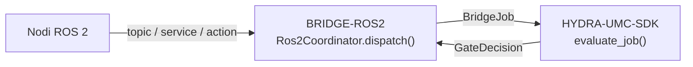

<!-- =============================================================================
HYDRA-UMC-BRIDGE-ROS2 - ROS 2 coordination bridge
Copyright (C) JuanenRac (Electro Hobby 3D) <electrohobby3d@gmail.com>
GPL-3.0-or-later - see LICENSE
============================================================================= -->

<p align="center">
  
</p>

# 🐢 HYDRA-UMC-BRIDGE-ROS2

<p align="center"><a href="README.md">🇺🇸 English</a> | <a href="README_spa.md">🇪🇸 Español</a> | <a href="README_fra.md">🇫🇷 Français</a> | 🇮🇹 <b>Italiano</b> | <a href="README_deu.md">🇩🇪 Deutsch</a> | <a href="README_zho.md">🇨🇳 简体中文</a> | <a href="README_jpn.md">🇯🇵 日本語</a> | <a href="README_por.md">🇵🇹 Português</a></p>

### 🔗 Confine di coordinamento privo di dipendenze tra HYDRA-UMC e ROS 2

<p align="center">
  
  
  
  
  
  
</p>

---

> **Verifica di onestà - cosa funziona davvero oggi:** il nucleo di coordinamento senza dipendenze (`coordinator.py` con `Ros2Coordinator`, che fa passare ogni dispatch attraverso il vero `evaluate_job()` di `HYDRA-UMC-SDK`), il vero trasporto `rclpy` (importato in modo lazy) per `std_srvs/Trigger` e `std_msgs/String` (`rclpy_transport.py` con `Ros2SafeStopClient`/`Ros2StateSubscriber`), e il trasporto comandi/stato MQTT (`mqtt_transport.py`) sono reali e coperti da 88 test unitari superati (`python tools/build_test.py` - `test_coordinator.py`, `test_rclpy_transport.py`, `test_mqtt_transport.py`, `test_intake.py`, `test_mqtt_environment.py`, `test_hardening.py`). Nulla di tutto ciò è stato testato contro una vera installazione ROS 2, una vera rete DDS, o un vero broker MQTT - `test_rclpy_transport.py` gira contro un nodo/publisher fittizio e `test_mqtt_transport.py` contro un client broker fittizio, quindi `rclpy`/`std_srvs`/`std_msgs` non devono nemmeno essere installati perché questi test passino. I contratti personalizzati `.srv`/`.action` di `inspect_service`/`job_action` non hanno ancora un vero tipo di messaggio ROS 2 standard né alcun client. Vedi "Roadmap e limiti noti" qui sotto, che lo dice già chiaramente, e `CHANGELOG.md` per cosa è stato esattamente consegnato finora. Il trasporto MQTT è stato eseguito anche contro un vero HYDRA-UMC-MQTT-BROKER su una macchina di sviluppo (`tests/test_broker_integration.py`, saltato se nessun broker è installato): pubblicazione e sottoscrizione con QoS 0, 1 e 2, la disponibilità trattenuta e il suo last will, e il ritorno dopo che il broker si è fermato ed è ripartito.

> **Stato di sicurezza (safety e security):** questo ecosistema non è un sistema di sicurezza certificato. Non esiste ancora un percorso E-STOP hardware, né limiti o interblocchi imposti dal firmware, né un comando di movimento verificato; le immagini firmware sono controllate con CRC-32 e una firma Ed25519, e una compilazione di rilascio rifiuta le chiavi di sviluppo pubblicate (le teste utensile e le schede di espansione dietro il relè usano ancora i bootloader di URTC, che accettano un HMAC-SHA256 a chiave condivisa invece di una firma); TLS e TLS reciproco sono opzionali e disattivati per impostazione predefinita; nessuna scheda propria è stata ancora assemblata o provata. Leggi la [base di sicurezza](https://github.com/JuanenRac/HYDRA-UMC-DOCS/blob/main/docs/SECURITY_BASELINE.md) e il [modello delle minacce](https://github.com/JuanenRac/HYDRA-UMC-DOCS/blob/main/docs/THREAT_MODEL.md) prima di fidarti di qualsiasi affermazione qui per la sicurezza di una persona.

---

## 📋 In breve

| | |
|---|---|
| Versione | `0.1.4` |
| Maturità | Funzionale |
| Test | 88 (`python tools/build_test.py`) |
| Tecnologia | Python / ROS 2 / rclpy / HYDRA-UMC-SDK |
| Destinazione | Il Raspberry Pi CM5 di una cella HYDRA-UMC |
| Su hardware reale | Solo simulato: provato con emulatori, test double o simulatori; per questa versione non risulta alcuna esecuzione su hardware reale |

**Vai a:** [Panoramica](#-panoramica) · [Architettura](#-architettura) · [Funzionalità](#-funzionalità) · [Sicurezza e protezione](#-sicurezza-e-protezione) · [Interfacce](#-interfacce) · [Configurazione](#-configurazione) · [Avvio rapido](#-avvio-rapido) · [Test](#-test) · [Risoluzione dei problemi](#-risoluzione-dei-problemi) · [Struttura del repository](#-struttura-del-repository) · [Progetti correlati](#-progetti-correlati)

## 🚦 Stato del progetto

Ogni riga è una parte di questo repository e il semaforo dice a che punto è oggi. È scritta in base a ciò che il repository può mostrare (test, compilazioni, esecuzioni), non a ciò che è previsto.

🟢 Fatto e verificato · 🟡 Funziona, con limiti noti · 🟠 Fatto a metà o non ancora verificato · 🔴 Non fatto o non funzionante

| Area | Stato | Cosa significa qui |
|---|---|---|
| Software | 🟡 | Funziona per il suo scopo principale; la verifica di onestà qui sopra elenca ciò che manca ancora |
| Test | 🟢 | 88 test automatici, eseguiti a ogni modifica |
| Hardware reale | 🟠 | Solo simulato: provato con emulatori, test double o simulatori; per questa versione non risulta alcuna esecuzione su hardware reale |
| Documentazione | 🟢 | README in otto lingue, verificato rispetto al manifesto a ogni modifica |

## 🎯 Panoramica

**HYDRA-UMC-BRIDGE-ROS2** è il confine di coordinamento bidirezionale e di alto livello tra HYDRA-UMC e ROS 2. Mappa l'osservazione continua su un topic, l'ispezione immediata su un service, e il lavoro di cella di lunga durata su un'action annullabile. Non è un nodo di controllo motore e non può aggirare HYDRA-UMC-SERVER, i limiti dell'MCU, i watchdog o l'E-STOP. Oggi sono collegati solo il topic di stato e il servizio di arresto sicuro; il servizio di ispezione e l'action di lavoro sono nomi riservati senza tipo di messaggio dietro. Il nodo deve girare perché il topic di stato venga consegnato: `run_forever()` lo fa su un thread proprio.

Appartiene alla famiglia **External Automation Bridges**: un insieme di repository fratelli (CNC, LASER, OPENPNP, PRINTER3D, ROS2) che condividono lo stesso contratto di sicurezza di `HYDRA-UMC-SDK`, così nessun ponte può inventare una propria definizione di "sicuro per lavorare".

## 🧩 Ruolo in HYDRA-UMC

**HYDRA-UMC-BRIDGE-ROS2** sta tra un grafo ROS 2 e la cella di robot. Riferisce ciò che dice quel lato, interroga la porta condivisa prima di qualsiasi lavoro ausiliario e non assume mai l'autorità della macchina con cui si coordina.

Ogni bridge parla il contratto di sicurezza condiviso di `HYDRA-UMC-SDK`: un lavoro viene accettato solo se la porta condivisa `evaluate_job()` lo permette, e quella porta fallisce chiusa. Il progetto padre è `HYDRA-UMC-SERVER`; questo bridge non lo chiama, risponde via MQTT, attraverso `HYDRA-UMC-MQTT-BROKER`, a chi comanda la cella.

## 🏛️ Architettura

<p align="center">
  
</p>

<details>
<summary>Versione testuale del diagramma (Mermaid)</summary>



</details>

**Perché è fatto così**

* **Perché `coordinator.py` non ha alcuna dipendenza da `rclpy`.** Il proprio docstring del modulo lo afferma deliberatamente: "può essere testato su qualsiasi host e diventa un nodo ROS 2 solo tramite un adattatore distribuito separatamente". Questo mantiene testabile in CI la logica di coordinamento rilevante per la sicurezza senza un'installazione di ROS 2, e permette di scegliere e validare l'adattatore in modo indipendente, in seguito.
* **Perché tre tipi di interfaccia distinti invece di un canale generico.** `state_topic`, `inspect_service` e `job_action` corrispondono deliberatamente alla semantica propria di ROS 2: la pubblicazione continua dello stato non richiede richiesta/risposta (topic), un'ispezione rapida richiede una risposta sincrona (service), e il lavoro di cella deve poter essere annullato in corso (action) — ridurre tutto a un solo canale farebbe perdere questa distinzione.
* **Perché `Ros2Coordinator.dispatch()` incanala comunque ogni lavoro attraverso la porta condivisa `evaluate_job()`.** ROS 2 è semplicemente un altro client dello stesso `bridge_contract` usato da CNC, LASER, OPENPNP e PRINTER3D — non ottiene alcuna esenzione speciale dalla logica IDLE/READY applicata da tutti gli altri ponti e da HYDRA-UMC-SERVER.
* **Perché `ABORT` resta richiedibile durante un guasto.** Il requisito di fase produttiva della porta (`IDLE` + `READY`) non viene deliberatamente applicato allo stesso modo a una richiesta di abort — un operatore o un nodo ROS 2 deve sempre poter richiedere un arresto controllato, anche in pieno guasto.
* **Perché l'adattatore `rclpy` e i contratti ROS `.msg`/`.srv`/`.action` non sono ancora in questo repository.** Vincolarsi a definizioni specifiche di messaggi/servizi/azioni prima che un ambiente ROS 2 reale sia selezionato e testato rischierebbe di incorporare ipotesi che questo nucleo locale privo di dipendenze non può verificare.
* **Come si inserisce nel resto dell'ecosistema.** BRIDGE-ROS2 si trova tra i nodi ROS 2 e `HYDRA-UMC-SDK` → `HYDRA-UMC-SERVER` → sicurezza MCU: è un confine di coordinamento, mai un nodo di controllo motore, e non può aggirare HYDRA-UMC-SERVER, i limiti dell'MCU, i watchdog o l'E-STOP.

## ✨ Funzionalità

* ✅ **Nucleo di coordinamento privo di dipendenze, reale:** `coordinator.py` — `Ros2Coordinator` non importa affatto `rclpy`; è Python semplice deliberatamente, testabile su qualsiasi host senza un'installazione di ROS 2. *(implementato, testato in `tests/test_coordinator.py`)*
* ✅ **Mappatura a quattro interfacce, reale:** quattro attributi di classe fissi riservano il tipo esatto di interfaccia ROS 2 per ciascuno scopo — `/hydra_umc/machine_state` (topic, stato continuo), `/hydra_umc/inspect_cell` (service, ispezione breve), `/hydra_umc/execute_cell_job` (action, lavoro annullabile), `/hydra_umc/request_safe_stop` (servizio, arresto controllato). *(implementato)*
* ✅ **Porta di sicurezza condivisa, reale:** ogni lavoro inviato tramite `Ros2Coordinator.dispatch()` viene valutato da `evaluate_job()` del `bridge_contract` di `HYDRA-UMC-SDK`, la stessa porta usata da tutti i ponti fratelli e da HYDRA-UMC-SERVER; una fase produttiva richiede una macchina esterna `IDLE` e una cella HYDRA-UMC `READY`, mentre `ABORT` resta richiedibile durante un guasto. *(implementato)*
* ✅ **Instradamento delle fasi chiuso ed evidenza statica:** le fasi produttive si mappano solo all'azione di lavoro pianificata, `ABORT` si mappa a `/hydra_umc/request_safe_stop` e una futura fase SDK sconosciuta viene negata. `inspect_interface_plan.py` emette il piano statico di schema `1.1` — incluso il vero QoS di durabilità `transient_local` di cui il topic di stato ha bisogno (il sostituto proprio di ROS 2 per il publisher "latched" di ROS 1, studiato su design.ros2.org/articles/qos.html) — senza importare `rclpy` né contattare DDS. *(implementato, testato)*
* ✅ **Trasporto `rclpy` reale e parziale:** `rclpy_transport.py` collega le 2 interfacce con un vero tipo di messaggio ROS 2 standard già oggi — `Ros2SafeStopClient` (un vero client `std_srvs/Trigger`) e `Ros2StateSubscriber` (un vero subscriber `std_msgs/String`, che usa il vero QoS di durabilità `transient_local`). *(implementato, testato in `tests/test_rclpy_transport.py`)*
* ✅ **Build/test non mutante:** `build-test.bat`/`.sh` compilano il codice sorgente ed eseguono test unitari deterministici senza cambiare versione o CHANGELOG. *(implementato, vedi Compilazione e rilascio più sotto)*
* 🔜 **Contratti `.srv`/`.action` personalizzati per `inspect_service`/`job_action`** — questi non hanno un vero tipo di messaggio ROS 2 standard, quindi un client per essi richiede che questo repository definisca prima il proprio pacchetto di interfaccia. *(pianificato)*
* ✅ **Stato osservato della macchina, messaggi trattenuti e chiavi ripetute:** quando il bridge segue il topic di stato di ROS 2, la porta condivisa usa lo stato riferito dalla macchina invece del `machine_state` scritto nel lavoro (un messaggio che chiunque sul broker può pubblicare), e una macchina di cui non si è mai sentito nulla conta come OFFLINE; `handle_message()` ignora i messaggi trattenuti (il broker li ripropone a ogni riconnessione) e, se riceve un `IdempotencyStore`, risponde a una `idempotency_key` ripetuta con la prima risposta. *(implementato, testato in `tests/test_intake.py`)*
* ✅ **Un ciclo di messaggi che sopravvive ai propri input, un nodo davvero girato e uno stato che può invecchiare:** `handle_message()` non solleva mai un'eccezione (un JSON enorme o molto annidato e qualunque guasto inatteso tornano come rifiuto); `cmd/job` risponde con `allowed` come ogni altro bridge (e `accepted` come prima); un lavoro `ABORT` dice chiaramente di essere solo un piano e che l'arresto vero è `cmd/safe_stop`. `run_forever()` fa girare il nodo su un thread proprio (`spin_node_in_background()`, perché il topic di stato venga davvero consegnato), riusa un solo client di servizio, esegue `cmd/safe_stop` su una corsia che non aspetta mai dietro un altro comando, lascia un Last Will su `availability`, ripubblica lo stato con il suo `machine_state` normalizzato e un'ora `observed_at`, e si rifiuta di partire se il topic di stato ROS 2 non può essere sottoscritto; `observed_max_age_seconds` fa contare come OFFLINE uno stato che non viene più ripubblicato (disattivato di default). *(implementato, testato con sostituti; mai eseguito contro un vero grafo ROS 2, quindi il comportamento di executor e QoS non è verificato)*

## 🔒 Sicurezza e protezione

| Minaccia | Difesa | Dove |
|---|---|---|
| Un lavoro per una cella o macchina che non è in stato sicuro | Ogni lavoro passa dalla porta condivisa `evaluate_job()` dell'SDK, che fallisce chiusa; il bridge non ha una logica propria di accettazione | SDK `bridge_contract` |
| Dati di lavoro smisurati | Al massimo 32 parametri, chiavi fino a 64 caratteri, valori fino a 1024, identificatori fino a 128 (`MAX_PARAMETERS`, `MAX_PARAMETER_KEY_CHARS`, `MAX_PARAMETER_VALUE_CHARS`, `MAX_IDENTIFIER_CHARS`) | SDK `bridge_contract` |
| Un ordine ripetuto o rinviato | Un `IdempotencyStore` ricorda ogni chiave per 24 ore e al massimo 10 000 voci; una ripetizione riceve la prima risposta invece di essere valutata di nuovo | SDK `job_intake` |
| Un payload MQTT enorme o ostile | Un payload oltre 16 KiB, un JSON illeggibile o molto annidato e qualsiasi errore imprevisto ricevono un rifiuto sul topic di risultato e non terminano mai il ciclo | `mqtt_transport.py` |
| Un'interfaccia ROS 2 fuori dallo spazio consentito | I nomi delle interfacce devono iniziare con `/hydra_umc/` e il bridge conosce tipi di interfaccia, mai movimento grezzo | `coordinator.py` |
| Un arresto che aspetta dietro altro lavoro | `cmd/safe_stop` gira su una corsia propria (`STOP_VERBS`); le due interfacce rclpy standard usano la durabilità `transient_local`, quindi un sottoscrittore in ritardo riceve comunque l'ultimo stato | `mqtt_transport.py`, `rclpy_transport.py` |
| Uno stato macchina accettato sulla fiducia | Prima di `start_observing()` non è stato letto nulla e la porta rifiuta il lavoro; in osservazione, uno stato mai sentito o che non è un `MachineState` noto conta come `OFFLINE` | `mqtt_transport.py` |

**Cosa non fa mai:** non trasforma nessun lavoro in movimento grezzo e parla con ROS 2 solo tramite due interfacce a tipi standard.

## 🔌 Interfacce

Topic sotto `hydra/bridges/ros2/`; ogni comando riceve risposta su `<verbo>/result`.

| Topic o rotta | Cosa porta |
|---|---|
| `cmd/job` | un `BridgeJob`; la risposta è la decisione di invio per l'interfaccia ROS 2 |
| `cmd/safe_stop` | chiama il servizio di arresto sicuro tramite `Ros2SafeStopClient` |
| `state`, `availability` | lo stato della macchina letto dal topic di stato ROS 2 (`std_msgs/msg/String`) e `online`/`offline` |

Per controllare il piano delle interfacce senza ROS 2: `python tools/inspect_interface_plan.py --verify-fixture`.

## ⚙️ Configurazione

| Variabile | Predefinito | Cosa imposta |
|---|---|---|
| `HYDRA_MQTT_USERNAME` | nessuno | Il nome utente MQTT; il broker lo lega a un prefisso di ID client |
| `HYDRA_MQTT_PASSWORD` | nessuno | La password; valida solo insieme al nome utente |
| `HYDRA_MQTT_PASSWORD_FILE` | nessuno | La password letta da un file (segreto Docker o systemd); ignorata se `HYDRA_MQTT_PASSWORD` è impostata |
| `HYDRA_MQTT_TLS_CA` | nessuno | Il file della CA che ha firmato il certificato del broker: la connessione è TLS e il certificato viene verificato |
| `HYDRA_MQTT_TLS` | disattivato | `1` attiva TLS, verificato con le CA fidate del sistema |
| `HYDRA_MQTT_TLS_CERT` / `HYDRA_MQTT_TLS_KEY` | nessuno | Il certificato client e la sua chiave per un broker che richiede TLS reciproco; servono entrambi |

Il nome del nodo ROS 2 è l'argomento di `create_ros2_node()`; host, porta e ID client MQTT (`hydra-umc-bridge-ros2`) sono argomenti di `run_forever()`.

## 🚀 Avvio rapido

Richiede Python 3.11 o successivo. I test e gli script di build si aspettano `HYDRA-UMC-SDK` clonato accanto a questo repository (`../HYDRA-UMC-SDK`) o indicato con `HYDRA_UMC_SDK_ROOT`.

Provalo senza hardware (questo verifica tutto il bridge con i suoi emulatori e test double):

```bash
py -3 tools/build_test.py          # Windows
python3 tools/build_test.py         # Linux, macOS
```

Avviare il servizio (non c'è uno script da console: il servizio è il `run_forever()` del trasporto MQTT, che chiami dal tuo codice di avvio):

```python
from hydra_umc_bridge_ros2.rclpy_transport import create_ros2_node, spin_node_in_background
from hydra_umc_bridge_ros2.mqtt_transport import Ros2MqttBridge, run_forever
node = create_ros2_node("hydra_umc_bridge")          # needs rclpy from a ROS 2 installation
spin_node_in_background(node)
bridge = Ros2MqttBridge(node, cell_state=lambda: cell_state, node_is_spinning=True)
run_forever(bridge, host="192.168.0.180")
```

Nome utente, password e file TLS vengono dalle variabili `HYDRA_MQTT_*` (vedi Configurazione); il codice sopra non ha bisogno di credenziali proprie.

## 🧪 Test

88 casi `unittest` automatici si eseguono con `python tools/build_test.py` (che compila anche ogni modulo). I test non richiedono hardware, rete né pacchetti opzionali: quelli che richiederebbero `paho-mqtt`, `pyserial` o una libreria del produttore usano un sostituto o vengono saltati se il pacchetto manca.

| File di test | Test | Cosa copre |
|---|---|---|
| `test_coordinator.py`, `test_intake.py` | - | passaggio da lavoro a interfaccia e presa in carico dei lavori |
| `test_rclpy_transport.py` | - | le due interfacce rclpy contro un surrogato di rclpy |
| `test_mqtt_transport.py`, `test_mqtt_environment.py`, `test_hardening.py`, `test_edge_cases.py` | - | smistamento dei topic, credenziali dell'ambiente, client ostili, casi limite |

La CI esegue `HYDRA_UMC_CI=1 python tools/ci_validate.py`, che controlla il manifesto, i documenti, gli otto README e le immagini, ed esegue i test con una copia dell'SDK.

## 🏗️ Compilazione e rilascio

Richiede Python 3.11+. `tools/build_test.py` si aspetta che `HYDRA-UMC-SDK` sia clonato come directory fratella (`../HYDRA-UMC-SDK`) o indicato tramite la variabile d'ambiente `HYDRA_UMC_SDK_ROOT`.

```bash
# Windows
build-test.bat      # solo validazione — nessun cambio di versione/CHANGELOG
build.bat            # valida e, se ha successo, aggiorna versione + CHANGELOG

# Linux/macOS
bash build-test.sh
bash build.sh
```

`build-test` compila ogni modulo sotto `src/` con `py_compile` ed esegue l'intera suite `unittest` (tutti i file `test_*.py` in `tests/`) — in modo deterministico, senza installazione di ROS 2, senza rete e senza cambio di versione/CHANGELOG. `build` esegue prima quella stessa validazione e, solo in caso di successo, chiama `tools/bump_version.py` per sincronizzare la versione in `pyproject.toml`, `hydra-umc.project.json` e `CHANGELOG.md`. Non esiste ancora un comando `run` hardware reale — serve un deployment ROS 2 validato.

## 🩺 Risoluzione dei problemi

| Vedi | Perché | Fai |
|---|---|---|
| `ModuleNotFoundError: hydra_umc_sdk` | L'SDK non è installato né accanto a questo repository | Clona `HYDRA-UMC-SDK` accanto a questo repository o imposta `HYDRA_UMC_SDK_ROOT` |
| `paho-mqtt is not installed` | Il client MQTT è un extra opzionale | `pip install ".[mqtt]"` (serve `paho-mqtt` 2.1 o successivo, inferiore a 3) |
| `password was given without a username` | Le credenziali MQTT richiedono entrambe le parti | Imposta anche `HYDRA_MQTT_USERNAME`, non solo la password |
| `could not reach the MQTT broker after N attempts` | Il broker è spento, l'indirizzo è sbagliato o la porta è chiusa | Avvia `HYDRA-UMC-MQTT-BROKER` e controlla host e porta dati al trasporto (5 tentativi a 2 secondi di distanza); un errore dell'handshake TLS non viene ritentato |
| `the MQTT broker refused the connection` | Il broker ha rifiutato la credenziale (o non ha risposto entro il tempo limite) | Controlla `HYDRA_MQTT_USERNAME` e la password; l'ID client deve iniziare con il prefisso che il broker ha legato alla credenziale |
| `"allowed": false` + `reason` | La porta condivisa o una guardia ha rifiutato l'ordine | Leggi `reason` e correggi la causa; non riprovare alla cieca |
| `rclpy` cannot be imported | rclpy arriva con un'installazione ROS 2, non da PyPI | Carica l'ambiente ROS 2 prima di avviare il servizio; i test non ne hanno bisogno |

## 📂 Struttura del repository

<p align="center">
  
</p>

<details>
<summary>Versione testuale dell'albero</summary>

```text
HYDRA-UMC-BRIDGE-ROS2/
├── src/hydra_umc_bridge_ros2/
│   ├── coordinator.py             lavoro verso un'interfaccia ROS 2 con nome, mai movimento grezzo
│   ├── rclpy_transport.py         le due interfacce rclpy a tipi standard
│   └── mqtt_transport.py          trasporto MQTT di comandi, stato e arresto sicuro
├── tests/                         81 test, con rclpy sostituito da un surrogato
├── docs/                          guida del bridge
├── tools/                         esecutore di build e test, aumento di versione, validatore CI, generatori e controlli di README e immagini
├── images/                        banner e immagini del README
├── .github/                       workflow CI e modelli di segnalazione
├── pyproject.toml                 metadati del pacchetto e dipendenze
├── hydra-umc.project.json         manifesto: versione, maturità, famiglia
├── CHANGELOG.md                   cosa è cambiato in ogni versione
├── build.sh build.bat             script di build (non cambiano mai la versione)
├── build-test.sh build-test.bat   script di build (non cambiano mai la versione)
├── test.sh test.bat               eseguono i test
└── SECURITY.md SUPPORT.md CONTRIBUTING.md CODE_OF_CONDUCT.md LICENSE LICENSE.md
```

</details>

## 🗺️ Roadmap e limiti noti

**Limiti noti oggi**

**Reale oggi:** versione `0.1.4`, funzionale come nucleo di coordinamento privo di dipendenze (`Ros2Coordinator`) con una suite `unittest` deterministica di sessantaquattro test che copre il nucleo di coordinamento, il trasporto MQTT e il trasporto rclpy, instradamento delle fasi chiuso, uno schema di interfaccia statico `plan-only` che dichiara il vero QoS di durabilità `transient_local` di cui il topic di stato ha bisogno, un trasporto `rclpy` reale (importato in modo lazy) per le 2 interfacce con un vero tipo di messaggio ROS 2 standard, e script build-test non mutanti collegati alla CI con un checkout dell'SDK.

**Confine di integrazione:** questo ponte è solo un confine di coordinamento — non è un nodo di controllo motore, e non può aggirare HYDRA-UMC-SERVER, i limiti dell'MCU, i watchdog o l'E-STOP; ogni lavoro inviato passa comunque attraverso la stessa porta condivisa usata da tutti i ponti fratelli.

**Ancora da fare:** nessuna rete ROS, robot o attuatore fisico è ancora stato validato — l'adattatore `rclpy` e i contratti ROS `.msg`/`.srv`/`.action` concreti saranno introdotti solo dopo la selezione e il test di un ambiente ROS 2 reale.

## 🌍 Lingue

Questo README e i documenti del repository esistono in otto lingue: inglese, spagnolo, tedesco, francese, italiano, giapponese, cinese e portoghese (Portogallo). Sono scritti insieme e la CI verifica che gli otto file abbiano le stesse sezioni e gli stessi link. Questo repository non ha uno schermo né un catalogo di messaggi propri, quindi non ci sono stringhe di interfaccia da tradurre.

## 🔗 Progetti correlati

Questo progetto fa parte dell'ecosistema robotico HYDRA-UMC dello stesso autore (JuanenRac / Electro Hobby 3D). Vale la pena conoscerlo, poiché una richiesta potrebbe in realtà riguardare uno di questi invece di questo repository.

**Progetto Padre**
- **[HYDRA-UMC-SERVER](https://github.com/JuanenRac/HYDRA-UMC-SERVER)** — il vero backend headless (REST/WebSocket) con cui parla davvero ogni client di controllo; il confine autenticato dell'ecosistema a cui questo bridge riporta una volta che ogni comando ha superato la barriera di sicurezza locale di questo stesso bridge.

**Progetti Fratelli** — parlano anch'essi con la stessa API di HYDRA-UMC-SERVER, ciascuno come proprio client
- **[HYDRA-UMC-STUDIO](https://github.com/JuanenRac/HYDRA-UMC-STUDIO)** — dashboard di controllo web con visualizzazione 3D multi-robot in tempo reale.
- **[HYDRA-UMC-SUITE](https://github.com/JuanenRac/HYDRA-UMC-SUITE)** — centro di comando sciame desktop (PySide6) per più server contemporaneamente, pacchettizzato come eseguibile standalone.
- **[HYDRA-UMC-ANDROID-CONTROL](https://github.com/JuanenRac/HYDRA-UMC-ANDROID-CONTROL)** — app di controllo nativa per Android con login biometrico e un companion Wear OS abbinato.
- **[HYDRA-UMC-IOS-CONTROL](https://github.com/JuanenRac/HYDRA-UMC-IOS-CONTROL)** — app di controllo per iOS/iPadOS (Flutter) con sincronizzazione WebSocket in tempo reale.
- **[HYDRA-UMC-DSI](https://github.com/JuanenRac/HYDRA-UMC-DSI)** — interfaccia touch nativa per il touchscreen DSI da 7" a bordo, incorporata direttamente nel CM5.
- **[HYDRA-UMC-BRIDGE-AMR](https://github.com/JuanenRac/HYDRA-UMC-BRIDGE-AMR)** — barriera di coordinamento per flotte AGV/AMR tramite un publisher MQTT VDA 5050 (testato solo contro una flotta emulata).
- **[HYDRA-UMC-BRIDGE-CNC](https://github.com/JuanenRac/HYDRA-UMC-BRIDGE-CNC)** — coordinatore ad alto livello per celle CNC con accesso a stato/byte di controllo GRBL (testato solo contro un emulatore).
- **[HYDRA-UMC-BRIDGE-DROIDS](https://github.com/JuanenRac/HYDRA-UMC-BRIDGE-DROIDS)** — barriera di coordinamento per droidi con zampe/umanoidi, con un mittente di comandi per Boston Dynamics Spot (testato solo contro un emulatore).
- **[HYDRA-UMC-BRIDGE-LASER](https://github.com/JuanenRac/HYDRA-UMC-BRIDGE-LASER)** — coordinatore per celle laser che legge 3 segnali GPIO di chiave/involucro/interblocco (testato solo contro un chip simulato; non può armare né far partire un laser).
- **[HYDRA-UMC-BRIDGE-OPENPNP](https://github.com/JuanenRac/HYDRA-UMC-BRIDGE-OPENPNP)** — coordinatore ad alto livello sicuro per il flusso schede del pick-and-place OpenPnP.
- **[HYDRA-UMC-BRIDGE-PRINTER3D](https://github.com/JuanenRac/HYDRA-UMC-BRIDGE-PRINTER3D)** — barriera di coordinamento sicura per stampanti 3D Moonraker/Klipper, con comandi di lavoro reali e controllati.
- **[HYDRA-UMC-BRIDGE-UAV](https://github.com/JuanenRac/HYDRA-UMC-BRIDGE-UAV)** — barriera di coordinamento per UAV dotati di fotocamera, con un mittente di comandi MAVLink (testato solo contro un emulatore).

**Direttamente Correlati**
- **[HYDRA-UMC-SDK](https://github.com/JuanenRac/HYDRA-UMC-SDK)** — il contratto JSON-Schema condiviso e la barriera software di controllo dei job contro cui ogni bridge valida i propri comandi (non è una funzione di sicurezza certificata).
- **[HYDRA-UMC-CONNECTOR-HUB](https://github.com/JuanenRac/HYDRA-UMC-CONNECTOR-HUB)** — registro dichiarativo e validatore di manifesti adattatore per connettori di macchine esterne; estende la propria idea di contratto dell'SDK alle macchine esterne senza sostituire i progetti di gateway industriale.
- **[HYDRA-UMC-MQTT-BROKER](https://github.com/JuanenRac/HYDRA-UMC-MQTT-BROKER)** — il vero trasporto di `mqtt_transport.py` per i propri topic `hydra/bridges/ros2/...` di questo bridge — la barriera di lavoro solo-piano, una chiamata di arresto sicuro `std_srvs/Trigger` (non ancora eseguita contro un'installazione ROS 2), e il topic di stato ROS 2 ripubblicato come sempre previsto dall'adattatore `rclpy_transport.py` distribuito separatamente; vedi il proprio `docs/BRIDGE_TOPICS.md` di quel repository.
- **[HYDRA-UMC-HIL-BRIDGE](https://github.com/JuanenRac/HYDRA-UMC-HIL-BRIDGE)** — router hardware-in-the-loop con un interblocco software di collisione tra simulazione e hardware reale (testato senza hardware reale).

**Fa Anche Parte dell'Ecosistema**

*Hardware e Piattaforma di Base*
- **[HYDRA-UMC](https://github.com/JuanenRac/HYDRA-UMC)** — il progetto della scheda madre del braccio robotico: host CM5 + coprocessore STM32H745 dual-core, pensato per coordinare fino a 8 bracci utensile via CAN-OTA/SPI-OTA (firmware in fase iniziale; nessuna scheda assemblata per ora).
- **[HYDRA-UMC-OS](https://github.com/JuanenRac/HYDRA-UMC-OS)** — livello prodotto riproducibile su Raspberry Pi OS per il CM5: agente in sola lettura, config/profili validati, provisioning WiFi al primo contatto.

*Backend Centrale e Client*
- **[HYDRA-UMC-EDITOR-URDF](https://github.com/JuanenRac/HYDRA-UMC-EDITOR-URDF)** — creatore/editor grafico desktop di URDF che invia i modelli finiti al catalogo di STUDIO.
- **[HYDRA-UMC-EDITOR-STL](https://github.com/JuanenRac/HYDRA-UMC-EDITOR-STL)** — editor desktop di modelli STL, che trasforma/sostituisce/rimuove/aggiunge veri pezzi nello stesso catalogo di modelli modificato anche da HYDRA-UMC-EDITOR-URDF.

*Piattaforma Strumenti URTC*
- **[URTC](https://github.com/JuanenRac/URTC)** — firmware per la scheda fisica dell'Universal Robot Tool Controller, oltre 25 profili utensile su bus CAN.
- **[URTC-FLASHER](https://github.com/JuanenRac/URTC-FLASHER)** — strumento desktop con GUI per il flashing delle schede URTC, CAN-OTA più SWD/JTAG a chip intero.
- **[URTC-TESTER](https://github.com/JuanenRac/URTC-TESTER)** — strumento desktop di diagnostica CAN-bus dal vivo per schede URTC, un pannello per profilo utensile.
- **[URTC-WEB-STUDIO](https://github.com/JuanenRac/URTC-WEB-STUDIO)** — alternativa basata su browser a URTC-TESTER tramite la Web Serial API, senza installazione locale.
- **[URTC-GATEWAY](https://github.com/JuanenRac/URTC-GATEWAY)** — gateway davanti al bus CAN di URTC: elenco di identificatori consentiti, limite di frequenza e chiave di sessione; software provato su computer, non ancora su un bus reale.

*Nodo IA Visione (Hailo-8)*
- **[HYDRA-UMC-VISION-NODE](https://github.com/JuanenRac/HYDRA-UMC-VISION-NODE)** — hub di integrazione per la pipeline di visione Hailo-8, con un vero controllo di prontezza hardware per fase.
- **[HYDRA-UMC-DETECTION-HEF](https://github.com/JuanenRac/HYDRA-UMC-DETECTION-HEF)** — registro reale di modelli compilati con verifica di caricamento sicuro per architettura Hailo/checksum.
- **[HYDRA-UMC-VISION-STREAMER](https://github.com/JuanenRac/HYDRA-UMC-VISION-STREAMER)** — generatore reale di pipeline GStreamer + config MediaMTX, con una vera barriera di integrazione HailoRT.
- **[HYDRA-UMC-VISUAL-SERVOING-API](https://github.com/JuanenRac/HYDRA-UMC-VISUAL-SERVOING-API)** — legge di correzione Position-Based Visual Servoing con autorizzazione condizionata allo stato di zona; ancora nessuna stima di posa da telecamera.
- **[HYDRA-UMC-SAFETY-ZONES](https://github.com/JuanenRac/HYDRA-UMC-SAFETY-ZONES)** — logica v0 di violazione zona, freschezza di calibrazione e richiesta E-STOP che legge le posizioni degli oggetti da un file; nessun rilevatore la alimenta e nessun E-STOP fisico è ancora collegato.

*Nodo IA Cognitivo (Hailo-10)*
- **[HYDRA-UMC-COGNITIVE-NODE](https://github.com/JuanenRac/HYDRA-UMC-COGNITIVE-NODE)** — hub di integrazione per la pipeline cognitiva Hailo-10 (orchestrazione LLM/VLA/voce).
- **[HYDRA-UMC-VLA-ENGINE](https://github.com/JuanenRac/HYDRA-UMC-VLA-ENGINE)** — vera codifica/decodifica di token d'azione e generazione di traiettoria per un modello Vision-Language-Action.
- **[HYDRA-UMC-VOICE-UI](https://github.com/JuanenRac/HYDRA-UMC-VOICE-UI)** — vero front-end vocale (VAD + parser di intenti) con un relay verso Watch limitato e soggetto a conferma.
- **[HYDRA-UMC-SEMANTIC-PLANNER](https://github.com/JuanenRac/HYDRA-UMC-SEMANTIC-PLANNER)** — vera scomposizione dei task basata su regole e recupero semantico degli errori sui codici errore MCU.
- **[HYDRA-UMC-DOCS-QA](https://github.com/JuanenRac/HYDRA-UMC-DOCS-QA)** — vera ricerca documentale TF-IDF (solo libreria standard) sui documenti Markdown di questo ecosistema.
- **[HYDRA-UMC-LOCAL-TECHNICIAN](https://github.com/JuanenRac/HYDRA-UMC-LOCAL-TECHNICIAN)** — tecnico di manutenzione IA locale e con cancelli di policy per l'ecosistema stesso - osserva, diagnostica e propone correzioni; i due livelli di rischio più alti non sono deliberatamente ancora implementati.

*Orchestrazione e Sciame*
- **[HYDRA-UMC-ORCHESTRATOR](https://github.com/JuanenRac/HYDRA-UMC-ORCHESTRATOR)** — hub di integrazione con un vero contratto di health-report gRPC/Protobuf e una macchina a stati di missione.
- **[HYDRA-UMC-JOB-DISPATCHER](https://github.com/JuanenRac/HYDRA-UMC-JOB-DISPATCHER)** — vera coda di lavori basata su priorità con deduplicazione, su una vera API HTTP.
- **[HYDRA-UMC-NODE-HEALING](https://github.com/JuanenRac/HYDRA-UMC-NODE-HEALING)** — vero watchdog di salute della flotta basato su gRPC, con retry/backoff e rilevamento di discrepanza d'identità.
- **[HYDRA-UMC-PATH-PLANNER-3D](https://github.com/JuanenRac/HYDRA-UMC-PATH-PLANNER-3D)** — vero pianificatore di percorsi 3D basato su RRT, con vera validazione delle collisioni ostacolo/spazio di lavoro.
- **[HYDRA-UMC-SWARM-SYNC](https://github.com/JuanenRac/HYDRA-UMC-SWARM-SYNC)** — vera sincronizzazione di stato CRDT LWW-Element-Map, con property test per la convergenza multi-cella.

*Gemello Digitale e Simulazione*
- **[HYDRA-UMC-TWIN](https://github.com/JuanenRac/HYDRA-UMC-TWIN)** — hub di integrazione per il motore di gemello digitale, con un vero contratto di sincronizzazione per compatibilità di versione.
- **[HYDRA-UMC-PHYSICS-REPLICA](https://github.com/JuanenRac/HYDRA-UMC-PHYSICS-REPLICA)** — vera cinematica diretta e validazione dei limiti articolari su un vero sottoinsieme URDF.
- **[HYDRA-UMC-SYNTHETIC-DATA-GEN](https://github.com/JuanenRac/HYDRA-UMC-SYNTHETIC-DATA-GEN)** — vero generatore procedurale di scene 2D con esportazione di annotazioni YOLO/COCO.

*Dati e Analisi*
- **[HYDRA-UMC-DATALAKE](https://github.com/JuanenRac/HYDRA-UMC-DATALAKE)** — vero archivio di serie temporali basato su sqlite3, con una vera API HTTP di ingestione/query.
- **[HYDRA-UMC-ANOMALY-DETECTOR](https://github.com/JuanenRac/HYDRA-UMC-ANOMALY-DETECTOR)** — vero rilevatore di anomalie FFT + baseline statistica, con monitoraggio della deriva.
- **[HYDRA-UMC-PRODUCTION-REPORTS](https://github.com/JuanenRac/HYDRA-UMC-PRODUCTION-REPORTS)** — vero calcolo OEE/disponibilità sullo storico di DATALAKE, con esportazione CSV riproducibile.
- **[HYDRA-UMC-TELEMETRY-COLLECTOR](https://github.com/JuanenRac/HYDRA-UMC-TELEMETRY-COLLECTOR)** — vera pipeline di ingestione CAN/WebSocket verso DATALAKE, con deduplicazione per sequenza.

*Gateway Industriale*
- **[HYDRA-UMC-GATEWAY-INDUSTRIAL](https://github.com/JuanenRac/HYDRA-UMC-GATEWAY-INDUSTRIAL)** — hub di integrazione che inoltra ai protocolli industriali, con un vero livello di allowlist dei comandi/backpressure.
- **[HYDRA-UMC-OPCUA-SERVER](https://github.com/JuanenRac/HYDRA-UMC-OPCUA-SERVER)** — vero spazio di indirizzi OPC-UA, verificato con una vera sessione client del protocollo binario.
- **[HYDRA-UMC-MTCONNECT-ADAPTER](https://github.com/JuanenRac/HYDRA-UMC-MTCONNECT-ADAPTER)** — veri endpoint XML `/probe` e `/current` di MTConnect, con output in modalità degradata.

*Strumenti Complementari e Operazioni dell'Ecosistema*
- **[HYDRA-UMC-DASHBOARD-AI](https://github.com/JuanenRac/HYDRA-UMC-DASHBOARD-AI)** — pannelli Smart Summaries e Anomaly Highlighting su DATALAKE/ANOMALY-DETECTOR, con un fallback statistico onesto.
- **[HYDRA-UMC-TOOL-CLI](https://github.com/JuanenRac/HYDRA-UMC-TOOL-CLI)** — CLI di flotta con un vero e stabile contratto di exit-code, un client live reale della stessa API di HYDRA-UMC-SERVER.
- **[HYDRA-UMC-WATCH](https://github.com/JuanenRac/HYDRA-UMC-WATCH)** — app companion WearOS con schemi di avviso aptico e un relay vocale verso il telefono abbinato (non ancora eseguita su un orologio fisico).
- **[URTC-SMART-RACK](https://github.com/JuanenRac/URTC-SMART-RACK)** — firmware per un rack di montaggio schede con decodifica reale dell'ID utensile e logica di preriscaldamento Smart Idle.
- **[URTC-VISION-TOOL](https://github.com/JuanenRac/URTC-VISION-TOOL)** — firmware più un vero companion di visione Python per una testa utensile di ispezione termica/RGB.
- **[HYDRA-UMC-UPDATER](https://github.com/JuanenRac/HYDRA-UMC-UPDATER)** — strumento amministrativo desktop che scopre, clona e aggiorna ogni repository di questo ecosistema.
- **[HYDRA-UMC-OS-REBUILDER](https://github.com/JuanenRac/HYDRA-UMC-OS-REBUILDER)** — strumento desktop Windows/Linux che costruisce un'immagine della CM5 pronta da scrivere, precaricata con le versioni più aggiornate dell'ecosistema, con configurazione di primo avvio Wi-Fi/utente/SSH in stile Raspberry Pi Imager.
- **[HYDRA-UMC-OPS-AGENT](https://github.com/JuanenRac/HYDRA-UMC-OPS-AGENT)** — coordinatore di incidenti di manutenzione: un ruolo edge a basso privilegio raccoglie uno snapshot di inventario/salute sanificato, un ruolo control-plane lo rende in sola lettura e chiede a un provider di IA di suggerire una diagnosi - non applica mai una patch né distribuisce nulla.
- **[HYDRA-UMC-DEV-SERVER](https://github.com/JuanenRac/HYDRA-UMC-DEV-SERVER)** — host di sviluppo riproducibile (Raspberry Pi 5 / CM5) che conserva il codice sorgente dell'ecosistema ed esegue attività delimitate di build/test tramite una coda durevole; un ruolo di sviluppo dedicato, esplicitamente distinto da un CM5 operativo.

## 📚 Documentazione

Dove leggere di più:

* [docs/BRIDGE_GUIDE.md](docs/BRIDGE_GUIDE.md) - ambito, il piano delle interfacce, rclpy, script
* [Base di sicurezza dell'ecosistema](https://github.com/JuanenRac/HYDRA-UMC-DOCS/blob/main/docs/SECURITY_BASELINE.md)
* [Modello delle minacce dell'ecosistema](https://github.com/JuanenRac/HYDRA-UMC-DOCS/blob/main/docs/THREAT_MODEL.md)
* [Registro delle modifiche di questo repository](CHANGELOG.md)
* [Licenza di questo repository](LICENSE.md)

## 🤝 Contribuire e comunità

* Prima di una pull request esegui `HYDRA_UMC_CI=1 py -3 tools/ci_validate.py` (oppure `HYDRA_UMC_CI=1 python3 tools/ci_validate.py`): deve stampare `CI_VALIDATION=PASS`. Non eseguire `build.sh` né `build.bat` per questa verifica; compilare non è verificare.
* I otto README sono scritti da un'unica fonte in HYDRA-UMC-DOCS; non modificarli a mano. Cambia la fonte e riscrivili con `tools/make_readmes.py`.
* Non affermare in un README ciò che non è stato eseguito: scrivi «simulato» o «non provato su hardware» quando è la verità.
* Vedi [CONTRIBUTING.md](CONTRIBUTING.md), il [codice di condotta](CODE_OF_CONDUCT.md), [SECURITY.md](SECURITY.md) e [SUPPORT.md](SUPPORT.md).

## 👤 AUTORE

**JuanenRac (Electro Hobby 3D)** · electrohobby3d@gmail.com

## 📜 LICENZA

GPL-3.0-or-later - [LICENSE](LICENSE).
