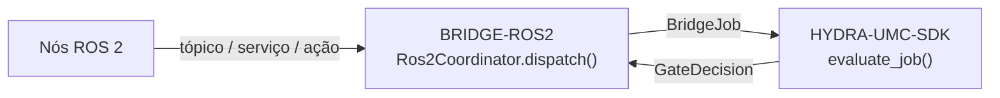

<!-- =============================================================================
HYDRA-UMC-BRIDGE-ROS2 - ROS 2 coordination bridge
Copyright (C) JuanenRac (Electro Hobby 3D) <electrohobby3d@gmail.com>
GPL-3.0-or-later - see LICENSE
============================================================================= -->

<p align="center">
  
</p>

# 🐢 HYDRA-UMC-BRIDGE-ROS2

<p align="center"><a href="README.md">🇺🇸 English</a> | <a href="README_spa.md">🇪🇸 Español</a> | <a href="README_fra.md">🇫🇷 Français</a> | <a href="README_ita.md">🇮🇹 Italiano</a> | <a href="README_deu.md">🇩🇪 Deutsch</a> | <a href="README_zho.md">🇨🇳 简体中文</a> | <a href="README_jpn.md">🇯🇵 日本語</a> | 🇵🇹 <b>Português</b></p>

### 🔗 Fronteira de coordenação sem dependências entre o HYDRA-UMC e o ROS 2

<p align="center">
  
  
  
  
  
  
</p>

---

> **Verificação de honestidade - o que realmente corre hoje:** o núcleo de coordenação sem dependências (o `Ros2Coordinator` de `coordinator.py`, que encaminha cada despacho pelo `evaluate_job()` do próprio `HYDRA-UMC-SDK`), o transporte `rclpy` real (importado sob demanda) para `std_srvs/Trigger` e `std_msgs/String` (o `Ros2SafeStopClient`/`Ros2StateSubscriber` de `rclpy_transport.py`) e o transporte MQTT de comandos/estado (`mqtt_transport.py`) são reais e estão cobertos por 112 testes unitários que passam (`python tools/build_test.py` - `test_coordinator.py`, `test_rclpy_transport.py`, `test_mqtt_transport.py`, `test_intake.py`, `test_mqtt_environment.py`, `test_hardening.py`). Nada disto foi exercitado contra uma instalação real do ROS 2, uma rede DDS real ou um broker MQTT real: `test_rclpy_transport.py` corre contra um nó/publicador falso e `test_mqtt_transport.py` contra um cliente de broker falso, pelo que nem sequer é preciso ter `rclpy`/`std_srvs`/`std_msgs` instalados para estes testes passarem. Os contratos `.srv`/`.action` personalizados `inspect_service`/`job_action` ainda não têm nenhum tipo de mensagem ROS 2 padrão real nem nenhum cliente. Ver «Roteiro e limites conhecidos» abaixo, que já o diz com clareza, e `CHANGELOG.md` para saber exatamente o que foi entregue até agora. O transporte MQTT também foi executado contra um HYDRA-UMC-MQTT-BROKER real numa máquina de desenvolvimento (`tests/test_broker_integration.py`, ignorado se não houver nenhum broker instalado): publicação e subscrição com QoS 0, 1 e 2, a disponibilidade retida e o seu último testamento, e o regresso depois de o broker ter parado e arrancado de novo.

> **Estado de segurança (safety e security):** este ecossistema não é um sistema de segurança certificado. Ainda não existe um caminho de E-STOP por hardware, nem limites ou interlocks impostos pelo firmware, nem um comando de movimento verificado; as imagens de firmware são verificadas com CRC-32 e uma assinatura Ed25519, e uma compilação de versão recusa as chaves de desenvolvimento publicadas (as cabeças de ferramenta e as placas de expansão atrás do relé ainda usam os bootloaders do URTC, que aceitam um HMAC-SHA256 de chave partilhada em vez de uma assinatura); TLS e TLS mútuo são opcionais e estão desativados por defeito; nenhuma placa própria foi ainda montada ou testada. Leia a [base de segurança](https://github.com/JuanenRac/HYDRA-UMC-DOCS/blob/main/docs/SECURITY_BASELINE.md) e o [modelo de ameaças](https://github.com/JuanenRac/HYDRA-UMC-DOCS/blob/main/docs/THREAT_MODEL.md) antes de confiar em qualquer afirmação aqui para a segurança de uma pessoa.

---

## 📋 Num relance

| | |
|---|---|
| Versão | `0.1.5` |
| Maturidade | Funcional |
| Testes | 112 (`python tools/build_test.py`) |
| Tecnologia | Python / ROS 2 / rclpy / HYDRA-UMC-SDK |
| Destino | O Raspberry Pi CM5 de uma célula HYDRA-UMC |
| Em hardware real | Só simulado: testado com emuladores, dublês de teste ou simuladores; não há registo de execução em hardware real para esta versão |

**Ir para:** [Visão geral](#-visão-geral) · [Arquitetura](#-arquitetura) · [Funcionalidades](#-funcionalidades) · [Segurança e proteção](#-segurança-e-proteção) · [Interfaces](#-interfaces) · [Configuração](#-configuração) · [Início rápido](#-início-rápido) · [Testes](#-testes) · [Resolução de problemas](#-resolução-de-problemas) · [Estrutura do repositório](#-estrutura-do-repositório) · [Projetos relacionados](#-projetos-relacionados)

## 🚦 Estado do projeto

Cada linha é uma parte deste repositório e a luz diz até onde chega hoje. É escrita com o que o repositório consegue demonstrar (testes, compilações, execuções), não com o que está previsto.

🟢 Feito e verificado · 🟡 Funciona, com limites conhecidos · 🟠 Feito a meio ou ainda por verificar · 🔴 Por fazer ou a não funcionar

| Área | Estado | O que significa aqui |
|---|---|---|
| Software | 🟡 | Funciona para o seu propósito principal; a verificação de honestidade acima lista o que ainda falta |
| Testes | 🟢 | 112 testes automáticos, executados a cada alteração |
| Hardware real | 🟠 | Só simulado: testado com emuladores, dublês de teste ou simuladores; não há registo de execução em hardware real para esta versão |
| Documentação | 🟢 | README em oito idiomas, verificado contra o manifesto a cada alteração |

## 🎯 Visão geral

O **HYDRA-UMC-BRIDGE-ROS2** é a fronteira de coordenação bidirecional e de alto nível entre o HYDRA-UMC e o ROS 2. Associa a observação contínua a um tópico, a inspeção imediata a um serviço e o trabalho de célula de longa duração a uma ação cancelável. Não é um nó de controlo de motores e não pode contornar o HYDRA-UMC-SERVER, os limites do MCU, os watchdogs nem a paragem de emergência (E-STOP). Hoje só o tópico de estado e o serviço de paragem segura estão ligados; o serviço de inspeção e a ação de trabalho são nomes reservados sem tipo de mensagem por trás. O nó tem de girar para o tópico de estado ser entregue: o `run_forever()` fá-lo numa thread própria.

Pertence à família de **Bridges de automação externa**: um conjunto de repositórios irmãos (CNC, LASER, OPENPNP, PRINTER3D, ROS2) que falam todos o mesmo contrato de segurança partilhado do `HYDRA-UMC-SDK`, de modo que nenhum bridge possa inventar a sua própria definição de «seguro para trabalhar».

## 🧩 Papel no HYDRA-UMC

O **HYDRA-UMC-BRIDGE-ROS2** fica entre um grafo ROS 2 e a célula de robôs. Relata o que esse lado diz, consulta a porta partilhada antes de qualquer trabalho auxiliar e nunca assume a autoridade da máquina com que coordena.

Todos os bridges falam o contrato de segurança partilhado do `HYDRA-UMC-SDK`: um trabalho só é aceite quando a porta partilhada `evaluate_job()` o permite, e essa porta falha fechada. O projeto pai é o `HYDRA-UMC-SERVER`; este bridge não o chama, responde por MQTT, através do `HYDRA-UMC-MQTT-BROKER`, a quem comanda a célula.

## 🏛️ Arquitetura

<p align="center">
  
</p>

<details>
<summary>Versão em texto do diagrama (Mermaid)</summary>



</details>

**Porque é construído assim**

* **Porque `coordinator.py` não tem nenhuma dependência de `rclpy`.** A sua própria docstring de módulo di-lo de propósito: «pode ser testado em qualquer máquina e só se torna um nó ROS 2 através de um adaptador implantado em separado». Isto mantém a lógica de coordenação relevante para a segurança testável no CI sem instalação do ROS 2 e deixa que o adaptador se escolha e valide de forma independente, mais tarde.
* **Porque três tipos de interface distintos em vez de um canal genérico.** `state_topic`, `inspect_service` e `job_action` correspondem de propósito à semântica própria do ROS 2: a publicação contínua de estado não precisa de pedido/resposta (tópico), uma inspeção rápida precisa de uma resposta síncrona (serviço) e o trabalho de célula tem de poder cancelar-se a meio (ação); juntá-los num só canal perderia essa distinção.
* **Porque `Ros2Coordinator.dispatch()` continua a encaminhar cada trabalho pela porta partilhada `evaluate_job()`.** O ROS 2 é apenas mais um cliente do mesmo `bridge_contract` que usam o CNC, o LASER, o OPENPNP e o PRINTER3D: não tem nenhum atalho para contornar a lógica IDLE/READY que impõem todos os outros bridges e o HYDRA-UMC-SERVER.
* **Porque `ABORT` continua a poder pedir-se durante uma falha.** O requisito de fase produtiva da porta (`IDLE` + `READY`) não se aplica de propósito da mesma forma a um pedido de abortar: um operador ou um nó ROS 2 tem de poder sempre pedir uma paragem controlada, mesmo a meio de uma falha.
* **Porque o adaptador `rclpy` e os contratos ROS `.msg`/`.srv`/`.action` ainda não estão neste repositório.** Comprometer-se com definições concretas de mensagem/serviço/ação antes de se escolher e testar um ambiente ROS 2 real arriscaria fixar pressupostos que este núcleo local e sem dependências não consegue verificar.
* **Como se encaixa no resto do ecossistema.** O BRIDGE-ROS2 fica entre os nós ROS 2 e o `HYDRA-UMC-SDK` → `HYDRA-UMC-SERVER` → segurança do MCU: é uma fronteira de coordenação, nunca um nó de controlo de motores, e não pode contornar o HYDRA-UMC-SERVER, os limites do MCU, os watchdogs nem a paragem de emergência (E-STOP).

## ✨ Funcionalidades

* ✅ **Núcleo de coordenação real e sem dependências:** o `Ros2Coordinator` de `coordinator.py` não tem nenhum import de `rclpy`: é Python simples de propósito, testável em qualquer máquina sem instalação do ROS 2. *(implementado, testado em `tests/test_coordinator.py`)*
* ✅ **Mapeamento real de interfaces em quatro vias:** quatro atributos de classe fixos reservam o tipo exato de interface do ROS 2 para cada fim: `/hydra_umc/machine_state` (tópico, estado contínuo), `/hydra_umc/inspect_cell` (serviço, inspeção curta), `/hydra_umc/execute_cell_job` (ação, trabalho cancelável), `/hydra_umc/request_safe_stop` (serviço, paragem controlada). *(implementado)*
* ✅ **Porta de segurança partilhada real:** cada trabalho despachado por `Ros2Coordinator.dispatch()` é avaliado pelo `evaluate_job()` do `bridge_contract` do `HYDRA-UMC-SDK`, a mesma porta que usam todos os bridges irmãos e o HYDRA-UMC-SERVER; uma fase produtiva exige uma máquina externa `IDLE` e uma célula do HYDRA-UMC `READY`, enquanto `ABORT` continua a poder pedir-se durante uma falha. *(implementado)*
* ✅ **Encaminhamento de fases com falha segura e evidência estática:** as fases produtivas correspondem apenas à ação de trabalho prevista, `ABORT` corresponde a `/hydra_umc/request_safe_stop` e uma fase futura desconhecida do SDK é negada. `inspect_interface_plan.py` emite o plano estático do esquema `1.1`, incluindo a QoS real de durabilidade `transient_local` de que o tópico de estado precisa (a substituição própria do ROS 2 para o publicador «latched» do ROS 1, investigada em design.ros2.org/articles/qos.html), sem importar `rclpy` nem contactar o DDS. *(implementado, testado)*
* ✅ **Transporte `rclpy` real e parcial:** `rclpy_transport.py` liga as 2 interfaces que hoje têm um tipo de mensagem ROS 2 padrão real: `Ros2SafeStopClient` (um cliente `std_srvs/Trigger` real) e `Ros2StateSubscriber` (um subscritor `std_msgs/String` real, que usa a QoS real de durabilidade `transient_local`). *(implementado, testado em `tests/test_rclpy_transport.py`)*
* ✅ **Compilação/teste que não altera nada:** `build-test.bat`/`.sh` compilam o código-fonte e executam testes unitários deterministas sem alterar a versão nem o CHANGELOG. *(implementado, ver Compilação e publicação abaixo)*
* 🔜 **Contratos `.srv`/`.action` personalizados para `inspect_service`/`job_action`:** não têm nenhum tipo de mensagem ROS 2 padrão real, pelo que um cliente para eles exige que este repositório defina primeiro o seu próprio pacote de interfaces. *(planeado)*
* ✅ **Estado observado da máquina, mensagens retidas e chaves repetidas:** quando o bridge segue o tópico de estado do ROS 2, a porta partilhada usa o estado que a máquina comunicou em vez do `machine_state` escrito no trabalho (uma mensagem que qualquer pessoa no broker pode publicar), e uma máquina da qual nunca se ouviu nada conta como OFFLINE; `handle_message()` ignora as mensagens retidas (o broker reenvia-as em cada religação) e, se receber um `IdempotencyStore`, responde a uma `idempotency_key` repetida com a primeira resposta. *(implementado, testado em `tests/test_intake.py`)*
* ✅ **Um ciclo de mensagens que sobrevive à sua entrada, um nó que de facto gira e um estado que pode caducar:** o `handle_message()` nunca lança uma exceção (um JSON enorme ou muito aninhado e qualquer falha inesperada voltam como recusa); o `cmd/job` responde com `allowed` como os restantes bridges (e `accepted` como antes); um trabalho `ABORT` diz claramente que é apenas plano e que a paragem real é `cmd/safe_stop`. O `run_forever()` faz o nó girar numa thread própria (`spin_node_in_background()`, para que o tópico de estado seja mesmo entregue), reutiliza um único cliente de serviço, executa `cmd/safe_stop` numa via que nunca espera atrás de outro comando, deixa um Last Will em `availability`, republica o estado com o seu `machine_state` normalizado e uma hora `observed_at`, e recusa-se a arrancar se não conseguir subscrever o tópico de estado do ROS 2; o `observed_max_age_seconds` faz com que um estado que deixa de ser republicado conte como OFFLINE (desligado por omissão). *(implementado, testado com dobles; nunca executado contra um grafo ROS 2 real, pelo que o comportamento do executor e da QoS não está verificado)*
* ✅ **Segue a paragem global (desativado por defeito):** com `HYDRA_UMC_ROS2_GLOBAL_STOP=1` o bridge lê o anúncio retido do servidor em `hydra/swarm/safety/estop`; enquanto disser `SAFE_STOP`, ou não puder ser lido, recusa com um motivo: um trabalho (um aborto passa). As paragens e os pedidos só de leitura continuam a funcionar e só `READY` termina a recusa. *(implementado, testado contra um broker real; nunca executado com um servidor real)*

## 🔒 Segurança e proteção

| Ameaça | Defesa | Onde |
|---|---|---|
| Um trabalho para uma célula ou máquina que não está em estado seguro | Todo o trabalho passa pela porta partilhada `evaluate_job()` do SDK, que falha fechada; o bridge não tem lógica própria de aceitar ou recusar | SDK `bridge_contract` |
| Dados de trabalho desmesurados | No máximo 32 parâmetros, chaves até 64 carateres, valores até 1024, identificadores até 128 (`MAX_PARAMETERS`, `MAX_PARAMETER_KEY_CHARS`, `MAX_PARAMETER_VALUE_CHARS`, `MAX_IDENTIFIER_CHARS`) | SDK `bridge_contract` |
| Uma ordem repetida ou reenviada | Um `IdempotencyStore` lembra cada chave durante 24 horas e no máximo 10 000 entradas; uma repetição recebe a primeira resposta em vez de ser avaliada de novo | SDK `job_intake` |
| Uma carga MQTT enorme ou hostil | Uma carga acima de 16 KiB, um JSON ilegível ou muito aninhado e qualquer falha inesperada recebem uma recusa no tópico de resultado e nunca terminam o ciclo | `mqtt_transport.py` |
| Uma interface ROS 2 fora do espaço permitido | Os nomes de interface têm de começar por `/hydra_umc/` e o bridge conhece tipos de interface, nunca movimento bruto | `coordinator.py` |
| Uma paragem que espera atrás de outro trabalho | `cmd/safe_stop` corre numa via própria (`STOP_VERBS`); as duas interfaces rclpy padrão usam a durabilidade `transient_local`, por isso um subscritor tardio recebe na mesma o último estado | `mqtt_transport.py`, `rclpy_transport.py` |
| Um estado de máquina aceite sem verificação | Antes de `start_observing()` nada foi lido e a porta recusa o trabalho; já em observação, um estado nunca ouvido ou que não é um `MachineState` conhecido conta como `OFFLINE` | `mqtt_transport.py` |

**O que nunca faz:** não converte nenhum trabalho em movimento bruto e só fala com o ROS 2 através de duas interfaces com tipos padrão.

## 🔌 Interfaces

Tópicos sob `hydra/bridges/ros2/`; cada comando é respondido em `<verbo>/result`.

| Tópico ou rota | O que leva |
|---|---|
| `cmd/job` | um `BridgeJob`; a resposta é a decisão de envio para a interface ROS 2 |
| `cmd/safe_stop` | chama o serviço de paragem segura através do `Ros2SafeStopClient` |
| `state`, `availability` | o estado da máquina lido do tópico de estado ROS 2 (`std_msgs/msg/String`) e `online`/`offline` |

Para verificar o plano de interfaces sem ROS 2: `python tools/inspect_interface_plan.py --verify-fixture`.

## ⚙️ Configuração

| Variável | Predefinição | O que define |
|---|---|---|
| `HYDRA_UMC_ROS2_GLOBAL_STOP` | desativado | `1` segue a paragem global do servidor: enquanto o último anúncio no tópico retido `hydra/swarm/safety/estop` disser `SAFE_STOP` (ou não puder ser lido), o bridge recusa com um motivo: um trabalho (um aborto passa); só `READY` lhe põe fim. `HYDRA_UMC_ROS2_GLOBAL_STOP_TOPIC` muda o tópico e `HYDRA_UMC_ROS2_GLOBAL_STOP_STRICT=1` recusa também até chegar o primeiro anúncio |
| `HYDRA_MQTT_USERNAME` | nenhum | O nome de utilizador MQTT; o broker liga-o a um prefixo de ID de cliente |
| `HYDRA_MQTT_PASSWORD` | nenhum | A palavra-passe; só vale em conjunto com o nome de utilizador |
| `HYDRA_MQTT_PASSWORD_FILE` | nenhum | A palavra-passe lida de um ficheiro (segredo do Docker ou do systemd); ignorada se `HYDRA_MQTT_PASSWORD` estiver definida |
| `HYDRA_MQTT_TLS_CA` | nenhum | O ficheiro da CA que assinou o certificado do broker: a ligação é TLS e o certificado é verificado |
| `HYDRA_MQTT_TLS` | desativado | `1` ativa o TLS, verificado com as CA de confiança do sistema |
| `HYDRA_MQTT_TLS_CERT` / `HYDRA_MQTT_TLS_KEY` | nenhum | O certificado de cliente e a sua chave para um broker que exige TLS mútuo; são precisos os dois |

O nome do nó ROS 2 é o argumento de `create_ros2_node()`; o anfitrião, a porta e o ID de cliente MQTT (`hydra-umc-bridge-ros2`) são argumentos de `run_forever()`.

## 🚀 Início rápido

Requer Python 3.11 ou superior. Os testes e os scripts de compilação esperam o `HYDRA-UMC-SDK` clonado ao lado deste repositório (`../HYDRA-UMC-SDK`) ou indicado com `HYDRA_UMC_SDK_ROOT`.

Experimente sem hardware (isto verifica todo o bridge com os seus emuladores e dublês de teste):

```bash
py -3 tools/build_test.py          # Windows
python3 tools/build_test.py         # Linux, macOS
```

Arrancar o serviço (não há um script de consola: o serviço é o `run_forever()` do transporte MQTT, que chama a partir do seu próprio código de arranque):

```python
from hydra_umc_bridge_ros2.rclpy_transport import create_ros2_node, spin_node_in_background
from hydra_umc_bridge_ros2.mqtt_transport import Ros2MqttBridge, run_forever
node = create_ros2_node("hydra_umc_bridge")          # needs rclpy from a ROS 2 installation
spin_node_in_background(node)
bridge = Ros2MqttBridge(node, cell_state=lambda: cell_state, node_is_spinning=True)
run_forever(bridge, host="192.168.0.180")
```

O nome de utilizador, a palavra-passe e os ficheiros TLS vêm das variáveis `HYDRA_MQTT_*` (ver Configuração); o código acima não precisa de credenciais próprias.

## 🧪 Testes

112 casos `unittest` automáticos correm com `python tools/build_test.py` (que também compila cada módulo). Os testes não precisam de hardware, rede nem pacotes opcionais: os que precisariam de `paho-mqtt`, `pyserial` ou de uma biblioteca do fabricante usam um substituto ou são saltados se o pacote faltar.

| Ficheiro de testes | Testes | O que cobre |
|---|---|---|
| `test_global_stop.py`, `test_global_stop_broker.py` | - | a guarda da paragem global e as suas recusas com o motivo, e o mesmo contra um broker real numa porta local livre (o anúncio em QoS 0, 1 e 2, uma paragem retida obedecida ao ligar, uma ilegível que falha fechada) |
| `test_broker_integration.py`, `broker_harness.py` | - | o cliente MQTT contra um HYDRA-UMC-MQTT-BROKER real numa porta local livre: uma ordem através do cliente, o estado retido e a última vontade, e o regresso depois de o broker cair e voltar; é ignorado quando faltam o Node.js, o `paho-mqtt` ou o broker instalado (`HYDRA_UMC_TEST_BROKER_DIR`, por omissão a pasta ao lado) |
| `test_coordinator.py`, `test_intake.py` | - | mapeamento de trabalho para interface e a admissão de trabalhos |
| `test_rclpy_transport.py` | - | as duas interfaces rclpy contra um dublê do rclpy |
| `test_mqtt_transport.py`, `test_mqtt_environment.py`, `test_hardening.py`, `test_edge_cases.py` | - | distribuição de tópicos, credenciais do ambiente, clientes hostis, casos limite |

A CI executa `HYDRA_UMC_CI=1 python tools/ci_validate.py`, que verifica o manifesto, os documentos, os oito README e as imagens, e corre os testes com uma cópia do SDK.

## 🏗️ Compilação e publicação

Requer Python 3.11+. `tools/build_test.py` espera o `HYDRA-UMC-SDK` extraído como diretoria irmã (`../HYDRA-UMC-SDK`) ou indicado pela variável de ambiente `HYDRA_UMC_SDK_ROOT`.

```bash
# Windows
build-test.bat      # só valida - sem alteração de versão/CHANGELOG
build.bat            # Valida e compila (compilar nunca altera a versão)

# Linux/macOS
bash build-test.sh
bash build.sh
```

`build-test` compila com `py_compile` cada módulo em `src/` e executa a suíte `unittest` completa (todos os ficheiros `test_*.py` de `tests/`) de forma determinista, sem instalação do ROS 2, sem rede e sem alteração de versão/CHANGELOG. `build` executa primeiro essa mesma validação e, só se correr bem, chama `tools/bump_version.py` para sincronizar a versão em `pyproject.toml`, `hydra-umc.project.json` e `CHANGELOG.md`. Ainda não há comando `run` de hardware vivo: exige uma implantação validada do ROS 2.

## 🩺 Resolução de problemas

| Vê | Porque | Faça |
|---|---|---|
| `ModuleNotFoundError: hydra_umc_sdk` | O SDK não está instalado nem ao lado deste repositório | Clone o `HYDRA-UMC-SDK` ao lado deste repositório ou defina `HYDRA_UMC_SDK_ROOT` |
| `paho-mqtt is not installed` | O cliente MQTT é um extra opcional | `pip install ".[mqtt]"` (precisa de `paho-mqtt` 2.1 ou superior, inferior a 3) |
| `password was given without a username` | As credenciais MQTT precisam das duas partes | Defina também `HYDRA_MQTT_USERNAME`, não só a palavra-passe |
| `could not reach the MQTT broker after N attempts` | O broker está em baixo, o endereço está errado ou a porta está fechada | Arranque o `HYDRA-UMC-MQTT-BROKER` e verifique o anfitrião e a porta dados ao transporte (5 tentativas com 2 segundos de intervalo); uma falha do handshake TLS não é repetida |
| `the MQTT broker refused the connection` | O broker recusou a credencial (ou não respondeu a tempo) | Verifique `HYDRA_MQTT_USERNAME` e a palavra-passe; o ID de cliente tem de começar pelo prefixo que o broker ligou à credencial |
| `"allowed": false` + `reason` | A porta partilhada ou uma guarda recusou a ordem | Leia `reason` e corrija a causa; não repita às cegas |
| `rclpy` cannot be imported | o rclpy vem com uma instalação do ROS 2, não do PyPI | Carregue o ambiente ROS 2 antes de arrancar o serviço; os testes não precisam dele |

## 📂 Estrutura do repositório

<p align="center">
  
</p>

<details>
<summary>Versão em texto da árvore</summary>

```text
HYDRA-UMC-BRIDGE-ROS2/
├── src/hydra_umc_bridge_ros2/
│   ├── coordinator.py             trabalho para uma interface ROS 2 com nome, nunca movimento bruto
│   ├── rclpy_transport.py         as duas interfaces rclpy com tipos padrão
│   └── mqtt_transport.py          transporte MQTT de comandos, estado e paragem segura
├── tests/                         81 testes, com o rclpy substituído por um dublê
├── docs/                          guia do bridge
├── tools/                         executor de compilação e testes, subida de versão, validador de CI, geradores e verificações de README e imagens
├── images/                        faixa e imagens do README
├── .github/                       fluxo de CI e modelos de questões
├── pyproject.toml                 metadados do pacote e dependências
├── hydra-umc.project.json         manifesto: versão, maturidade, família
├── CHANGELOG.md                   o que mudou em cada versão
├── build.sh build.bat             scripts de compilação (nunca mudam a versão)
├── build-test.sh build-test.bat   scripts de compilação (nunca mudam a versão)
├── test.sh test.bat               executam os testes
└── SECURITY.md SUPPORT.md CONTRIBUTING.md CODE_OF_CONDUCT.md LICENSE LICENSE.md
```

</details>

## 🗺️ Roteiro e limites conhecidos

**Limites conhecidos hoje**

**Real hoje:** versão `0.1.5`, funcional como núcleo de coordenação sem dependências (`Ros2Coordinator`) com uma suíte `unittest` determinista de sessenta e quatro testes que cobre o núcleo de coordenação, o transporte MQTT e o transporte rclpy, o encaminhamento de fases com falha segura, um esquema estático de interface `plan-only` que declara a QoS real de durabilidade `transient_local` de que o tópico de estado precisa, um transporte rclpy real (importado sob demanda) para as 2 interfaces com um tipo de mensagem ROS 2 padrão real e scripts build-test que não alteram nada ligados ao CI com um checkout do SDK.

**Fronteira de integração:** este bridge é apenas uma fronteira de coordenação: não é um nó de controlo de motores e não pode contornar o HYDRA-UMC-SERVER, os limites do MCU, os watchdogs nem a paragem de emergência (E-STOP); cada trabalho despachado continua a passar pela mesma porta partilhada que usam todos os bridges irmãos.

**Ainda por fazer:** ainda não se validou nenhuma rede ROS, robô ou atuador físico: o adaptador `rclpy` e os contratos ROS `.msg`/`.srv`/`.action` concretos só se introduzirão depois de se escolher e testar um ambiente ROS 2 real.

## 🌍 Idiomas

Este README e os documentos do repositório existem em oito idiomas: inglês, espanhol, alemão, francês, italiano, japonês, chinês e português (Portugal). São escritos em conjunto e a CI verifica que os oito ficheiros têm as mesmas secções e as mesmas ligações. Este repositório não tem ecrã nem catálogo de mensagens próprios, por isso não há textos de interface para traduzir.

## 🔗 Projetos relacionados

Este projeto faz parte do ecossistema de robótica HYDRA-UMC do mesmo autor (JuanenRac / Electro Hobby 3D). Vale a pena conhecê-los, porque um pedido pode ser, na verdade, sobre um destes e não sobre este repositório.

**Projeto-mãe**
- **[HYDRA-UMC-SERVER](https://github.com/JuanenRac/HYDRA-UMC-SERVER)** — o verdadeiro backend sem interface (REST/WebSocket) com que falam todos os clientes de controlo; a fronteira autenticada do ecossistema a que este bridge reporta depois de cada comando ter passado pela porta de segurança local do próprio bridge.

**Projetos irmãos** — também falam com a API do próprio HYDRA-UMC-SERVER, cada um como cliente próprio
- **[HYDRA-UMC-STUDIO](https://github.com/JuanenRac/HYDRA-UMC-STUDIO)** — painel web de controlo com visualização 3D em tempo real de vários robôs.
- **[HYDRA-UMC-SUITE](https://github.com/JuanenRac/HYDRA-UMC-SUITE)** — centro de comando de enxame para desktop (PySide6) para vários servidores ao mesmo tempo, empacotado como executável independente.
- **[HYDRA-UMC-ANDROID-CONTROL](https://github.com/JuanenRac/HYDRA-UMC-ANDROID-CONTROL)** — aplicação Android nativa de controlo, com início de sessão biométrico e um companheiro Wear OS emparelhado.
- **[HYDRA-UMC-IOS-CONTROL](https://github.com/JuanenRac/HYDRA-UMC-IOS-CONTROL)** — aplicação de controlo para iOS/iPadOS (Flutter) com sincronização WebSocket em tempo real.
- **[HYDRA-UMC-DSI](https://github.com/JuanenRac/HYDRA-UMC-DSI)** — interface tátil nativa para o ecrã tátil DSI de 7" integrado, executada no próprio CM5.
- **[HYDRA-UMC-BRIDGE-AMR](https://github.com/JuanenRac/HYDRA-UMC-BRIDGE-AMR)** — fronteira de coordenação para frotas AGV/AMR através de um publicador MQTT VDA 5050 (testado apenas contra uma frota emulada).
- **[HYDRA-UMC-BRIDGE-CNC](https://github.com/JuanenRac/HYDRA-UMC-BRIDGE-CNC)** — coordenador de células CNC de alto nível com acesso ao estado GRBL e aos bytes de controlo (testado apenas contra um emulador).
- **[HYDRA-UMC-BRIDGE-DROIDS](https://github.com/JuanenRac/HYDRA-UMC-BRIDGE-DROIDS)** — fronteira de coordenação para droides com patas/humanoides, com um emissor de comandos para o Boston Dynamics Spot (testado apenas contra um emulador).
- **[HYDRA-UMC-BRIDGE-LASER](https://github.com/JuanenRac/HYDRA-UMC-BRIDGE-LASER)** — coordenador de células laser que lê 3 sinais GPIO (chave, caixa e interlock) (testado apenas contra um chip simulado; não pode armar nem disparar um laser).
- **[HYDRA-UMC-BRIDGE-OPENPNP](https://github.com/JuanenRac/HYDRA-UMC-BRIDGE-OPENPNP)** — coordenador seguro de fluxo de placa de alto nível para pick-and-place com OpenPnP.
- **[HYDRA-UMC-BRIDGE-PRINTER3D](https://github.com/JuanenRac/HYDRA-UMC-BRIDGE-PRINTER3D)** — fronteira de coordenação segura para impressoras 3D Moonraker/Klipper, com comandos de trabalho reais protegidos por portas.
- **[HYDRA-UMC-BRIDGE-UAV](https://github.com/JuanenRac/HYDRA-UMC-BRIDGE-UAV)** — fronteira de coordenação para UAV com câmara, com um emissor de comandos MAVLink (testado apenas contra um emulador).

**Diretamente relacionados**
- **[HYDRA-UMC-SDK](https://github.com/JuanenRac/HYDRA-UMC-SDK)** — o contrato JSON-Schema partilhado e a fronteira de software de controlo de trabalhos contra a qual cada bridge valida os seus comandos (não é uma função de segurança certificada).
- **[HYDRA-UMC-CONNECTOR-HUB](https://github.com/JuanenRac/HYDRA-UMC-CONNECTOR-HUB)** — registo declarativo de manifestos de adaptador e validador para conectores de máquinas externas; estende a ideia de contrato do SDK a máquinas externas sem substituir os projetos de gateway industrial.
- **[HYDRA-UMC-MQTT-BROKER](https://github.com/JuanenRac/HYDRA-UMC-MQTT-BROKER)** — o transporte real de `mqtt_transport.py` para os tópicos `hydra/bridges/ros2/...` deste bridge: a porta de trabalhos só de plano, uma chamada de paragem segura `std_srvs/Trigger` (ainda não executada contra uma instalação ROS 2) e o tópico de estado do ROS 2 republicado como o adaptador `rclpy_transport.py` implantado em separado que sempre se previu; ver o `docs/BRIDGE_TOPICS.md` desse repositório.
- **[HYDRA-UMC-HIL-BRIDGE](https://github.com/JuanenRac/HYDRA-UMC-HIL-BRIDGE)** — encaminhador hardware-in-the-loop com um interlock de software de colisão entre a simulação e o hardware real (testado sem hardware real).

**Também fazem parte do ecossistema**

*Hardware e plataforma centrais*
- **[HYDRA-UMC](https://github.com/JuanenRac/HYDRA-UMC)** — o desenho da placa-mãe do braço robótico: anfitrião CM5 + STM32H745 de dois núcleos, pensado para orquestrar até 8 braços de ferramenta por CAN-OTA/SPI-OTA (firmware numa fase inicial; ainda sem placa montada).
- **[HYDRA-UMC-OS](https://github.com/JuanenRac/HYDRA-UMC-OS)** — camada de produto reproduzível do Raspberry Pi OS para o CM5: agente só de leitura, configuração/perfis validados, aprovisionamento Wi-Fi de primeiro contacto.

*Backend central e clientes*
- **[HYDRA-UMC-EDITOR-URDF](https://github.com/JuanenRac/HYDRA-UMC-EDITOR-URDF)** — criador/editor gráfico de URDF para desktop que envia os modelos concluídos para o catálogo do STUDIO.
- **[HYDRA-UMC-EDITOR-STL](https://github.com/JuanenRac/HYDRA-UMC-EDITOR-STL)** — editor de modelos STL para desktop que transforma/substitui/remove/adiciona peças reais no mesmo catálogo de modelos que o HYDRA-UMC-EDITOR-URDF também edita.

*Plataforma de ferramentas URTC*
- **[URTC](https://github.com/JuanenRac/URTC)** — firmware da placa física Universal Robot Tool Controller, mais de 25 perfis de ferramenta por barramento CAN.
- **[URTC-FLASHER](https://github.com/JuanenRac/URTC-FLASHER)** — ferramenta gráfica de gravação para desktop das placas URTC, por CAN-OTA e também SWD/JTAG de chip completo.
- **[URTC-TESTER](https://github.com/JuanenRac/URTC-TESTER)** — ferramenta de diagnóstico CAN em tempo real para desktop das placas URTC, com um painel por perfil de ferramenta.
- **[URTC-WEB-STUDIO](https://github.com/JuanenRac/URTC-WEB-STUDIO)** — alternativa no navegador ao URTC-TESTER através da Web Serial API, sem instalação local.
- **[URTC-GATEWAY](https://github.com/JuanenRac/URTC-GATEWAY)** — gateway à frente do barramento CAN do URTC: lista de identificadores permitidos, limite de taxa e chave de sessão; software testado num computador, ainda não num barramento real.

*Nó de IA de visão (Hailo-8)*
- **[HYDRA-UMC-VISION-NODE](https://github.com/JuanenRac/HYDRA-UMC-VISION-NODE)** — centro de integração do pipeline de visão Hailo-8, com uma verificação real de prontidão de hardware por fase.
- **[HYDRA-UMC-DETECTION-HEF](https://github.com/JuanenRac/HYDRA-UMC-DETECTION-HEF)** — registo real de modelos compilados com verificação segura de carga por arquitetura Hailo e soma de verificação.
- **[HYDRA-UMC-VISION-STREAMER](https://github.com/JuanenRac/HYDRA-UMC-VISION-STREAMER)** — pipeline GStreamer real e gerador de configuração MediaMTX com uma fronteira de integração HailoRT real.
- **[HYDRA-UMC-VISUAL-SERVOING-API](https://github.com/JuanenRac/HYDRA-UMC-VISUAL-SERVOING-API)** — lei de correção de servovisão baseada em posição com autorização condicionada ao estado da zona; ainda sem estimativa de pose por câmara.
- **[HYDRA-UMC-SAFETY-ZONES](https://github.com/JuanenRac/HYDRA-UMC-SAFETY-ZONES)** — lógica v0 de violação de zonas, atualidade da calibração e pedido de E-STOP que lê as posições dos objetos de um ficheiro; nenhum detetor a alimenta e ainda não há E-STOP físico ligado.

*Nó de IA cognitiva (Hailo-10)*
- **[HYDRA-UMC-COGNITIVE-NODE](https://github.com/JuanenRac/HYDRA-UMC-COGNITIVE-NODE)** — centro de integração do pipeline cognitivo do Hailo-10 (orquestração de LLM/VLA/voz).
- **[HYDRA-UMC-VLA-ENGINE](https://github.com/JuanenRac/HYDRA-UMC-VLA-ENGINE)** — codificação/descodificação real de tokens de ação e geração de trajetórias para um modelo Visão-Linguagem-Ação.
- **[HYDRA-UMC-VOICE-UI](https://github.com/JuanenRac/HYDRA-UMC-VOICE-UI)** — front-end de voz real (VAD + analisador de intenções) com um relé para o relógio limitado e protegido por confirmação.
- **[HYDRA-UMC-SEMANTIC-PLANNER](https://github.com/JuanenRac/HYDRA-UMC-SEMANTIC-PLANNER)** — decomposição real de tarefas baseada em regras e recuperação semântica de erros sobre os códigos de erro do MCU.
- **[HYDRA-UMC-DOCS-QA](https://github.com/JuanenRac/HYDRA-UMC-DOCS-QA)** — pesquisa real de documentos TF-IDF só com a biblioteca padrão sobre a documentação Markdown deste ecossistema.
- **[HYDRA-UMC-LOCAL-TECHNICIAN](https://github.com/JuanenRac/HYDRA-UMC-LOCAL-TECHNICIAN)** — técnico de manutenção de IA local, protegido por políticas, para o próprio ecossistema: observa, diagnostica e propõe correções; os dois níveis de maior risco não estão implementados de propósito.

*Orquestração e enxame*
- **[HYDRA-UMC-ORCHESTRATOR](https://github.com/JuanenRac/HYDRA-UMC-ORCHESTRATOR)** — centro de integração com um contrato real de relatório de saúde gRPC/Protobuf e uma máquina de estados de missões.
- **[HYDRA-UMC-JOB-DISPATCHER](https://github.com/JuanenRac/HYDRA-UMC-JOB-DISPATCHER)** — fila real de trabalhos por prioridade com deduplicação, sobre uma API HTTP real.
- **[HYDRA-UMC-NODE-HEALING](https://github.com/JuanenRac/HYDRA-UMC-NODE-HEALING)** — vigilante real de saúde da frota por gRPC com repetição/recuo e deteção de identidade incoerente.
- **[HYDRA-UMC-PATH-PLANNER-3D](https://github.com/JuanenRac/HYDRA-UMC-PATH-PLANNER-3D)** — planeador real de trajetórias 3D baseado em RRT com validação real de colisões com obstáculos e espaço de trabalho.
- **[HYDRA-UMC-SWARM-SYNC](https://github.com/JuanenRac/HYDRA-UMC-SWARM-SYNC)** — sincronização real de estado CRDT LWW-Element-Map, testada por propriedades para a convergência de várias células.

*Gémeo digital e simulação*
- **[HYDRA-UMC-TWIN](https://github.com/JuanenRac/HYDRA-UMC-TWIN)** — centro de integração do motor de gémeo digital, com um contrato real de sincronização de compatibilidade de versões.
- **[HYDRA-UMC-PHYSICS-REPLICA](https://github.com/JuanenRac/HYDRA-UMC-PHYSICS-REPLICA)** — cinemática direta real e validação de limites de juntas sobre um subconjunto real de URDF.
- **[HYDRA-UMC-SYNTHETIC-DATA-GEN](https://github.com/JuanenRac/HYDRA-UMC-SYNTHETIC-DATA-GEN)** — gerador procedural real de cenas 2D com exportação de anotações YOLO/COCO.

*Dados e análise*
- **[HYDRA-UMC-DATALAKE](https://github.com/JuanenRac/HYDRA-UMC-DATALAKE)** — armazém real de séries temporais sobre sqlite3 com uma API HTTP real de ingestão/consulta.
- **[HYDRA-UMC-ANOMALY-DETECTOR](https://github.com/JuanenRac/HYDRA-UMC-ANOMALY-DETECTOR)** — detetor real de anomalias por FFT e linha de base estatística, com monitorização de deriva.
- **[HYDRA-UMC-PRODUCTION-REPORTS](https://github.com/JuanenRac/HYDRA-UMC-PRODUCTION-REPORTS)** — cálculo real de OEE/disponibilidade sobre o histórico do DATALAKE, com exportação CSV reprodutível.
- **[HYDRA-UMC-TELEMETRY-COLLECTOR](https://github.com/JuanenRac/HYDRA-UMC-TELEMETRY-COLLECTOR)** — pipeline real de ingestão CAN/WebSocket para o DATALAKE, com deduplicação por sequência.

*Gateway industrial*
- **[HYDRA-UMC-GATEWAY-INDUSTRIAL](https://github.com/JuanenRac/HYDRA-UMC-GATEWAY-INDUSTRIAL)** — centro de integração que retransmite para protocolos industriais, com uma camada real de lista de comandos permitidos e contrapressão.
- **[HYDRA-UMC-OPCUA-SERVER](https://github.com/JuanenRac/HYDRA-UMC-OPCUA-SERVER)** — espaço de endereços OPC-UA real, verificado com uma sessão de cliente real do protocolo binário.
- **[HYDRA-UMC-MTCONNECT-ADAPTER](https://github.com/JuanenRac/HYDRA-UMC-MTCONNECT-ADAPTER)** — endpoints XML MTConnect `/probe` e `/current` reais com saída em modo degradado.

*Ferramentas complementares e operações do ecossistema*
- **[HYDRA-UMC-DASHBOARD-AI](https://github.com/JuanenRac/HYDRA-UMC-DASHBOARD-AI)** — painéis de Resumos Inteligentes e Realce de Anomalias sobre o DATALAKE/ANOMALY-DETECTOR, com um recurso estatístico honesto.
- **[HYDRA-UMC-TOOL-CLI](https://github.com/JuanenRac/HYDRA-UMC-TOOL-CLI)** — CLI da frota com um contrato de códigos de saída real e estável, um cliente vivo genuíno da API do HYDRA-UMC-SERVER.
- **[HYDRA-UMC-WATCH](https://github.com/JuanenRac/HYDRA-UMC-WATCH)** — aplicação companheira WearOS com padrões de alerta tátil e um relé de voz para o telemóvel emparelhado (ainda não executada num relógio físico).
- **[URTC-SMART-RACK](https://github.com/JuanenRac/URTC-SMART-RACK)** — firmware de um rack de montagem de placas com descodificação real do ID da ferramenta e lógica de pré-aquecimento Smart Idle.
- **[URTC-VISION-TOOL](https://github.com/JuanenRac/URTC-VISION-TOOL)** — firmware mais um companheiro de visão em Python real para uma cabeça de ferramenta de inspeção térmica/RGB.
- **[HYDRA-UMC-UPDATER](https://github.com/JuanenRac/HYDRA-UMC-UPDATER)** — ferramenta administrativa de desktop que descobre, clona e atualiza todos os repositórios deste ecossistema.
- **[HYDRA-UMC-OS-REBUILDER](https://github.com/JuanenRac/HYDRA-UMC-OS-REBUILDER)** — ferramenta de desktop para Windows/Linux que constrói uma imagem do CM5 pronta a gravar com as versões mais recentes do ecossistema, com configuração de primeiro arranque de Wi-Fi/utilizador/SSH ao estilo do Raspberry Pi Imager.
- **[HYDRA-UMC-OPS-AGENT](https://github.com/JuanenRac/HYDRA-UMC-OPS-AGENT)** — coordenador de incidentes de manutenção: um papel de borda de poucos privilégios recolhe um inventário/estado higienizado, um papel de plano de controlo mostra-o só de leitura e pede a um fornecedor de IA que sugira um diagnóstico; nunca aplica um patch nem implanta nada.
- **[HYDRA-UMC-DEV-SERVER](https://github.com/JuanenRac/HYDRA-UMC-DEV-SERVER)** — anfitrião de desenvolvimento reproduzível (Raspberry Pi 5 / CM5) que guarda o código-fonte do ecossistema e executa tarefas limitadas de compilação/teste numa fila durável; um papel de desenvolvimento dedicado, explicitamente não um CM5 operacional.

## 📚 Documentação

Onde ler mais:

* [docs/BRIDGE_GUIDE.md](docs/BRIDGE_GUIDE.md) - âmbito, o plano de interfaces, rclpy, scripts
* [Base de segurança do ecossistema](https://github.com/JuanenRac/HYDRA-UMC-DOCS/blob/main/docs/SECURITY_BASELINE.md)
* [Modelo de ameaças do ecossistema](https://github.com/JuanenRac/HYDRA-UMC-DOCS/blob/main/docs/THREAT_MODEL.md)
* [Registo de alterações deste repositório](CHANGELOG.md)
* [Licença deste repositório](LICENSE.md)

## 🤝 Contribuir e comunidade

* Antes de um pull request execute `HYDRA_UMC_CI=1 py -3 tools/ci_validate.py` (ou `HYDRA_UMC_CI=1 python3 tools/ci_validate.py`): tem de imprimir `CI_VALIDATION=PASS`. Não execute `build.sh` nem `build.bat` para esta verificação; compilar não é verificar.
* Os oito README são escritos a partir de uma única fonte em HYDRA-UMC-DOCS; não os edite à mão. Altere a fonte e escreva-os de novo com `tools/make_readmes.py`.
* Não afirme num README o que não foi executado: diga «simulado» ou «não testado em hardware» quando for a verdade.
* Consulte [CONTRIBUTING.md](CONTRIBUTING.md), o [código de conduta](CODE_OF_CONDUCT.md), [SECURITY.md](SECURITY.md) e [SUPPORT.md](SUPPORT.md).

## 👤 AUTOR

**JuanenRac (Electro Hobby 3D)** · electrohobby3d@gmail.com

## 📜 LICENÇA

GPL-3.0-or-later - [LICENSE](LICENSE).
