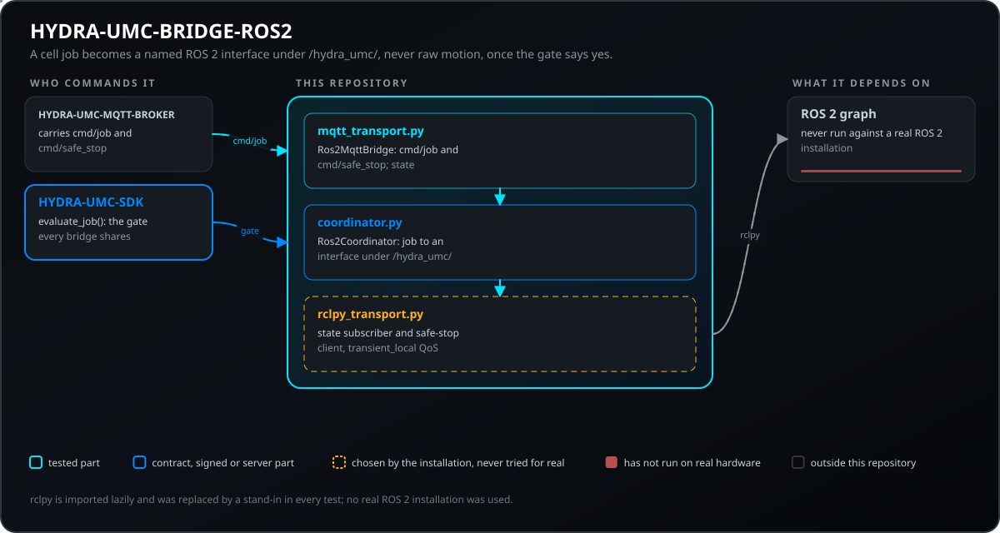
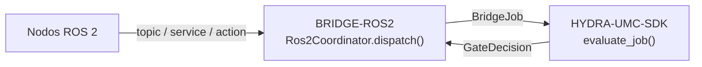
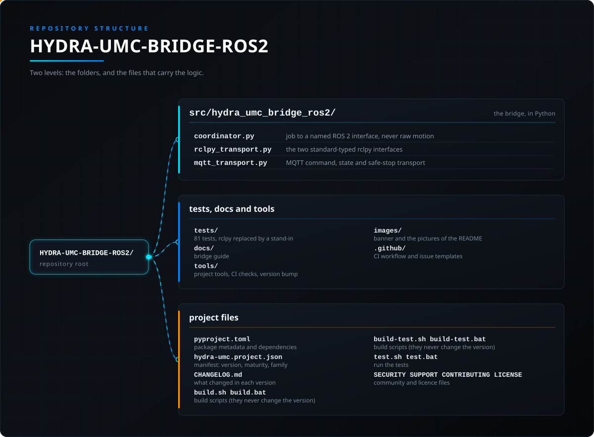

<!-- =============================================================================
HYDRA-UMC-BRIDGE-ROS2 - ROS 2 coordination bridge
Copyright (C) JuanenRac (Electro Hobby 3D) <electrohobby3d@gmail.com>
GPL-3.0-or-later - see LICENSE
============================================================================= -->

<p align="center">
  
</p>

# 🐢 HYDRA-UMC-BRIDGE-ROS2

<p align="center"><a href="README.md">🇺🇸 English</a> | 🇪🇸 <b>Español</b> | <a href="README_fra.md">🇫🇷 Français</a> | <a href="README_ita.md">🇮🇹 Italiano</a> | <a href="README_deu.md">🇩🇪 Deutsch</a> | <a href="README_zho.md">🇨🇳 简体中文</a> | <a href="README_jpn.md">🇯🇵 日本語</a> | <a href="README_por.md">🇵🇹 Português</a></p>

### 🔗 Frontera de coordinación sin dependencias entre HYDRA-UMC y ROS 2

<p align="center">
  
  
  
  
  
  
</p>

---

> **Comprobación de honestidad - qué funciona realmente hoy:** el núcleo de coordinación sin dependencias (`coordinator.py` con `Ros2Coordinator`, que hace pasar cada despacho por el propio `evaluate_job()` de `HYDRA-UMC-SDK`), el transporte `rclpy` real (importado de forma perezosa) para `std_srvs/Trigger` y `std_msgs/String` (`rclpy_transport.py` con `Ros2SafeStopClient`/`Ros2StateSubscriber`), y el transporte de comandos/estado MQTT (`mqtt_transport.py`) son reales y están cubiertos por 81 tests unitarios que pasan (`python tools/build_test.py` - `test_coordinator.py`, `test_rclpy_transport.py`, `test_mqtt_transport.py`, `test_intake.py`, `test_mqtt_environment.py`, `test_hardening.py`). Nada de esto se ha probado contra una instalación ROS 2 real, una red DDS real, ni un broker MQTT real - `test_rclpy_transport.py` corre contra un nodo/publicador falso y `test_mqtt_transport.py` contra un cliente de broker falso, así que `rclpy`/`std_srvs`/`std_msgs` ni siquiera necesitan estar instalados para que estos tests pasen. Los contratos personalizados `.srv`/`.action` de `inspect_service`/`job_action` todavía no tienen un tipo de mensaje ROS 2 estándar real ni ningún cliente. Ver "Estado actual y próximos pasos" más abajo, que ya lo indica con claridad, y `CHANGELOG.md` para lo que se ha entregado exactamente hasta ahora.

> **Estado de seguridad física y de ciberseguridad:** este ecosistema no es un sistema de seguridad certificado. Todavía no existe una ruta de E-STOP por hardware, ni límites ni enclavamientos aplicados por el firmware, ni un comando de movimiento verificado; las imágenes de firmware se comprueban con CRC32 y un HMAC-SHA256 de clave compartida, no con una firma asimétrica; TLS y TLS mutuo son opcionales y están desactivados por defecto; aún no se ha poblado ni probado ninguna placa propia. Lee la [línea base de seguridad](https://github.com/JuanenRac/HYDRA-UMC-DOCS/blob/main/docs/SECURITY_BASELINE.md) y el [modelo de amenazas](https://github.com/JuanenRac/HYDRA-UMC-DOCS/blob/main/docs/THREAT_MODEL.md) antes de fiarte de cualquier afirmación de aquí para la seguridad de una persona.

---

## 📋 De un vistazo

| | |
|---|---|
| Versión | `0.1.3` |
| Madurez | Funcional |
| Tests | 81 (`python tools/build_test.py`) |
| Tecnología | Python / ROS 2 / rclpy / HYDRA-UMC-SDK |
| Destino | La Raspberry Pi CM5 de una celda HYDRA-UMC |
| En hardware real | Solo simulado: probado con emuladores, dobles de prueba o simuladores; no consta ninguna ejecución en hardware real para esta versión |

**Ir a:** [Resumen](#-resumen) · [Arquitectura](#-arquitectura) · [Funciones](#-funciones) · [Seguridad y protección](#-seguridad-y-protección) · [Interfaces](#-interfaces) · [Configuración](#-configuración) · [Inicio rápido](#-inicio-rápido) · [Pruebas](#-pruebas) · [Resolución de problemas](#-resolución-de-problemas) · [Estructura del repositorio](#-estructura-del-repositorio) · [Proyectos relacionados](#-proyectos-relacionados)

## 🚦 Estado del proyecto

Cada línea es una parte de este repositorio y la luz dice hasta dónde llega hoy. Se escribe con lo que el repositorio puede demostrar (pruebas, compilaciones, ejecuciones), no con lo previsto.

🟢 Hecho y verificado · 🟡 Funciona, con límites conocidos · 🟠 Hecho a medias o sin verificar · 🔴 Sin hacer o sin funcionar

| Área | Estado | Qué significa aquí |
|---|---|---|
| Software | 🟡 | Funciona para su propósito principal; la comprobación de honestidad de arriba lista lo que aún falta |
| Pruebas | 🟢 | 81 pruebas automáticas, ejecutadas en cada cambio |
| Hardware real | 🟠 | Solo simulado: probado con emuladores, dobles de prueba o simuladores; no consta ninguna ejecución en hardware real para esta versión |
| Documentación | 🟢 | README en ocho idiomas, comprobado contra el manifiesto en cada cambio |

## 🎯 Resumen

**HYDRA-UMC-BRIDGE-ROS2** es la frontera de coordinación bidireccional de alto nivel entre HYDRA-UMC y ROS 2. Mapea la observación continua a un topic, la inspección inmediata a un service, y el trabajo de celda de larga duración a una action cancelable. No es un nodo de control de motores y no puede eludir HYDRA-UMC-SERVER, los límites de MCU, los watchdogs ni el E-STOP. Hoy solo están conectados el topic de estado y el servicio de parada segura; el servicio de inspección y la acción de trabajo son nombres reservados sin tipo de mensaje detrás. El nodo tiene que girar para que se entregue el topic de estado: `run_forever()` lo hace en un hilo propio.

Pertenece a la familia **External Automation Bridges**: un conjunto de repositorios hermanos (CNC, LASER, OPENPNP, PRINTER3D, ROS2) que hablan el mismo contrato de seguridad compartido de `HYDRA-UMC-SDK`, de modo que ningún puente puede inventar su propia definición de "seguro para trabajar".

## 🧩 Papel en HYDRA-UMC

**HYDRA-UMC-BRIDGE-ROS2** está entre un grafo ROS 2 y la celda de robots. Cuenta lo que dice ese lado, consulta la puerta compartida antes de cualquier trabajo auxiliar y nunca asume la autoridad de la máquina con la que coordina.

Todos los bridges hablan el contrato de seguridad compartido de `HYDRA-UMC-SDK`: un trabajo solo se acepta cuando la puerta compartida `evaluate_job()` lo permite, y esa puerta falla cerrada. El proyecto padre es `HYDRA-UMC-SERVER`; este bridge no lo llama, responde por MQTT, a través de `HYDRA-UMC-MQTT-BROKER`, a quien manda en la celda.

## 🏛️ Arquitectura

<p align="center">
  
</p>

<details>
<summary>Versión en texto del diagrama (Mermaid)</summary>



</details>

**Por qué está hecho así**

* **Por qué `coordinator.py` no tiene dependencia de `rclpy`.** Su propio docstring de módulo lo afirma deliberadamente: "puede probarse en cualquier host y solo se convierte en un nodo ROS 2 mediante un adaptador desplegado por separado". Esto mantiene comprobable en CI la lógica de coordinación relevante para la seguridad sin necesidad de una instalación de ROS 2, y permite elegir y validar el adaptador de forma independiente, más adelante.
* **Por qué tres tipos de interfaz distintos en lugar de un canal genérico.** `state_topic`, `inspect_service` y `job_action` se corresponden deliberadamente con la propia semántica de ROS 2: la publicación continua de estado no necesita petición/respuesta (topic), una inspección rápida necesita una respuesta síncrona (service), y el trabajo de celda necesita poder cancelarse a mitad de ejecución (action) — reducir esto a un solo canal perdería esa distinción.
* **Por qué `Ros2Coordinator.dispatch()` sigue canalizando cada trabajo a través de la puerta compartida `evaluate_job()`.** ROS 2 es simplemente otro cliente del mismo `bridge_contract` que usan CNC, LASER, OPENPNP y PRINTER3D — no obtiene ninguna excepción especial de la lógica IDLE/READY que aplican todos los demás puentes y HYDRA-UMC-SERVER.
* **Por qué `ABORT` sigue siendo solicitable durante un fallo.** El requisito de fase productiva de la puerta (`IDLE` + `READY`) deliberadamente no se aplica de la misma manera a una solicitud de aborto — un operador o un nodo ROS 2 siempre debe poder pedir una parada controlada, incluso en mitad de un fallo.
* **Por qué el adaptador `rclpy` y los contratos ROS `.msg`/`.srv`/`.action` todavía no están en este repositorio.** Comprometerse con definiciones concretas de mensajes/servicios/acciones antes de seleccionar y probar un entorno ROS 2 real arriesgaría a incorporar suposiciones que este núcleo local sin dependencias no puede verificar.
* **Cómo encaja en el resto del ecosistema.** BRIDGE-ROS2 se sitúa entre los nodos ROS 2 y `HYDRA-UMC-SDK` → `HYDRA-UMC-SERVER` → seguridad de MCU: es una frontera de coordinación, nunca un nodo de control de motores, y no puede eludir HYDRA-UMC-SERVER, los límites de MCU, los watchdogs ni el E-STOP.

## ✨ Funciones

* ✅ **Núcleo de coordinación sin dependencias, real:** `coordinator.py` — `Ros2Coordinator` no importa `rclpy` en absoluto; es Python plano de forma deliberada, comprobable en cualquier host sin una instalación de ROS 2. *(implementado, probado en `tests/test_coordinator.py`)*
* ✅ **Mapeo de interfaz cuádruple, real:** cuatro atributos de clase fijos reservan el tipo exacto de interfaz ROS 2 para cada propósito — `/hydra_umc/machine_state` (topic, estado continuo), `/hydra_umc/inspect_cell` (service, inspección corta), `/hydra_umc/execute_cell_job` (action, trabajo cancelable), `/hydra_umc/request_safe_stop` (servicio, parada controlada). *(implementado)*
* ✅ **Puerta de seguridad compartida, real:** cada trabajo despachado a través de `Ros2Coordinator.dispatch()` se evalúa mediante `evaluate_job()` de `bridge_contract` en `HYDRA-UMC-SDK`, la misma puerta que usan todos los puentes hermanos y HYDRA-UMC-SERVER; una fase productiva requiere una máquina externa `IDLE` y una celda HYDRA-UMC `READY`, mientras que `ABORT` sigue siendo solicitable durante un fallo. *(implementado)*
* ✅ **Enrutado de fases cerrado y evidencia estática:** las fases productivas se asignan solo a la acción de trabajo planificada, `ABORT` se asigna a `/hydra_umc/request_safe_stop` y una fase futura desconocida del SDK se deniega. `inspect_interface_plan.py` emite el plan estático de esquema `1.1` — incluyendo la calidad de servicio (QoS) de durabilidad `transient_local` real que necesita el topic de estado (el propio reemplazo de ROS 2 para el publicador "latched" de ROS 1, investigado en design.ros2.org/articles/qos.html) — sin importar `rclpy` ni contactar DDS. *(implementado, probado)*
* ✅ **Transporte `rclpy` real y parcial:** `rclpy_transport.py` conecta las 2 interfaces con un tipo de mensaje ROS 2 estándar real hoy — `Ros2SafeStopClient` (un cliente `std_srvs/Trigger` real) y `Ros2StateSubscriber` (un suscriptor `std_msgs/String` real, usando la calidad de servicio de durabilidad `transient_local` real). *(implementado, probado en `tests/test_rclpy_transport.py`)*
* ✅ **Compilación/prueba no mutante:** `build-test.bat`/`.sh` compilan el código y ejecutan pruebas unitarias deterministas sin cambiar la versión ni el CHANGELOG. *(implementado, ver Compilación y publicación más abajo)*
* 🔜 **Contratos `.srv`/`.action` personalizados para `inspect_service`/`job_action`** — no tienen un tipo de mensaje ROS 2 estándar real, por lo que un cliente para ellos necesita que este repositorio defina primero su propio paquete de interfaz. *(planeado)*
* ✅ **Estado observado de la máquina, mensajes retenidos y claves repetidas:** cuando el bridge sigue el tópico de estado de ROS 2, la puerta compartida usa el estado que informó la máquina en lugar del `machine_state` escrito en el trabajo (un mensaje que cualquiera en el broker puede publicar), y una máquina de la que nunca se ha oído nada cuenta como OFFLINE; `handle_message()` ignora los mensajes retenidos (el broker los reenvía en cada reconexión) y, si recibe un `IdempotencyStore`, responde a una `idempotency_key` repetida con la primera respuesta. *(implementado, probado en `tests/test_intake.py`)*
* ✅ **Un bucle de mensajes que sobrevive a su entrada, un nodo que de verdad gira y un estado que puede caducar:** `handle_message()` nunca lanza una excepción (un JSON enorme o muy anidado y cualquier fallo inesperado vuelven como un rechazo); `cmd/job` responde con `allowed` como el resto de bridges (y `accepted` como antes); un trabajo `ABORT` dice claramente que es solo plan y que la parada real es `cmd/safe_stop`. `run_forever()` hace girar el nodo en un hilo propio (`spin_node_in_background()`, para que el topic de estado se entregue de verdad), reutiliza un único cliente de servicio, ejecuta `cmd/safe_stop` en un carril que nunca espera tras otro comando, deja un Last Will en `availability`, republica el estado con su `machine_state` normalizado y una hora `observed_at`, y se niega a arrancar si no puede suscribirse al topic de estado de ROS 2; `observed_max_age_seconds` hace que un estado que deja de republicarse cuente como OFFLINE (desactivado por defecto). *(implementado, probado con dobles; nunca ejecutado contra un grafo ROS 2 real, así que el comportamiento del ejecutor y de la QoS no está verificado)*

## 🔒 Seguridad y protección

| Amenaza | Defensa | Dónde |
|---|---|---|
| Un trabajo para una celda o máquina que no está en estado seguro | Todo trabajo pasa por la puerta compartida `evaluate_job()` del SDK, que falla cerrada; el bridge no tiene lógica propia de aceptar o rechazar | SDK `bridge_contract` |
| Datos de trabajo desmesurados | Como máximo 32 parámetros, claves de hasta 64 caracteres, valores de hasta 1024, identificadores de hasta 128 (`MAX_PARAMETERS`, `MAX_PARAMETER_KEY_CHARS`, `MAX_PARAMETER_VALUE_CHARS`, `MAX_IDENTIFIER_CHARS`) | SDK `bridge_contract` |
| Una orden repetida o reenviada | Un `IdempotencyStore` recuerda cada clave 24 horas y como máximo 10 000 entradas; una repetición recibe la primera respuesta en vez de evaluarse otra vez | SDK `job_intake` |
| Una carga MQTT enorme u hostil | Una carga de más de 16 KiB, un JSON ilegible o muy anidado y cualquier fallo inesperado se responden con un rechazo en el topic de resultado y nunca terminan el bucle | `mqtt_transport.py` |
| Una interfaz ROS 2 fuera del espacio permitido | Los nombres de interfaz deben empezar por `/hydra_umc/` y el bridge conoce tipos de interfaz, nunca movimiento crudo | `coordinator.py` |
| Una parada que espera detrás de otro trabajo | `cmd/safe_stop` corre en un carril propio (`STOP_VERBS`); las dos interfaces rclpy estándar usan durabilidad `transient_local`, así que un suscriptor tardío recibe igualmente el último estado | `mqtt_transport.py`, `rclpy_transport.py` |
| Un estado de máquina aceptado sin comprobar | Antes de `start_observing()` no se ha leído nada y la puerta rechaza el trabajo; ya observando, un estado nunca oído o que no es un `MachineState` conocido cuenta como `OFFLINE` | `mqtt_transport.py` |

**Lo que nunca hace:** no convierte ningún trabajo en movimiento crudo y habla con ROS 2 solo a través de dos interfaces con tipos estándar.

## 🔌 Interfaces

Topics bajo `hydra/bridges/ros2/`; cada orden se responde en `<verbo>/result`.

| Topic o ruta | Qué lleva |
|---|---|
| `cmd/job` | un `BridgeJob`; la respuesta es la decisión de despacho para la interfaz ROS 2 |
| `cmd/safe_stop` | llama al servicio de parada segura mediante `Ros2SafeStopClient` |
| `state`, `availability` | el estado de la máquina leído del topic de estado ROS 2 (`std_msgs/msg/String`) y `online`/`offline` |

Para comprobar el plan de interfaces sin ROS 2: `python tools/inspect_interface_plan.py --verify-fixture`.

## ⚙️ Configuración

| Variable | Por defecto | Qué fija |
|---|---|---|
| `HYDRA_MQTT_USERNAME` | ninguno | El usuario MQTT; el broker lo liga a un prefijo de ID de cliente |
| `HYDRA_MQTT_PASSWORD` | ninguno | La contraseña; solo vale junto con el usuario |
| `HYDRA_MQTT_PASSWORD_FILE` | ninguno | La contraseña leída de un fichero (secreto de Docker o systemd); se ignora si hay `HYDRA_MQTT_PASSWORD` |
| `HYDRA_MQTT_TLS_CA` | ninguno | El fichero de la CA que firmó el certificado del broker: la conexión es TLS y se verifica el certificado |
| `HYDRA_MQTT_TLS` | desactivado | `1` activa TLS, verificado con las CA de confianza del sistema |
| `HYDRA_MQTT_TLS_CERT` / `HYDRA_MQTT_TLS_KEY` | ninguno | El certificado de cliente y su clave para un broker que exige TLS mutuo; hacen falta los dos |

El nombre del nodo ROS 2 es el argumento de `create_ros2_node()`; el host, el puerto y el ID de cliente MQTT (`hydra-umc-bridge-ros2`) son argumentos de `run_forever()`.

## 🚀 Inicio rápido

Requiere Python 3.11 o superior. Las pruebas y los scripts de compilación esperan `HYDRA-UMC-SDK` clonado junto a este repositorio (`../HYDRA-UMC-SDK`) o indicado con `HYDRA_UMC_SDK_ROOT`.

Pruébalo sin hardware (esto comprueba todo el bridge contra sus emuladores y dobles de prueba):

```bash
py -3 tools/build_test.py          # Windows
python3 tools/build_test.py         # Linux, macOS
```

Arranca el servicio (no hay un script de consola: el servicio es el `run_forever()` del transporte MQTT, que llamas desde tu propio código de arranque):

```python
from hydra_umc_bridge_ros2.rclpy_transport import create_ros2_node, spin_node_in_background
from hydra_umc_bridge_ros2.mqtt_transport import Ros2MqttBridge, run_forever
node = create_ros2_node("hydra_umc_bridge")          # needs rclpy from a ROS 2 installation
spin_node_in_background(node)
bridge = Ros2MqttBridge(node, cell_state=lambda: cell_state, node_is_spinning=True)
run_forever(bridge, host="192.168.0.180")
```

El usuario, la contraseña y los ficheros TLS salen de las variables `HYDRA_MQTT_*` (ver Configuración); el código de arriba no necesita credenciales propias.

## 🧪 Pruebas

81 casos automáticos de `unittest` se ejecutan con `python tools/build_test.py` (que también compila cada módulo). Las pruebas no necesitan hardware, red ni paquetes opcionales: las que necesitarían `paho-mqtt`, `pyserial` o una biblioteca del fabricante usan un sustituto o se saltan si falta el paquete.

| Fichero de pruebas | Pruebas | Qué cubre |
|---|---|---|
| `test_coordinator.py`, `test_intake.py` | - | paso de trabajo a interfaz y la admisión de trabajos |
| `test_rclpy_transport.py` | - | las dos interfaces rclpy contra un doble de rclpy |
| `test_mqtt_transport.py`, `test_mqtt_environment.py`, `test_hardening.py`, `test_edge_cases.py` | - | despacho de topics, las credenciales del entorno, clientes hostiles, casos límite |

El CI ejecuta `HYDRA_UMC_CI=1 python tools/ci_validate.py`, que comprueba el manifiesto, los documentos, los ocho README y las imágenes, y ejecuta las pruebas con una copia del SDK.

## 🏗️ Compilación y publicación

Requiere Python 3.11+. `tools/build_test.py` espera que `HYDRA-UMC-SDK` esté clonado como directorio hermano (`../HYDRA-UMC-SDK`) o indicado mediante la variable de entorno `HYDRA_UMC_SDK_ROOT`.

```bash
# Windows
build-test.bat      # solo valida — sin cambio de versión/CHANGELOG
build.bat            # Valida y compila (compilar nunca cambia la versión)

# Linux/macOS
bash build-test.sh
bash build.sh
```

`build-test` compila cada módulo bajo `src/` con `py_compile` y ejecuta la batería completa de `unittest` (todos los ficheros `test_*.py` de `tests/`) — de forma determinista, sin instalación de ROS 2, sin red y sin cambio de versión/CHANGELOG. `build` ejecuta primero esa misma validación y, solo si tiene éxito, llama a `tools/bump_version.py` para sincronizar la versión en `pyproject.toml`, `hydra-umc.project.json` y `CHANGELOG.md`. Todavía no existe un comando `run` real de hardware — eso requiere un despliegue ROS 2 validado.

## 🩺 Resolución de problemas

| Ves | Porque | Haz |
|---|---|---|
| `ModuleNotFoundError: hydra_umc_sdk` | El SDK no está instalado ni junto a este repositorio | Clona `HYDRA-UMC-SDK` junto a este repositorio o define `HYDRA_UMC_SDK_ROOT` |
| `paho-mqtt is not installed` | El cliente MQTT es un extra opcional | `pip install ".[mqtt]"` (necesita `paho-mqtt` 2.1 o superior, menor que 3) |
| `password was given without a username` | Las credenciales MQTT necesitan las dos partes | Define `HYDRA_MQTT_USERNAME` además de la contraseña |
| `could not reach the MQTT broker after N attempts` | El broker está caído, la dirección es errónea o el puerto está cerrado | Arranca `HYDRA-UMC-MQTT-BROKER` y revisa el host y el puerto dados al transporte (lo intenta 5 veces, con 2 segundos de pausa); un fallo del handshake TLS no se reintenta |
| `the MQTT broker refused the connection` | El broker rechazó la credencial (o no respondió dentro del plazo) | Revisa `HYDRA_MQTT_USERNAME` y la contraseña; el ID de cliente debe empezar por el prefijo que el broker ligó a la credencial |
| `"allowed": false` + `reason` | La puerta compartida o una guarda rechazó la orden | Lee `reason` y arregla la causa; no reintentes a ciegas |
| `rclpy` cannot be imported | rclpy viene con una instalación de ROS 2, no de PyPI | Carga el entorno de ROS 2 antes de arrancar el servicio; las pruebas no lo necesitan |

## 📂 Estructura del repositorio

<p align="center">
  
</p>

<details>
<summary>Versión en texto del árbol</summary>

```text
HYDRA-UMC-BRIDGE-ROS2/
├── src/hydra_umc_bridge_ros2/
│   ├── coordinator.py             trabajo a una interfaz ROS 2 con nombre, nunca movimiento crudo
│   ├── rclpy_transport.py         las dos interfaces rclpy con tipos estándar
│   └── mqtt_transport.py          transporte MQTT de órdenes, estado y parada segura
├── tests/                         81 pruebas, con rclpy sustituido por un doble
├── docs/                          guía del bridge
├── tools/                         ejecutor de compilación y pruebas, subida de versión, validador de CI, generadores y comprobaciones de README e imágenes
├── images/                        banner y las imágenes del README
├── .github/                       flujo de CI y plantillas de incidencias
├── pyproject.toml                 metadatos del paquete y dependencias
├── hydra-umc.project.json         manifiesto: versión, madurez, familia
├── CHANGELOG.md                   qué cambió en cada versión
├── build.sh build.bat             scripts de compilación (nunca cambian la versión)
├── build-test.sh build-test.bat   scripts de compilación (nunca cambian la versión)
├── test.sh test.bat               ejecutan las pruebas
└── SECURITY.md SUPPORT.md CONTRIBUTING.md CODE_OF_CONDUCT.md LICENSE LICENSE.md
```

</details>

## 🗺️ Hoja de ruta y límites conocidos

**Límites conocidos hoy**

**Real hoy:** versión `0.1.3`, funcional como núcleo de coordinación sin dependencias (`Ros2Coordinator`) con una batería `unittest` determinista de sesenta y cuatro pruebas que cubre el núcleo de coordinación, el transporte MQTT y el transporte rclpy, enrutado de fases cerrado, un esquema de interfaz estático `plan-only` que declara la calidad de servicio (QoS) de durabilidad `transient_local` real que necesita el topic de estado, un transporte `rclpy` real (importado de forma perezosa) para las 2 interfaces con un tipo de mensaje ROS 2 estándar real, y scripts build-test no mutantes conectados a CI con un checkout del SDK.

**Frontera de integración:** este puente es únicamente una frontera de coordinación — no es un nodo de control de motores, y no puede eludir HYDRA-UMC-SERVER, los límites de MCU, los watchdogs ni el E-STOP; cada trabajo despachado sigue pasando por la misma puerta compartida que usan todos los puentes hermanos.

**Todavía pendiente:** todavía no se ha validado ninguna red ROS, robot ni actuador físico — el adaptador `rclpy` y los contratos concretos ROS `.msg`/`.srv`/`.action` se introducirán solo después de seleccionar y probar un entorno ROS 2 real.

## 🌍 Idiomas

Este README y los documentos del repositorio existen en ocho idiomas: inglés, español, alemán, francés, italiano, japonés, chino y portugués (Portugal). Se escriben a la vez y el CI comprueba que los ocho ficheros tengan las mismas secciones y los mismos enlaces. Este repositorio no tiene pantalla ni catálogo de mensajes propios, así que no hay cadenas de interfaz que traducir.

## 🔗 Proyectos relacionados

Este proyecto es parte del ecosistema de robótica HYDRA-UMC del mismo autor (JuanenRac / Electro Hobby 3D). Vale la pena conocerlo, ya que una petición podría en realidad ser sobre alguno de estos en vez de sobre este repositorio.

**Proyecto Padre**
- **[HYDRA-UMC-SERVER](https://github.com/JuanenRac/HYDRA-UMC-SERVER)** — el backend headless real (REST/WebSocket) con el que habla de verdad cada cliente de control; la frontera autenticada del ecosistema a la que reporta este bridge una vez cada comando ha superado la barrera de seguridad local de este propio bridge.

**Proyectos Hermanos** — también hablan con la propia API de HYDRA-UMC-SERVER, cada uno como su propio cliente
- **[HYDRA-UMC-STUDIO](https://github.com/JuanenRac/HYDRA-UMC-STUDIO)** — panel de control web con visualización 3D multi-robot en tiempo real.
- **[HYDRA-UMC-SUITE](https://github.com/JuanenRac/HYDRA-UMC-SUITE)** — centro de mando de enjambre de escritorio (PySide6) para varios servidores a la vez, empaquetado como ejecutable independiente.
- **[HYDRA-UMC-ANDROID-CONTROL](https://github.com/JuanenRac/HYDRA-UMC-ANDROID-CONTROL)** — app nativa de control para Android con inicio de sesión biométrico y un compañero Wear OS emparejado.
- **[HYDRA-UMC-IOS-CONTROL](https://github.com/JuanenRac/HYDRA-UMC-IOS-CONTROL)** — app de control para iOS/iPadOS (Flutter) con sincronización en tiempo real por WebSocket.
- **[HYDRA-UMC-DSI](https://github.com/JuanenRac/HYDRA-UMC-DSI)** — interfaz táctil nativa para la pantalla táctil DSI de 7" a bordo, embebida en el propio CM5.
- **[HYDRA-UMC-BRIDGE-AMR](https://github.com/JuanenRac/HYDRA-UMC-BRIDGE-AMR)** — barrera de coordinación para flotas AGV/AMR mediante un publicador MQTT VDA 5050 (probado solo contra una flota emulada).
- **[HYDRA-UMC-BRIDGE-CNC](https://github.com/JuanenRac/HYDRA-UMC-BRIDGE-CNC)** — coordinador de alto nivel para celdas CNC con acceso a estado/bytes de control GRBL (probado solo contra un emulador).
- **[HYDRA-UMC-BRIDGE-DROIDS](https://github.com/JuanenRac/HYDRA-UMC-BRIDGE-DROIDS)** — barrera de coordinación para droides con patas/humanoides, con un emisor de comandos para Boston Dynamics Spot (probado solo contra un emulador).
- **[HYDRA-UMC-BRIDGE-LASER](https://github.com/JuanenRac/HYDRA-UMC-BRIDGE-LASER)** — coordinador de celdas láser que lee 3 señales GPIO de llave/carcasa/enclavamiento (probado solo contra un chip simulado; no puede armar ni disparar un láser).
- **[HYDRA-UMC-BRIDGE-OPENPNP](https://github.com/JuanenRac/HYDRA-UMC-BRIDGE-OPENPNP)** — coordinador de alto nivel seguro para el flujo de placas de pick-and-place OpenPnP.
- **[HYDRA-UMC-BRIDGE-PRINTER3D](https://github.com/JuanenRac/HYDRA-UMC-BRIDGE-PRINTER3D)** — barrera de coordinación segura para impresoras 3D Moonraker/Klipper, con comandos de trabajo reales y controlados.
- **[HYDRA-UMC-BRIDGE-UAV](https://github.com/JuanenRac/HYDRA-UMC-BRIDGE-UAV)** — barrera de coordinación para UAV equipados con cámara, con un emisor de comandos MAVLink (probado solo contra un emulador).

**Directamente Relacionados**
- **[HYDRA-UMC-SDK](https://github.com/JuanenRac/HYDRA-UMC-SDK)** — el contrato JSON-Schema compartido y la barrera de software de puerta de trabajos contra la que cada bridge valida sus comandos (no es una función de seguridad certificada).
- **[HYDRA-UMC-CONNECTOR-HUB](https://github.com/JuanenRac/HYDRA-UMC-CONNECTOR-HUB)** — registro declarativo y validador de manifiestos de adaptador para conectores de máquinas externas; extiende la propia idea de contrato del SDK a máquinas externas sin sustituir a los proyectos de pasarela industrial.
- **[HYDRA-UMC-MQTT-BROKER](https://github.com/JuanenRac/HYDRA-UMC-MQTT-BROKER)** — el transporte real de `mqtt_transport.py` para los propios tópicos `hydra/bridges/ros2/...` de este bridge — la barrera de trabajos solo-plan, una llamada de parada segura `std_srvs/Trigger` (todavía no ejecutada contra una instalación de ROS 2), y el propio tópico de estado ROS 2 republicado tal y como siempre anticipó el adaptador `rclpy_transport.py` desplegado por separado; ver el propio `docs/BRIDGE_TOPICS.md` de ese repositorio.
- **[HYDRA-UMC-HIL-BRIDGE](https://github.com/JuanenRac/HYDRA-UMC-HIL-BRIDGE)** — enrutador hardware-in-the-loop con un enclavamiento de software por colisión entre simulación y hardware real (probado sin hardware real).

**También Forma Parte del Ecosistema**

*Hardware y Plataforma Base*
- **[HYDRA-UMC](https://github.com/JuanenRac/HYDRA-UMC)** — el diseño de la placa madre del brazo robótico: host CM5 + coprocesador STM32H745 de doble núcleo, pensado para coordinar hasta 8 brazos herramienta por CAN-OTA/SPI-OTA (firmware en fase temprana; todavía no hay ninguna placa poblada).
- **[HYDRA-UMC-OS](https://github.com/JuanenRac/HYDRA-UMC-OS)** — capa de producto reproducible sobre Raspberry Pi OS para el CM5: agente de solo lectura, config/perfiles validados, aprovisionamiento WiFi de primer contacto.

*Backend Central y Clientes*
- **[HYDRA-UMC-EDITOR-URDF](https://github.com/JuanenRac/HYDRA-UMC-EDITOR-URDF)** — creador/editor gráfico de URDF de escritorio que envía los modelos terminados al propio catálogo de STUDIO.
- **[HYDRA-UMC-EDITOR-STL](https://github.com/JuanenRac/HYDRA-UMC-EDITOR-STL)** — editor de escritorio de modelos STL, que transforma/reemplaza/quita/añade piezas reales en el mismo catálogo de modelos que también edita HYDRA-UMC-EDITOR-URDF.

*Plataforma de Herramientas URTC*
- **[URTC](https://github.com/JuanenRac/URTC)** — firmware para la placa física del Universal Robot Tool Controller, más de 25 perfiles de herramienta por bus CAN.
- **[URTC-FLASHER](https://github.com/JuanenRac/URTC-FLASHER)** — herramienta de escritorio con GUI para flashear placas URTC, CAN-OTA más SWD/JTAG de chip completo.
- **[URTC-TESTER](https://github.com/JuanenRac/URTC-TESTER)** — herramienta de escritorio de diagnóstico CAN-bus en vivo para placas URTC, un panel por perfil de herramienta.
- **[URTC-WEB-STUDIO](https://github.com/JuanenRac/URTC-WEB-STUDIO)** — alternativa basada en navegador a URTC-TESTER mediante la Web Serial API, sin instalación local.
- **[URTC-GATEWAY](https://github.com/JuanenRac/URTC-GATEWAY)** — pasarela delante del bus CAN de URTC: lista de identificadores permitidos, límite de tasa y clave de sesión; software probado en ordenador, aún no en un bus real.

*Nodo IA de Visión (Hailo-8)*
- **[HYDRA-UMC-VISION-NODE](https://github.com/JuanenRac/HYDRA-UMC-VISION-NODE)** — nodo de integración para el pipeline de visión Hailo-8, con una comprobación real de disponibilidad de hardware por etapa.
- **[HYDRA-UMC-DETECTION-HEF](https://github.com/JuanenRac/HYDRA-UMC-DETECTION-HEF)** — registro real de modelos compilados con verificación de carga segura por arquitectura Hailo/checksum.
- **[HYDRA-UMC-VISION-STREAMER](https://github.com/JuanenRac/HYDRA-UMC-VISION-STREAMER)** — generador real de pipeline GStreamer + config MediaMTX, con una frontera de integración HailoRT real.
- **[HYDRA-UMC-VISUAL-SERVOING-API](https://github.com/JuanenRac/HYDRA-UMC-VISUAL-SERVOING-API)** — ley de corrección Position-Based Visual Servoing con autorización condicionada al estado de zona; todavía sin estimación de pose por cámara.
- **[HYDRA-UMC-SAFETY-ZONES](https://github.com/JuanenRac/HYDRA-UMC-SAFETY-ZONES)** — lógica v0 de invasión de zona, vigencia de calibración y solicitud de E-STOP que toma las posiciones de los objetos de un fichero; ningún detector la alimenta y todavía no hay un E-STOP físico conectado.

*Nodo IA Cognitivo (Hailo-10)*
- **[HYDRA-UMC-COGNITIVE-NODE](https://github.com/JuanenRac/HYDRA-UMC-COGNITIVE-NODE)** — nodo de integración para el pipeline cognitivo Hailo-10 (orquestación de LLM/VLA/voz).
- **[HYDRA-UMC-VLA-ENGINE](https://github.com/JuanenRac/HYDRA-UMC-VLA-ENGINE)** — codificación/decodificación real de tokens de acción y generación de trayectoria para un modelo Vision-Language-Action.
- **[HYDRA-UMC-VOICE-UI](https://github.com/JuanenRac/HYDRA-UMC-VOICE-UI)** — front-end de voz real (VAD + analizador de intención) con un relé a Watch acotado y con confirmación.
- **[HYDRA-UMC-SEMANTIC-PLANNER](https://github.com/JuanenRac/HYDRA-UMC-SEMANTIC-PLANNER)** — descomposición real de tareas basada en reglas y recuperación semántica de errores sobre códigos de error del MCU.
- **[HYDRA-UMC-DOCS-QA](https://github.com/JuanenRac/HYDRA-UMC-DOCS-QA)** — búsqueda real de documentos TF-IDF (solo librería estándar) sobre los propios documentos Markdown de este ecosistema.
- **[HYDRA-UMC-LOCAL-TECHNICIAN](https://github.com/JuanenRac/HYDRA-UMC-LOCAL-TECHNICIAN)** — técnico de mantenimiento con IA local y con puertas de política para el propio ecosistema - observa, diagnostica y propone arreglos; los dos niveles de riesgo más altos están deliberadamente sin implementar todavía.

*Orquestación y Enjambre*
- **[HYDRA-UMC-ORCHESTRATOR](https://github.com/JuanenRac/HYDRA-UMC-ORCHESTRATOR)** — nodo de integración con un contrato real de informe de salud gRPC/Protobuf y una máquina de estados de misión.
- **[HYDRA-UMC-JOB-DISPATCHER](https://github.com/JuanenRac/HYDRA-UMC-JOB-DISPATCHER)** — cola de trabajos real basada en prioridad con deduplicación, sobre una API HTTP real.
- **[HYDRA-UMC-NODE-HEALING](https://github.com/JuanenRac/HYDRA-UMC-NODE-HEALING)** — watchdog de salud de flota real basado en gRPC, con reintento/backoff y detección de discrepancia de identidad.
- **[HYDRA-UMC-PATH-PLANNER-3D](https://github.com/JuanenRac/HYDRA-UMC-PATH-PLANNER-3D)** — planificador de rutas 3D real basado en RRT, con validación real de colisión de obstáculos/espacio de trabajo.
- **[HYDRA-UMC-SWARM-SYNC](https://github.com/JuanenRac/HYDRA-UMC-SWARM-SYNC)** — sincronización de estado real mediante CRDT LWW-Element-Map, con pruebas de propiedades para convergencia multi-celda.

*Gemelo Digital y Simulación*
- **[HYDRA-UMC-TWIN](https://github.com/JuanenRac/HYDRA-UMC-TWIN)** — nodo de integración para el motor de gemelo digital, con un contrato real de sincronización por compatibilidad de versión.
- **[HYDRA-UMC-PHYSICS-REPLICA](https://github.com/JuanenRac/HYDRA-UMC-PHYSICS-REPLICA)** — cinemática directa real y validación de límites articulares sobre un subconjunto real de URDF.
- **[HYDRA-UMC-SYNTHETIC-DATA-GEN](https://github.com/JuanenRac/HYDRA-UMC-SYNTHETIC-DATA-GEN)** — generador real de escenas 2D procedurales con exportación de anotaciones YOLO/COCO.

*Datos y Analítica*
- **[HYDRA-UMC-DATALAKE](https://github.com/JuanenRac/HYDRA-UMC-DATALAKE)** — almacén de series temporales real respaldado por sqlite3, con una API HTTP real de ingesta/consulta.
- **[HYDRA-UMC-ANOMALY-DETECTOR](https://github.com/JuanenRac/HYDRA-UMC-ANOMALY-DETECTOR)** — detector de anomalías real basado en FFT + línea base estadística, con monitorización de deriva.
- **[HYDRA-UMC-PRODUCTION-REPORTS](https://github.com/JuanenRac/HYDRA-UMC-PRODUCTION-REPORTS)** — cálculo real de OEE/disponibilidad sobre el histórico de DATALAKE, con exportación CSV reproducible.
- **[HYDRA-UMC-TELEMETRY-COLLECTOR](https://github.com/JuanenRac/HYDRA-UMC-TELEMETRY-COLLECTOR)** — pipeline real de ingesta CAN/WebSocket hacia DATALAKE, con deduplicación por secuencia.

*Pasarela Industrial*
- **[HYDRA-UMC-GATEWAY-INDUSTRIAL](https://github.com/JuanenRac/HYDRA-UMC-GATEWAY-INDUSTRIAL)** — nodo de integración que retransmite a protocolos industriales, con una capa real de lista blanca de comandos/contrapresión.
- **[HYDRA-UMC-OPCUA-SERVER](https://github.com/JuanenRac/HYDRA-UMC-OPCUA-SERVER)** — espacio de direcciones OPC-UA real, verificado con una sesión de cliente real del protocolo binario.
- **[HYDRA-UMC-MTCONNECT-ADAPTER](https://github.com/JuanenRac/HYDRA-UMC-MTCONNECT-ADAPTER)** — endpoints XML reales `/probe` y `/current` de MTConnect, con salida en modo degradado.

*Herramientas Complementarias y Operaciones del Ecosistema*
- **[HYDRA-UMC-DASHBOARD-AI](https://github.com/JuanenRac/HYDRA-UMC-DASHBOARD-AI)** — paneles de Resúmenes Inteligentes y Resaltado de Anomalías sobre DATALAKE/ANOMALY-DETECTOR, con un respaldo estadístico honesto.
- **[HYDRA-UMC-TOOL-CLI](https://github.com/JuanenRac/HYDRA-UMC-TOOL-CLI)** — CLI de flota con un contrato real y estable de códigos de salida, cliente real y en vivo de la propia API de HYDRA-UMC-SERVER.
- **[HYDRA-UMC-WATCH](https://github.com/JuanenRac/HYDRA-UMC-WATCH)** — app compañera de WearOS con patrones de alerta háptica y un relé de voz al teléfono emparejado (todavía no ejecutada en un reloj físico).
- **[URTC-SMART-RACK](https://github.com/JuanenRac/URTC-SMART-RACK)** — firmware para un rack de montaje de placas con decodificación real de ID de herramienta y lógica de precalentamiento Smart Idle.
- **[URTC-VISION-TOOL](https://github.com/JuanenRac/URTC-VISION-TOOL)** — firmware más un compañero de visión real en Python para un cabezal de inspección térmica/RGB.
- **[HYDRA-UMC-UPDATER](https://github.com/JuanenRac/HYDRA-UMC-UPDATER)** — herramienta administrativa de escritorio que descubre, clona y actualiza cada repositorio de este ecosistema.
- **[HYDRA-UMC-OS-REBUILDER](https://github.com/JuanenRac/HYDRA-UMC-OS-REBUILDER)** — herramienta de escritorio Windows/Linux que construye una imagen de la CM5 lista para grabar, precargada con las versiones más actuales del ecosistema, con configuración de primer arranque de Wi-Fi/usuario/SSH al estilo de Raspberry Pi Imager.
- **[HYDRA-UMC-OPS-AGENT](https://github.com/JuanenRac/HYDRA-UMC-OPS-AGENT)** — coordinador de incidencias de mantenimiento: un rol edge de bajo privilegio recopila un snapshot de inventario/salud saneado, un rol control-plane lo renderiza de solo lectura y pide a un proveedor de IA que sugiera un diagnóstico - nunca aplica un parche ni despliega nada.
- **[HYDRA-UMC-DEV-SERVER](https://github.com/JuanenRac/HYDRA-UMC-DEV-SERVER)** — host de desarrollo reproducible (Raspberry Pi 5 / CM5) que almacena el código del ecosistema y ejecuta tareas acotadas de compilación/pruebas bajo una cola duradera; un rol de desarrollo dedicado, explícitamente distinto de un CM5 operativo.

## 📚 Documentación

Dónde leer más:

* [docs/BRIDGE_GUIDE.md](docs/BRIDGE_GUIDE.md) - alcance, el plan de interfaces, rclpy, scripts
* [Base de seguridad del ecosistema](https://github.com/JuanenRac/HYDRA-UMC-DOCS/blob/main/docs/SECURITY_BASELINE.md)
* [Modelo de amenazas del ecosistema](https://github.com/JuanenRac/HYDRA-UMC-DOCS/blob/main/docs/THREAT_MODEL.md)
* [Historial de cambios de este repositorio](CHANGELOG.md)
* [Licencia de este repositorio](LICENSE.md)

## 🤝 Contribuir y comunidad

* Antes de un pull request ejecuta `HYDRA_UMC_CI=1 py -3 tools/ci_validate.py` (o `HYDRA_UMC_CI=1 python3 tools/ci_validate.py`): debe imprimir `CI_VALIDATION=PASS`. No ejecutes `build.sh` ni `build.bat` para esta comprobación; compilar no es comprobar.
* Los ocho README se escriben desde una sola fuente en HYDRA-UMC-DOCS; no los edites a mano. Cambia la fuente y vuelve a escribirlos con `tools/make_readmes.py`.
* No afirmes en un README lo que no se ha ejecutado: di «simulado» o «sin probar en hardware» cuando esa sea la verdad.
* Mira [CONTRIBUTING.md](CONTRIBUTING.md), el [código de conducta](CODE_OF_CONDUCT.md), [SECURITY.md](SECURITY.md) y [SUPPORT.md](SUPPORT.md).

## 👤 AUTOR

**JuanenRac (Electro Hobby 3D)** · electrohobby3d@gmail.com

## 📜 LICENCIA

GPL-3.0-or-later - [LICENSE](LICENSE).
